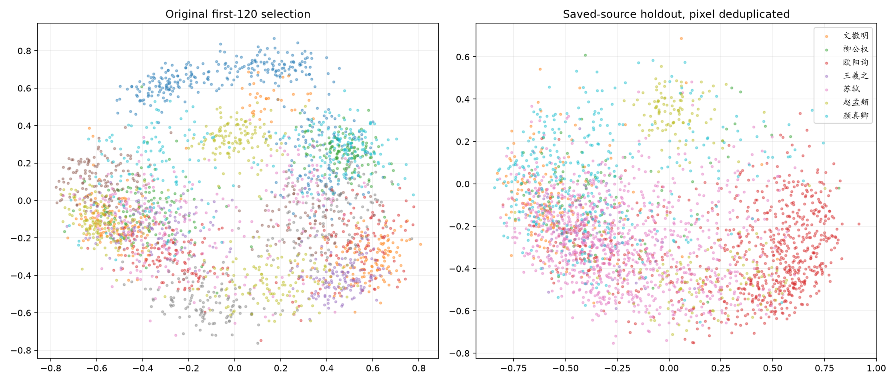
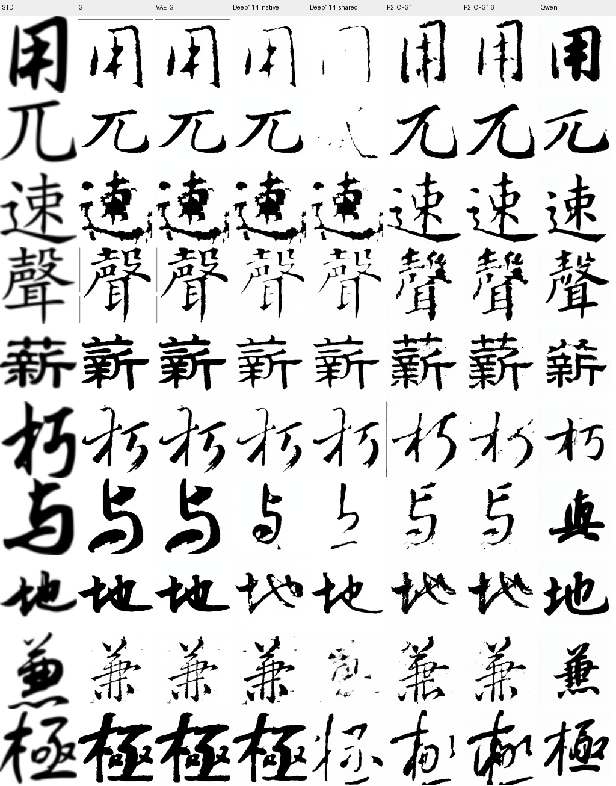
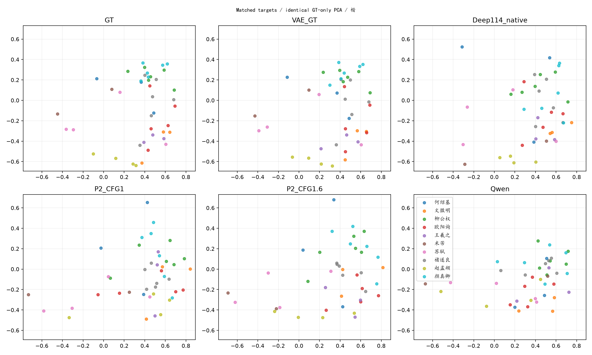
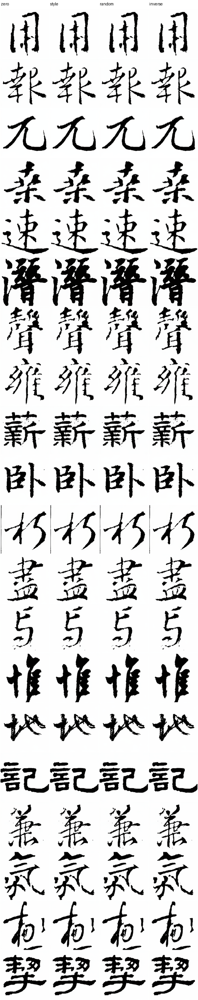

# Style Disc 判别实验：高 ARI、真实分布与生成梯度

日期：2026-10-26。已完成权重/样本身份审计、同目标100张的模型对照、来源与字符留出验证、VAE重建、白底/墨量控制、Writer-swap方向检查和20字冻结梯度pilot。**没有训练新判别器，没有修改U-Net架构，也没有启动新的Style Loss训练。**

结论：**P2具有可利用的书家响应，CFG1.6在这个空间中比CFG1更接近GT；但ARI=.914的ResNet空间尚不够可靠，当前不应直接用它监督生成器。** 来源泛化不均匀、原报告有常数冒充计算结果，以及自身梯度收益不迁移，是三项独立的限制。

## 1. 原来的高ARI来自什么

实际权重是48上的 `assets/style_disc_ce_holdout.pt`，不是Pixel D1，也不是Latent D2。

- 架构：ResNet18 → Linear(512,256)；评价使用L2-normalized embedding；CE训练使用未归一化投影。
- 26个槽位：23个Writer×Script真迹类、3个STD类。不是单纯10类Writer分类。
- SHA256：`6da6a38511a289a8b906178eca022af858013e59a60e524f40f6f147e2dbcaca`。
- 权重记录训练准确率100%、来源留出槽位分类37.7418%；本轮重算来源留出结果与之吻合。

对原脚本的核查：

| 原报告项目 | 核查结果 |
|---|---|
| 楷书五家GT ARI .914169 | 确实在原始256D计算，本轮精确复现 |
| 行书四家GT ARI .902864 | 确实计算，本轮精确复现 |
| GT抽样 | 训练CSV去增强后，每Writer×Script直接取前120张，没有筛判别器留出集 |
| Qwen ARI .0387 / NMI .0594 | **代码直接写入的常数，没有执行该项聚类计算** |
| DINO展示ARI .010 | 同样是标题/描述中的常数，原脚本没有计算DINO K-means ARI |
| 最后一张GT/Qwen图 | PCA由GT和生成图一起拟合，不符合“固定GT投影”的要求 |

原图共2626张GT，只有260张属于权重保存的来源留出组，约90.1%落在重建的训练来源内。高ARI不是假的，但不能作为跨来源风格解耦的证明。

[原脚本副本](metadata/original_plot_script.py.txt)保留了常数、抽样和PCA代码。[权重身份](metadata/models/teacher_identity.json)记录全部类别、来源组和限制。权重没有保存原训练CSV哈希或精确训练图ID，因此按保存的holdout_works重建来源划分，不能声称拥有完整原始训练清单。

## 2. 来源留出以后，还剩多少风格信息

来源键是目录代理，例如`bei/欧阳询-楷`，不是经过核实的独立碑帖/作品ID。移除跨训练/留出集合的完全相同像素后，可用来源留出2533张；同时满足全局字符未见的178张。

| GT协议 | 数量 | 26槽位CE Top-1 | 已知书体后的真实Writer Top-1 |
|---|---:|---:|---:|
| 原每组前120张 | 2626 | 94.06% | 94.55% |
| 去重复的来源留出 | 2533 | 37.74% | 41.93% |
| 来源+全局字符留出 | 178 | 31.46% | 37.08% |

不能直接比较不同作者数量、不均衡样本下的ARI。因此补做相同作者、相同每家数量的对照，10次固定随机抽样/聚类：

| 同作者同样本量对照 | 原抽样ARI均值 | 来源留出ARI均值 | 覆盖限制 |
|---|---:|---:|---|
| 楷书：欧阳询/柳公权/赵孟頫，各11张 | .9013 | .3612 | 颜真卿、褚遂良没有可用来源留出；每家数量很小 |
| 行书：王羲之/苏轼/文徵明，各60张 | .8520 | .7172 | 米芾没有可用来源留出 |

这说明**有可迁移信息，尤其部分行书；同时存在显著且不均匀的来源泛化损失**。不能说编码器完全无用，也不能把所有书家都当作已通过验收。抽样范围是10次结果范围，非95%置信区间，详见JSON。

图中两侧类别和数量不同，只作展示；判断下降使用上面的相同作者、相同数量对照。所有聚类指标都用256D，二维图只用于观察。

DINO缓存重新计算的楷书五家ARI为.0268（L2后.0211），行书四家为.0207（L2后.0140）。仍然很低，但不等于不存在可判别Writer信息。缓存没有逐图哈希，虽Writer/Script顺序一致，不能严格证明与原GT逐像素对应。

## 3. 同一风格空间中的GT、VAE、Deep、P2和Qwen

取固定val100，含98个不同字符。GT、P2 CFG1/1.6、Qwen P2-A@4k按 **Writer、Script、字符、原始像素SHA256** 精确配对。P2使用已有同噪声PNG；Deep@85k重新用相同噪声、正确旧Writer映射生成。

Deep做了两列：原生STD，以及与P2完全相同的bbox64/sigma0 STD。后者是输入域敏感性诊断，不代表Deep的原生能力。VAE、EMA、Heun50/CFG1等身份均保存。

以下“跨字识别”是同书体的GT原型检索，每次排除查询字符；**不是CE分类头准确率**。中心距离是有至少2张GT/生成图的Writer×Script槽位，归一化256D中心L2距离的宏平均，越小越近。

| 输入 | 跨字原型Top-1 | Target margin | 对应GT中心距离↓ |
|---|---:|---:|---:|
| GT | 81% | +.2273 | 0 |
| VAE重建GT | 82% | +.2214 | .0515 |
| Deep114@85k，原生STD | 70% | +.1066 | .3578 |
| Deep114@85k，共享P2 STD | 55% | +.0313 | .4730 |
| P2 EMA，CFG1 | 57% | +.0102 | .4882 |
| P2 EMA，CFG1.6 | 75% | +.1355 | .4004 |
| Qwen P2-A@4k | 27% | −.2058 | .7807 |

**两项关键可比性限制：**

- 100张配对GT中，只有15张属于该判别器的来源留出、3张字符留出，同时满足两者的只有1张。这个表是匹配目标的诊断，不是可靠跨来源风格最终榜。
- 其中79张图片路径曾出现在Deep114训练CSV；不能用Deep原生列与P2比较未见字泛化。它的优势部分可能来自记忆，具体比例不能凭此表分解。

逐Writer×Script的MMD、中心距离、类内方差比和样本量均在[完整结果](metrics/results.json)。不预设高斯分布；无偏MMD²可为负，不能据负值声称“比GT更真实”。

每位Writer取固定的第一个样本，没有按好看程度挑选。原生Deep在多行上近似GT，共享STD后部分字严重缺笔，说明输入契约变化很重要；结合79/100训练重叠，也不能把近似复制直接解释为更强泛化。P2两种CFG的主要字形变化很小，局部粗细/墨迹发生改变；Qwen较规则，部分行与目标的笔势、部件比例仍有明显距离。分类分数改善没有系统解决这些内容问题。

投影由真实GT的均衡参考子集拟合，所有生成模型共用同一投影与坐标范围；生成图不参与PCA拟合。拟合GT本身含编码器训练来源，图只能描述这个固定空间，不能代替留出验收。

## 4. VAE有没有破坏这个空间

匹配100张的GT与VAE重建很接近，但其中多数GT是判别器见过的来源。额外把178张来源+字符留出GT全部做了确定性VAE round-trip，双方统一采用PNG等价量化、PIL bicubic160、ImageNet归一化：

- 槽位CE Top-1：GT **31.46%**，重建 **32.58%**。
- GT/重建特征平均余弦 **.9919**，平均L2 **.1155**。
- 原始GT本身的留出识别已弱，重建没有出现整体风格空间塌缩。

因此，**当前证据不支持“VAE把该编码器能识别的书家信号普遍抹掉了”**。它不证明VAE保留了所有真实笔锋信息，也不排除编码器对部分细节不敏感。

[178张留出重建指标](metrics/heldout_vae_roundtrip.json) · [留出GT/重建图](figures/samples/heldout_vae_roundtrip.png)。

## 5. CFG的收益有多少与墨量有关

做了统一白底/浅灰压制，以及将每张生成图的soft ink总量匹配到对应GT的控制。墨量匹配使用分数形态学，达到目标质量但也改变边界和几何，**不是纯墨量因果干预**。

| 处理 | P2 CFG1 Top-1 | CFG1.6 Top-1 | 配对差值95% CI |
|---|---:|---:|---|
| 原图 | 57% | 75% | +18pp，[+10.2,+26.5]pp |
| 白底/浅灰压制 | 56% | 74% | +18pp，约[+10.2,+26.5]pp |
| 再匹配GT墨量 | 49% | 53% | +4pp，[−4.1,+13.0]pp |

墨量匹配后，margin仍有+.08795的收益，CI[+.04781,+.12792]。所以CFG作用不能完全等同于浓淡；但Top-1优势大幅收窄，说明墨量/形态变化确实影响了风格分数。不能将收窄的14pp全部归因于墨量一项。

补了此前缺失的STD中心对照：Qwen逐图特征到GT平均距离.9990，到STD .9935；55%的样本更接近STD，CI[45.0%,64.3%]。**这不足以支持“所有Qwen都塌缩到STD中心”**，更准确的是目标书家分离弱、与目标GT分布相距较远。

## 6. Writer-swap的方向

同字同书体比较真实A→B与生成A→B的特征差方向：

- 全GT探索集：9个字、63对，平均余弦 **.6153**，按字符分组CI[.5395,.7542]；正方向比例98.4%。
- 白底控制：平均余弦.6156，现象保留。
- 只用来源留出GT：仅剩2个字、2对，远不足以支持泛化结论。

这是该编码器空间内的方向一致性，包含它已经学到的粗细、结体等因素，不能直接解释为“98.4%的真实笔法都正确”。[完整配对记录](metrics/writer_direction.json)保留所有GT数量与字符。

## 7. ResNet Style Disc的梯度是否可用

20个不同字符、单seed、冻结所有模型；仅对P2 CFG1生成latent施加1%相对L2更新，比较零更新、Style、同幅随机和反方向。正/负目标来自该判别器的重建训练来源，均排除查询字符。独立评价用旧Pixel D1和Latent D2，而不是该ResNet自己。

| 评价器 | 原型Top-1：前→后 | Style−Random margin | 95% CI |
|---|---|---:|---|
| ResNet自身 | 65%→80% | +.21743 | [+.17199,+.26340] |
| Pixel D1 | 65%→65% | +.00085 | [−.00409,+.00687] |
| Latent D2 | 50%→50% | +.00074 | [−.00459,+.00625] |

LPIPS相对原生成图改变约.00429，soft ink平均绝对变化约.000147。读图没有看到稳定的书风改善，变化很小；自身目标改善远大于独立迁移。不能称作已经证明的对抗攻击，但**没有通过有效生成梯度的验收**。

这是20字单seed pilot，不能排除其他目标、步长或训练分布上的潜在价值；同样不能以自身+15pp为理由接入强训练。[逐图结果](gradient/results.json)包含全部margin、LPIPS和墨量变化。

## 8. 决策与机器状态

1. 保留114M shared U-Net，不因这组聚类换架构、换256D条件表或提高Writer CE。
2. P2没有表现出与Qwen同程度的目标书家重叠；CFG提供可利用响应，但真实风格验收仍不足。
3. 当前ResNet可作有明确限制的辅助观察器；来源泛化与独立梯度均不足，不把它直接接成生成器Style Loss。
4. 若继续发展教师，应先修来源划分/覆盖和跨字目标；对同作者、同数量的来源留出和独立梯度分别验收，而不是继续提高训练ARI。
5. 4090等曝光A系列保持运行；48原R0训练进程474191及串行父进程474127处于SIGSTOP挂起，保留内存中的权重/优化器/RNG，未自动启动R1，也未恢复新的Style Loss训练。挂起不是完训，尚无可恢复磁盘checkpoint的中途状态保证。

48完整输出：`/home/ds/Workspace/DiT/assets/style_space_audit_20261026/`；源码：[tools/style_space_audit](../../tools/style_space_audit/README.md)。本地已保留定量结果、身份记录、原脚本副本和图。[产物校验记录](metrics/completion.json)用于确认实际文件存在与样本数，不替代上面的科学验收。
