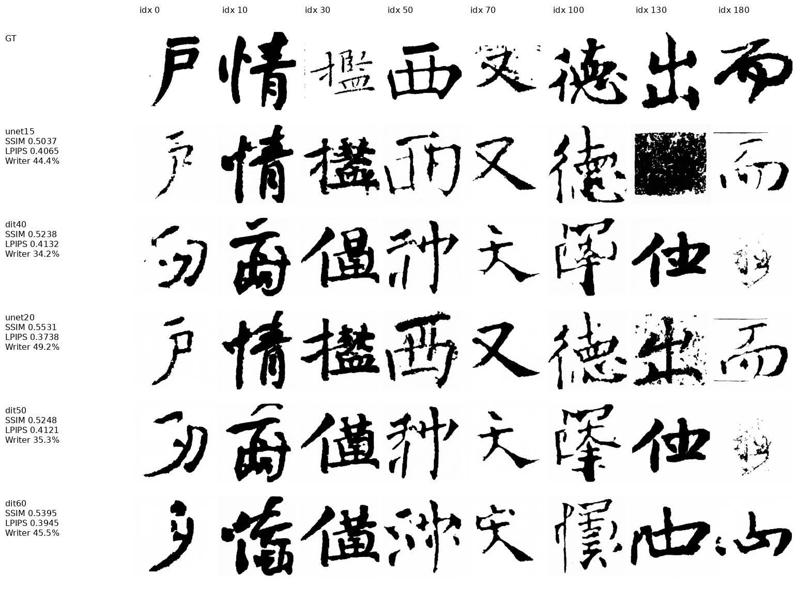

# U-Net 暂停后的正确重评：有优势，但尚未全面超过同期 DiT

## 执行状态与口径

48的U-Net已停止：最后日志21700，完整checkpoint20000；全部产物保留，没有恢复训练。
4090的32×256及自动续训至200k安排未改动。

U-Net使用有效raw权重，丢弃历史失效EMA作为模型质量依据。
15k/20k重新按原187字、Heun50、CFG1、gamma0、固定噪声采样，明确VAE路径与raw标志。
DONE已生成并由独立比较脚本重新核验；checkpoint size/SHA及严格加载均通过。
DiT使用20×384的历史有效EMA@40k/50k/60k，不重新占用4090推理。

5组187张GT逐像素相同；U-Net两组与DiT的187张实际STD输入PNG哈希全部相同。
VAE config SHA92d3dfb746fc…、safetensors SHA32db726da04f…在两机完全相同。
VAE目录树哈希不同来自额外bin/cache文件，不代表权重不同。

下表全部是**统一PNG重评**，因此SSIM与训练日志/浮点GPU评测略有差异，不能交叉混比。
独立Writer沿用holdout CE/同一训练原型库（GT Top1上限71.66%），不是新U-Net自己的评分。

## 同期对照

| 模型 | 曝光量 | SSIM↑ | LPIPS-VGG↓ | Ink-IoU↑ | Writer Top1↑ | Frag↓ |
| --- | ---: | ---: | ---: | ---: | ---: | ---: |
| U-Net raw@15k | 768万 | .5037 | .4065 | .2755 | 44.39% | 5.517 |
| DiT20×384 EMA@40k | 768万 | .5238 | .4132 | .1892 | 34.22% | 1.927 |
| U-Net raw@20k | 1024万 | .5531 | .3738 | .2966 | 49.20% | 3.910 |
| DiT20×384 EMA@50k | 960万 | .5248 | .4121 | .1915 | 35.29% | 2.279 |
| DiT20×384 EMA@60k | 1152万 | .5395 | .3945 | .2228 | 45.45% | 1.801 |

精确等曝光量（U-Net15k−DiT40k），字符分组配对bootstrap5000次：

- Writer +10.16个百分点，95%CI **[+2.12,+18.72]**；margin +.0516，[+.0024,+.1002]。
- Ink-IoU +.0863，[+.0757,+.0972]；薄笔画覆盖召回 +13.49个百分点，[+10.32,+16.63]。
- SSIM −.0200，[−.0347,−.0056]，明确更差。
- LPIPS −.0067，[−.0166,+.0034]，无法确认有收益。
- Frag +3.590，[+1.820,+5.810]，断裂/额外组件明显更多。

20k仍在改善：相对曝光量更多12.5%的DiT60k，SSIM +.0136、LPIPS −.0206、
Ink-IoU +.0738，三者区间均支持改善；Writer +3.74个百分点区间[−4.81,+12.17]，不显著。
Frag仍差+2.109，[+.932,+3.556]。

## 图片说明了什么

8例按固定索引0/10/30/50/70/100/130/180选取，不按好坏挑选。
U-Net更常保留目标字的整体结构，例如情、西、德等；同期DiT有明显的错字/结构偏离。
U-Net@15k有个别近噪声块，20k改善明显；但户/西等仍有断笔，部分边缘粗糙。
因此低Frag并不单独证明DiT内容更正确：写错字、缺笔也可能降低组件数量。
反过来，U-Net IoU/薄笔画覆盖好，也不意味着笔画已连贯或书家风格已完全正确。

## 未见字符与归因边界

按本次实际训练CSV的`character`集合，187中仅13个全局未见字符；
按writer×character有66个未见组合，writer×script×character则112个。
历史“62 unseen”索引本轮没有可靠来源，未擅自复用或拼成62。

13字子集上，U-Net20k的SSIM .5093、LPIPS .4052、Writer46.15%；
DiT60k为.5282/.3922/53.85%。差值区间很宽，不能声称泛化已更强。
主结论基于全部187；子集样本量不足须明确保留。

还有重要混杂：U-Net72.09M vs DiT55.03M、raw vs EMA、B512 vs192、LR6e-5 vs5e-5、
条件注入方式及EMA interval不同。两者均无REPA，但这仍不是只换CNN/Attention的单变量消融。
单训练/采样seed，CI只反映字符集合变化，不代表跨训练seed稳健性；Writer模型也可能有数据捷径。

## 决策

**值得保留这条U-Net路线，但不能宣布全面胜出，更不能再把旧EMA噪声结果当作失败证据。**
当前优势是目标字形覆盖及早期Writer辨识，短板是断笔连贯性；完全未见字符泛化尚无优势证据。
本轮不修复/重启训练。下一步如继续，应从20k raw保留优化器/调度恢复，修正EMA配对、
元数据与VAE路径，显式重置EMA；再用同口径评测检验连接问题是否改善。

逐样本指标、全部CI、PNG哈希：[comparison.json](../assets/audits/unet_vs_dit_20261018/comparison.json)。
脚本与复现入口：[README](../tools/analysis/unet_compare/README.md)。
