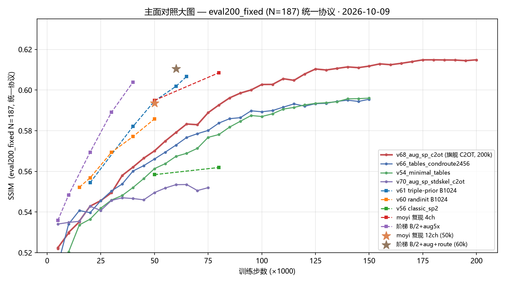
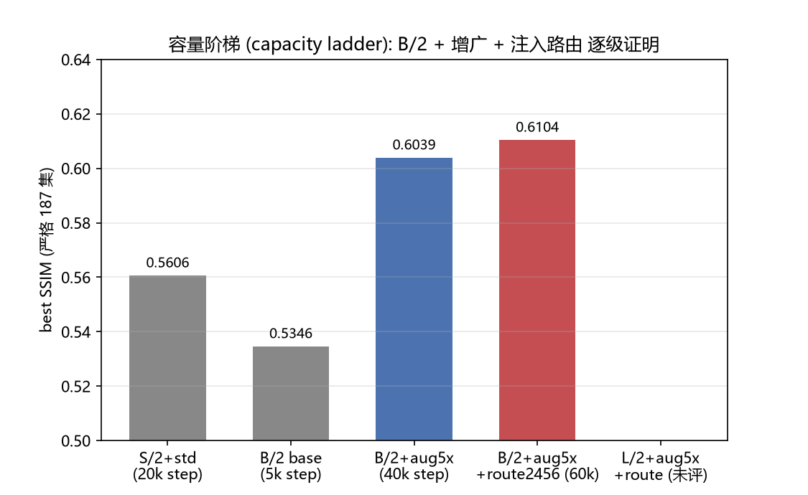

# Callig-DiT（马良）

> **面向中文书法的条件潜空间扩散生成系统**：以「书家 + 书体 + 汉字」三张条件表为输入，在 4×32×32 的 VAE 潜空间上用 **Flow Matching** 训练 DiT，生成 256×256 书法字图像。
> 目标不是复刻训练集里的字，而是**开集泛化**：对未见过的字、未见的（书家×书体×字）组合，仍能写出该名家的笔法。

---

## 0. 当前状态速查（2026-10-09）

| 项 | 值 |
|---|---|
| **主线模型** | `DiT-2Cond-Sp/2`（实测 **59.14M** 参数）+ 三表条件 + 分层路由 2,4,5,6 + C2OT |
| **当前在跑** | `v72`（**冻结新 Calli-VAE 潜空间** + 无增广 26k 语料，Sp/2 + C2OT，200k 规划）@ 4090 |
| **同口径最强** | `v68_aug_sp_c2ot` **0.6149** @200k（`eval200_fixed` N=187） |
| **性价比最强** | `v72` **0.5999** @50k —— 已超过 `v54`/`v66` 跑满 150k 的 0.5960/0.5955 |
| **零成本增益** | SiT SDE 采样器 `γ=0.5`：v68 0.6089 → **0.6289**，破碎度 −52% |
| **参照上界** | 全数据集穷举 **0.6503**（条件平均口径） |
| **⚠ 口径铁律** | 仓库默认已是 `Heun-50 + cfg 0.8 + SDE γ0.5`；10-08 之前的配置是 `cfg 1.0 + 纯 ODE`。**两套口径不可横比**（见 §4.3） |

> **读本文的正确姿势**：§1 是**当前实现**（照它写代码/复现）；§6 是**能下的结论**（分"已证/弱/证伪/未证"四级，未证的不许当事实用）；§7 是**历史**（只做趋势参考，数值多为老协议，不可与 §5 横比）。

---

## 1. 当前模型实现

### 1.1 任务形式

```
条件 (三表)                        目标
├─ 书家 y_callig ∈ 10 类   ──┐
├─ 书体 y_script ∈ 3 类    ──┤──> 条件向量 c ──┐
└─ 汉字 y_char  ∈ 4,690 类 ──┘                │
                                              ▼
随机噪声 x_t ∈ R^{4×32×32} ──────> [ DiT-2Cond ] ──> 速度场 v_θ ──> ODE/SDE 积分 ──> x_0 ──> VAE decode ──> 256×256
```

- **输入空间**：预训练 VAE 的潜变量，`4×32×32`（下采样 8×），patch size 2 → 256 个 token。
- **输出**：速度场（Flow Matching 的直线插值速度），不是 ε、不是 x_0。
- **不使用**字符 ID 作为输入的**唯一**通路以外的东西——三表是唯一条件源（骨架/ControlNet 分支见 §1.7）。

### 1.2 主干网络

`src/model/dit.py` 的 `DiT_2Cond`，按变体注册：

| 变体 | depth | hidden | heads | 实测参数（三表配置） |
|---|---|---|---|---|
| `XS6/2` | 6 | 384 | 6 | 17.93M |
| `XS/2` | 8 | 384 | 6 | 23.25M |
| `S320/2` | 12 | 320 | 5 | 23.96M |
| `S/2` | 12 | 384 | 6 | **33.89M** |
| `M/2` | 12 | 432 | 6 | 42.52M |
| **`Sp/2`**（主线） | **12** | **512** | **8** | **59.14M** |
| `WS/2` | 8 | 768 | 12 | 88.65M |
| `B/2` | 12 | 768 | 12 | 131.17M |
| `L/2` | 24 | 1024 | 16 | **458.58M** |
| `XL/2` | 28 | 1152 | 16 | 675.51M |

> 全部 `patch_size=2`（`_4`/`_8` 后缀为 patch 变体）。参数为**按主线三表配置实测**，非估计。
> ⚠ `src/model/dit.py` 里 `L/2` 的注释写"~340M"是**错的**，实测 458.58M —— 以实测为准。

**全现代结构**（均经单变量消融验证为正贡献，见 §6-A4）：

| 组件 | 说明 |
|---|---|
| **RMSNorm** | 替代 LayerNorm |
| **SwiGLU** | 替代 GELU MLP（贡献最大的一档） |
| **RoPE** | 2D 旋转位置编码，`rope_theta=100` |
| **QK-Norm** | 注意力 Q/K 归一化 |
| **SDPA** | `attn_impl=sdpa`（不物化注意力矩阵，显存大降） |
| **torch.compile** | `compile=true`（4090 上实测 +2.6× 吞吐） |

### 1.3 条件系统（本项目的核心设计）

**三张冻结表**（`assets/triple_tables_best_minimal/`，实测形状）：

```
callig_table.npy  (10, 32)     10 位书家
font_table.npy    (3, 16)      3 种书体（楷/行/隶）
char_table.npy    (4690, 256)  4,690 个汉字（DINOv2 语义嵌入，SupCon 训练）
```

- **融合**：`condition_fusion=factorized_cat` + `cond_fusion_norm=split`（各表独立 LayerNorm 后拼接）。
  > 历史教训：早期用**全局 LayerNorm** 导致骨架信号（方差 38×）把风格信号稀释，必须 split（见 §7.2 死胡同 5）。
- **分层路由（黄金靶点）**：`cond_inject_at="2,4,5,6"` —— 三表条件**只注入第 2/4/5/6 层**，其余 8 层条件被**完全切断**（`c = t_emb`），每层带可学习 scale。
  > 这是 2026-10-06 的层敏感度探针结论；但**至今没有干净的单变量对照**（见 §6-B5）。
- **4-way 条件 dropout**（可 CFG）：`all 0.05` / `callig 0.08` / `script 0.08` / `char 0.08`。
- **可训练性**：三表默认**冻结**（`freeze_triple_tables=true`）。冻结 vs 随机的对照见 §6-A3。

### 1.4 目标空间：VAE 与**三套 latent 约定**（最容易出错的地方）

| shards | VAE | 存盘约定 | 解码约定 | 用于 |
|---|---|---|---|---|
| `exp-std/data/shards_img_aug` | `sd-vae-ft-ema` | `posterior.mode()*sf` | `decode(z/sf)` | v68、消融四臂、v54/v66 |
| `exp-std/data/shards_img_aug_calli` | 旧 Calli-VAE（step 25000，**非标准**） | 裸 `posterior.sample()` | `decode(sample/sf)` + 注噪补丁 | v71（已废弃） |
| **`exp-std/data/shards_img_aug_calli_kl1e6_s12500_rsample`** | **新 Calli-VAE（kl1e6 / step 12500 / 标准约定）** | **`sample()*sf`** | **`decode(z/sf)` = `decode(sample)`** | **v72（在跑）** |

- `sf = 0.18215`。
- **新 Calli-VAE**（`experiments/vae_frozen/calli_vae_kl1e6_s12500_stdconv/`，带 `MD5SUMS.txt` + `PROVENANCE.md`）：
  - 训练方式：**纯 DINOv2 监督**（结构 MSE + 笔法方差 MSE），**无 GAN**、无判别器；KL 权重 `1e-6`。
  - 重建（128 图 fp32）：**PSNR 34.42 / SSIM 0.9687 / ink_IoU 0.9809**，对 sd-vae-ft-ema 的 32.44 / 0.9620 / 0.9744 全面领先。
  - 潜空间：逐维 std **1.005**、|均值| 中位 0.124（≈标准正态）；扰动鲁棒性全面优于 SD（ε=1.0 时 SSIM 0.775 vs 0.523）。
- ⚠ **严禁混用三套约定**：编码自检脚本 `tools/vae/verify_calli_latent_shards.py`（判据：`decode(z/sf)` 的 L1 应 ≈0.007，而 `decode(z)` 会到 0.66）。

### 1.5 训练目标

$$\mathcal{L} = \underbrace{\|v_\theta(x_t,t,c) - (x_1-x_0)\|^2}_{\text{Flow Matching}} \;+\; 0.03 \cdot \underbrace{\mathcal{L}_{\text{REPA}}}_{\text{DINOv2 对齐}}$$

| 项 | 细节 |
|---|---|
| **Flow Matching** | 直线插值 `x_t = (1-t)x_0 + t x_1`；时间步 **logit-normal** 采样（聚焦中段） |
| **REPA**（`w=0.03`） | 主干第 **8 层**特征与**冻结 DINOv2 ViT-S/14** 的 patch 特征对齐 |
| **C2OT**（`use_c2ot=true, mode=slot`） | 同 (书家,书体) 槽位内的 minibatch 最优传输配对（30 个槽位），**数学保证不引入条件先验漂移**；开销 ~1.3% 步耗 |
| **不使用** | 无 skeleton 损失、无形变损失、无对抗损失（旧 SkelNet 那套已不在主线） |

### 1.6 采样器

| 项 | 默认 | 说明 |
|---|---|---|
| 求解器 | `heun`（二阶 RK2） | `euler` 可选，用于**算力对齐**对照 |
| 步数 | 50 | 质量 ~30 步到顶、50 步饱和；10 步已达 200 步 SSIM 的 98.5% |
| CFG | **0.8** | SSIM 峰值在 ≈0.7，LPIPS/破碎度的帕累托拐点在 0.8 |
| **SiT SDE** | **`sde_gamma=0.5`** | 布朗扰动 + 朗之万得分自纠偏；**零重训成本的免费午餐**（§6-A5） |

> 以上默认值由 commit `b28e393` 固化（`src/train/cli.py`、`src/eval/cli.py`）。
> **注意**：10-08 之前启动的 run 其 config 里写死 `eval_cfg=1.0`，且**训练机当时还没有 SDE 代码**——引用它们的曲线必须标注口径。

### 1.7 已停用的分支（历史，勿混淆）

`src/model/controlnet.py`、`deform_skel.py`、`dit_skel_1cond.py` 是 **SkelNet / ControlNet 骨架分支**（2026-09 的第十一纪元主力）。
它在**内容表路线**上被证明是冗余的（§6-A2），当前主线**完全不用骨架输入**。相关文档与资产已归档。

---

## 2. 数据

### 2.1 规模（`docs/107/01`，2026-10-07 重算）

| 集 | 张数 | 说明 |
|---|---|---|
| 真迹源池 | **38,583** | 10 书家 / 3 书体，清洗后切片 |
| **训练集** `exp-std/csv/train.csv` | **26,002** | 源池的 67.4% |
| **3× 对称增广** `train_top10_aug_sym.csv` | **77,823** | orig 26,002 + tp 25,948 + tn 25,873 |
| **5× 对称增广** `train_top10_aug_sym5x.csv` | **129,445** | 再加 tp2/tn2 |
| 评测 `eval200_fixed.csv` | **187** | 越界字过滤后（原始 200） |
| 评测 `seen20.csv` | **20** | 分布内（看拟合） |

> 磁盘口径：`imgs_aug_sym/` 只有 **51,821** 张**变体**（原图复用 `imgs/`）；必须按 CSV 的 `image_path` 取图，不要按目录硬拼。

### 2.2 稀疏性（决定了什么能泛化）

- 训练集唯一汉字 **4,677**；词表 **4,690**（多 13）。
- **只出现 1 次的字占 27%**（1,274 个）；每字张数中位 **3**、最多 45。
- 理论网格 10×3×4,677 = 140,310，**实际覆盖仅 13.3%**。
- **隶书是 3 家专属**（1,926 张），且**文徵明隶书仅 33 张** → 该槽位近乎无数据。
- ⚠ 三个 id 不是一回事：`character_id`(5,660) / `glyph_id`(7,193) / `character`(4,677)。

---

## 3. 评测协议（**先读这节，否则所有数字都会读错**）

### 3.1 统一协议

```
集   : eval200_fixed.csv  (N=187, 严格真迹外推)
采样 : Heun-50（或按标注的 solver/steps）, seed 0
CFG  : 0.8（新默认）或 1.0（10-08 前的 run）
指标 : SSIM（RGB 高斯窗 11×11 σ1.5）、LPIPS(alex)、墨迹 IoU、骨架 IoU、破碎度 frag、空洞 hole
       + nn_ssim（同字最近邻）、tgt_spec（风格专属性）、cal_enrich（书家富集度）
实现 : `src/eval`（唯一实现）
```

### 3.2 ⚠ 四套协议**不可混比**

同一个 SSIM 在不同评测集上**能差 0.3**：

| 协议 | 量级 | 谁在用 |
|---|---|---|
| **`eval200fix`（当前口径）** | **0.51 ~ 0.63** | v54 之后的全部主线 |
| `eval_seen_v10.csv` | 0.47 ~ 0.77 | v10b / v11 系列 |
| `fame_strict_clean_v8.csv` | 0.44 ~ 0.52 | v8 / v9 |
| 内嵌 json 老 seen/strict | 0.78 ~ 0.85 | v10a / v10b pretrain |

**因此**：§5 的表只在表内可比；§7 的历史数字**一律不与 §5 横比**。

### 3.3 组合泄漏：报分必须分档

`eval200_fixed`（187）与训练集**样本级 0 泄漏**，但 **组合级 75/187（40%）的 `(书家,书体,字)` 在训练里出现过**，且该子集对所有模型都更容易（v68 +0.0576）。

```
           组合见过(75)   组合未见(112)   全187
v68          0.6520         0.5934        0.6169
v66          0.6449         0.5660        0.5976
moyi_4ch     0.6352         0.5741        0.5986
```
Best 档 62 张里 **53% 组合见过** → **引用 Best 档必须注明**。

### 3.4 参照上界（全数据集穷举 12,105 对，解码域）

| 口径 | 含义 | SSIM |
|---|---|---|
| **E 按条件平均** | 随机一个条件，"两人写这字多像" | **0.6503**（中位 0.6336） |
| **A 均匀抽对** | 随机两张同条件真迹 | 0.6235 |
| **B 留一质心** | "只输出条件均值的完美模型" | 0.6156（**< A**） |
| **C 跨书家检索** | 同书体同字取最近真迹 | 0.5743 |
| **D 同字检索** | 同字任意书家书体 | 0.5541 |

**关键**：`B < A`（SSIM 含对比度项，惩罚模糊）→ **0.65 是参考线，不是任何输出都打不破的硬墙**；输出条件均值在 SSIM 下并非最优。

---

## 4. 当前结果（`eval200_fixed` N=187）

### 4.1 主面对照大表

> 数据落盘 [`docs/experiments/mainline_20261009.csv`](docs/experiments/mainline_20261009.csv) + 逐点台账 [`assets/ledger/points_all.csv`](assets/ledger/points_all.csv)。

| # | run | 定位 | 模型 | 步数 | SSIM↑ | LPIPS↓ | MSE↓ | 资产 |
|:-:|---|---|:-:|:-:|:-:|:-:|:-:|---|
| 1 | **`v68_aug_sp_c2ot`** | **旗舰**：C2OT + 3×增广 + 路由2456 | Sp/2 | 200k | **0.6149** | — | **0.7496** | 4090 `runs/v68_family/` |
| 2 | **`v72_callivae_...`** | **潜空间换代（在跑）** | Sp/2 | 65k | **0.6034** | 0.3974 | 0.7739 | 4090 `runs/v72_.../` |
| 3 | `ladder_B2_aug_route2456` | 容量阶梯顶 | B/2 | 60k | 0.6104 | **0.3243** | 0.7633 | 48 `capacity_ladder/` |
| 4 | `moyi_top10_rf_4ch` | 墨意复现（4ch） | 252M | 80k | 0.6085 | 0.3489 | 0.7604 | 48 `moyi/results/` |
| 5 | `v61_triple_prior_sota_b1024` | 三表冻结纯先验 | Sp/2 | 65k | 0.6067 | 0.3289 | 0.7709 | 48 `results/v61.../` |
| 6 | `v68_pix` | 像素域变体 | Sp/2 | 110k | 0.6002 | — | — | 4090 |
| 7 | `v54_minimal_tables_noskel` | 字表基线（无 skel） | S/2 | 150k | 0.5960 | — | 0.7862 | 4090 |
| 8 | `v66_tables_condroute2456` | 黄金路由基线 | S/2 | 150k | 0.5955 | 0.3367 | 0.7849 | 4090 |
| 9 | `moyi_top10_rf` | 墨意复现（12ch） | 252M | 50k | 0.5935 | — | 0.7983 | 48 |
| 10 | `v60_randinit_sota` | 随机初始化表（对照） | Sp/2 | 50k | 0.5858 | 0.3500 | 0.8393 | 48 |
| 11 | `v70_aug_sp_stdskel_c2ot` | 标准骨架路线（**已停 @78.7k**） | Sp/2 | 65k | 0.5535 | — | — | 4090 |
| 12 | `v68_dino_raw` / `v68_randtab` | 表内容探针 | Sp/2 | 20k | 0.5453 / 0.5323 | — | — | 4090 |
| 13 | `v71_callivae_sp_c2ot` | 旧 Calli-VAE（**约定有误，作废**） | Sp/2 | 30k | 0.5143 | — | — | 48 |

**四条读表要点**
1. `v68` 是绝对值旗舰，但它赢在**组合红利**（aug + C2OT + 路由），不是单点突破。
2. `v61`（三表冻结纯先验）是**斜率最陡的开集路线**：65k 即 0.6067 且仍在爬升。
3. **`v72` 是目前最有信息量的一行**：换潜空间 + 无增广，**50k 就到 0.5999**（超过 v54/v66 跑满 150k）。
4. **骨架路线（v70）明显最弱**（0.5535@65k 且 60k 后停滞）。

> **⚠ 本表口径**：来自 **2026-10-09 重抽**的 [`mainline_20261009.csv`](docs/experiments/mainline_20261009.csv) + [`assets/ledger`](assets/ledger/)（远程 in-mem eval，`cfg=1.0`）。

> **⚠⚠ 已知的跨文档数值冲突（引用前必读）**：`docs/107/02` 用的是 **"无 CFG"** 协议，与上表**不是同一口径**，两者对同一 run 给出不同数字，**至今未统一**：
>
> | 模型 | 本表（cfg=1.0） | `docs/107/02`（无 CFG） | 差 | 状态 |
> |---|---|---|---|---|
> | `v68` | **0.6149**@200k | 0.6169@200k | 0.002 | 疑为协议差 |
> | `v66` | **0.5955**@150k | 0.5976@150k | 0.002 | 疑为协议差 |
> | `moyi_4ch` | **0.6085**@80k | 0.5986@80k | **0.010** | **未定论** |
> | `moyi_12ch` | **0.5935**@50k | **0.5764**@50k | **0.017** | **未定论**：`docs/107/03` E6 指出 `eval/moyi_12ch` 里的 `t{i}.png` 是骨架线图（误用会虚高到 0.6897），"取 `i.png` = 0.5764 才对"，但 **0.5935 的来源尚未复核** |
>
> **处置建议**：跨文档引用 MoYi 数字时，**先统一 CFG 与图片来源**；在此之前，本文只用本表口径，且 MoYi 相关结论（A6/B7）只依赖**同一文档内**的成对比较（相对差），不依赖绝对值。

### 4.2 `v72` vs `v68` 同 step 对齐（本轮最有价值的曲线）

| step | v68 (aug + SD-VAE) | **v72 (noaug + Calli-VAE)** | Δ | v66（150k 线） |
|---|---|---|---|---|
| 10k | 0.5300 | **0.5414** | +0.0114 | 0.5341 |
| 20k | 0.5429 | **0.5650** | +0.0221 | 0.5397 |
| 30k | 0.5495 | **0.5844** | +0.0349 | 0.5504 |
| 50k | 0.5701 | **0.5999** | +0.0298 | 0.5661 |
| 65k | 0.5833 | **0.6034** | +0.0201 | 0.5767 |

> **限定（必须一起引用）**：① 这不是干净单变量——v72 = noaug + 新 Calli-VAE，v68 = aug + SD-VAE + C2OT，**正确对照臂 `noaug_c2ot` 在 48 上、数据不在 4090**；② 口径为 `cfg=1.0`、**无 SDE**；③ 单 run 趋势读数。

### 4.3 容量阶梯（逐级证明，无反转点）

```
S/2 33.9M ──> M/2 42.5M ──> Sp/2 59.1M ──> B/2 131.2M ──> L/2 458.6M（L 级未评测）
     +0.0086/10k      +0.019（混杂 aug/C2OT）   +0.0088@20k     +0.026（~6.4M 样本）
```
- **样本数比参数值钱**：B/2 唯一干净曲线 `1.92M→23M 样本：0.5264→0.5964`，每 10× ≈ **+0.065**（40k→60k 已衰减到 +0.0065）。
- **参数量翻倍 ≈ +0.01~0.026**，无饱和/反转点。

### 4.4 可视化索引

**四张主图**（2026-10-09 重抽，均为 187 协议）：





| 图 | 内容 |
|---|---|
| [`fig_history_timeline_20261009.png`](docs/system/imgs/fig_history_timeline_20261009.png) | **实验历程时间线**：上=老协议时代（v1→v21）· 下=187 统一协议时代（v54→v72） |
| [`fig_v68_family_20261009.png`](docs/system/imgs/fig_v68_family_20261009.png) | v68 家族与近线 run（base/pix/dino_raw/randtab/v54/v66/v69/v70） |
| [`table_vs_skel_75000.png`](docs/107/imgs/table_vs_skel_75000.png) | **表 vs 骨架**同频对照（§6-A1 的直接证据） |
| [`calli_vae_visuals/`](docs/experiments/calli_vae_visuals/) | Calli-VAE 重建质量演进（step 500 / 5k / 12.5k） |

**分级严苛评测海报**（同字绝对对齐：同一列 = 同一汉字 + 同一书家）：

| 图 | 内容 |
|---|---|
| [`eval200_top10_best_poster.png`](docs/04_experiments/imgs/eval200_top10_best_poster.png) | Top10 高分层演进 |
| [`eval200_mid10_median_poster.png`](docs/04_experiments/imgs/eval200_mid10_median_poster.png) | Mid10 中位层演进 |
| [`eval200_worst10_hardest_poster.png`](docs/04_experiments/imgs/eval200_worst10_hardest_poster.png) | **Worst10 攻坚层**（最能看出代际差异） |
| [`eval200_quartiles_distribution_chart.png`](docs/04_experiments/imgs/eval200_quartiles_distribution_chart.png) | 四分位分布对比图 |
| [`historical_strict_common_poster.png`](docs/04_experiments/imgs/historical_strict_common_poster.png) | 历代模型同字真实评测原图矩阵（含碑帖 GT 对照） |
| [`milestone_eval200_evolution_poster.png`](docs/04_experiments/imgs/milestone_eval200_evolution_poster.png) | 7 大里程碑统一确定性重评测 |
| [`calligdit_evolution_master_poster.png`](docs/04_experiments/imgs/calligdit_evolution_master_poster.png) | 全代际总览大图 |

> 篇幅考虑，正文只内嵌两张主图；其余按上表点开。**引用任何海报数值前请先确认其协议与分档口径**（§3.2 / §3.3）。

---

## 5. 消融台账（20k 同频，v68 配方为基准）

> 协议：全部与 v68 的 LR 日程对齐（`max_steps` 保持 200k，避免 cosine 压短带来混杂），**每臂只改一个开关**，训到 20k 停；`eval200fix` n=187。
> 基准 `v68@20k`：**SSIM 0.5429 / LPIPS 0.3915 / ink_iou 0.2250 / frag 1.852**。

### 5.1 现代组件（四个全为正贡献 →「现代组件有害」正式证伪）

| 臂（去掉的组件） | SSIM | ΔSSIM | ΔLPIPS |
|---|---|---|---|
| 去 **SwiGLU**（→gelu） | 0.5366 | **−0.0063** | +0.0040 |
| 去 **QK-Norm** | 0.5375 | **−0.0054** | +0.0040 |
| 去 **RMSNorm**（→layer） | 0.5405 | −0.0023 | +0.0017 |
| 去 **RoPE** | 0.5408 | −0.0021 | +0.0039 |

四臂 LPIPS **一致恶化 +0.004** → 这些组件买的主要是**感知质量**。配置：`src/train/configs/ab_mod_*.json`。
> ⚠ 诚实标注：20k 趋势读数（LR 未退火）、**每臂单 run**；RMSNorm/RoPE 的 −0.002 在噪声边缘，SwiGLU/QK-Norm 更扎实。

### 5.2 条件表内容（「是不是学出来的」比「用什么语料训」重要得多）

| 表（均冻结，行归一化同范数） | 20k SSIM | ΔSSIM |
|---|---|---|
| 基线：DINO-26k（`triple_tables_best_minimal`） | 0.5429 | — |
| **DINO-40 万 raw 训练后切片** | 0.5453 | **+0.0024** |
| 原始像素从零训练 | 0.5365 | −0.0064 |
| **完全随机（随机+冻结）** | 0.5323 | **−0.0106** |

- **"学过 vs 随机" ≈ 0.011（全场最大杠杆）**；"用什么语料/方法训"只差 ≤0.006。
- 旁证：40 万切片表的**探针**行质量仅 0.364（基线 0.671），但下游打平 → **探针高估了表内容的杠杆**。

### 5.3 杠杆全景（20k 处 ΔSSIM）

```
表内容: 学过 vs 完全随机      −0.0106~−0.0126   ← 最大
去 SwiGLU                    −0.0063
去 QK-Norm                   −0.0054
表内容: 像素表 vs DINO 表     −0.0064
去 RMSNorm                   −0.0023
去 RoPE                      −0.0021
表内容: 40万切片 vs 26k       +0.0024
```

---

## 6. 能下的结论（**四级证据分级**）

> 规则：**"未证"的下一版战略不得当事实用**；"弱证据"不许写成"证明"。

### A. 已证（有对照或物理实测，可据以决策）

| # | 结论 | 关键证据 |
|---|---|---|
| **A1** | **内容表 ≫ 骨架**（把骨架换成内容表，收益 +0.027~0.032，远大于骨架侧任何调参） | 无表（v50-A 0.5553 / v46 0.5516）vs 有表（v53/v54 **0.5875**） |
| **A2** | **有内容表后，骨架输入不提供终点收益**（差异只在前中段 ≤0.012，终点完全相同） | v53（表+骨架）vs v54（表、无骨架）：95k/100k 双双 **0.5875** |
| **A3** | **冻结正交三表 ≫ 随机词表**；且"学过 vs 随机"是全场最大杠杆 | v61 0.6018@60k vs v60 0.5858@50k；20k 消融 −0.0106~−0.0126 |
| **A4** | **现代组件（SwiGLU/QK-Norm/RMSNorm/RoPE）全部正贡献** | 10-09 四臂单变量，见 §5.1 |
| **A5** | **SiT SDE 采样器 `γ=0.5` 是零重训成本的免费午餐** | v68 0.6089→**0.6289**（frag −52%）；Tier3 B/2 0.6098→0.6218（LPIPS 首破 0.320）；**γ=0.5 对任意 CFG 全胜**（24 点扫描）；质量 ~30 步到顶 |
| **A6** | **12ch 从头训练不如 4ch**（辅助通道在高频去噪时倒灌真迹通道） | MoYi 12ch 0.5935 vs 4ch 0.5949（同步数） |
| **A7** | **3px 骨架 > 1px**（1px 细线经连续 VAE 丢失率 45%） | VAE 往返 IoU 0.960 vs 0.861 |
| **A8** | **FLUX 16ch VAE 在物理层 ≫ 4ch**（但端到端未证，见 D3） | 往返 skel_iou 0.7929→**0.9942**，断线率 20.7%→0.58% |
| **A9** | **新 Calli-VAE 潜空间比 SD-VAE 更"像高斯"且更鲁棒** | 逐维 std 1.005 / 均值 0.124（SD：4.098 / 3.220）；扰动 ε=1.0 时 SSIM 0.775 vs 0.523；重建 PSNR 34.42 vs 32.44 |
| **A10** | **v72 换潜空间后同 step 显著领先** | 50k 0.5999 > 旧线 150k 0.5960/0.5955；65k 0.6034 vs v68 0.5833（**但归因未拆，见 B6**） |

### B. 弱证据 / 混杂（**不能说"证明"**）

| # | 杠杆 | 实测 | 为什么不算证明 |
|---|---|---|---|
| **B1** | 数据增强 3× | 唯一同频点 5k：0.5346→0.5359（**+0.0013**） | cosine horizon 不同（aug 臂 LR 高 **8.7%**）；只有 1 个同频点；历史 "+0.033" 与训练长度共变 |
| **B2** | 条件侧增强 | 45k 步**零增益**（E1 0.5454 vs E0 0.5456） | 自设判据 frag 失败（strict 1.63→2.04） |
| **B3** | 模型变大 | 方向为正（+0.019 / +0.026） | 每个点都混杂（aug/C2OT/norm/batch） |
| **B4** | **C2OT 改善质量** | 只有数学无偏性 + 单测（跨槽位 0、先验偏差 0.3064→0.0039、代价 −2.4%） | **零质量证据**；干净臂 `v67` **至今未跑** |
| **B5** | 层级路由 `2,4,5,6` | — | 无单变量对照（只有层敏感度探针） |
| **B6** | **v72 的增益归因给 VAE** | — | v72 vs v68 同时差**语料**与**潜空间**两件事；对照臂 `noaug_c2ot` 在 48、数据不在 4090 |
| **B7** | v68 "强于 MoYi" | 全187 +0.0183（p=6.6e-6） | **我们是 2× NFE**（Heun-50 ≈100 NFE vs MoYi Euler-50 = 50 NFE）；且**墨迹 IoU 反而更差**（−0.0215, p=0.019）、**攻坚 25% 打平** |

### C. 已证伪 / 不要再投

**七条死刑**（`docs/105/01`）：12ch 从头训练、全层 xattn 插桩、1px 骨架走连续 VAE、大模型+纯随机词表长跑、`w_repa ≥ 0.1`、无网格隐式形变、多 token 风格外推。

**本项目实测证伪**：pt1 后训练（冻结主干 + cross-attn adapter）**无效**（骨架 IoU −0.0002）；等权 12ch loss 有害（吃掉 51% final-layer 梯度）；结构损失有害（彩色噪声）；条件噪声增强（seen **−0.048**）；style token / callig_spatial / skel_head ≈ 0；白底归零（连 ref 自己也不用）。

**八大技术死胡同**（全量清单见 §7.2）。

### D. 未证（**下一版不得当事实用**）

1. **数据增强有效** —— 测不出来（B1）。
2. **C2OT 改善质量** —— 零质量证据（B4）。
3. **FLUX 16ch 提升端到端质量** —— v63b(16ch) @50k=0.4765/@55k=0.4781，同期 4ch 臂 20–40k 就 0.55–0.60；**惨败且疑似 latent scale/shift 没接对**，要修完再验。
4. **v68 在算力对等下仍强于 MoYi** —— 2× NFE 未拆开（需 `--flow-sampler euler` 重采）。
5. **std-skel 泛化优于字表** —— v70 已停在 78,750 步（0.5535@65k），明显弱于表路线；且 std-skel 信息贡献探针只有 ~2.7%（GT-skel 10.4%）。
6. **换 Calli-VAE 本身带来增益** —— 对照臂缺失（B6）。

---

## 7. 历史实验

### 7.1 纪元演进（v1 → v72）

| 纪元 | 代表 | 步数 | 核心设定 | 结论 |
|---|---|---|---|---|
| 一 (08.15-08.29) | `v1_vanilla` `v9a-repa` | 130k | 基础 DiT + 离散字符 ID + DDPM | **证伪离散字符 ID**（无法开集外推） |
| 二 (08.30-09.08) | `v10b-stdskel` | 390k | Sp/2 + 12 层全量 XAttn + 标准骨架 | 首次跑通开集；但 XAttn 沉重、DDPM 锯齿、过拟合 |
| 三 (09.08-09.12) | `v11-pretrain` | 500k | 切 Flow Matching + RoPE；试 12ch 与结构损失 | 确立流匹配底座；**证伪 12ch** |
| 四 (09.12-09.14) | `v12_compress` | 95k | 骨架全局均值池化 → 128d 向量 | **证伪全局池化**（拓扑塌陷） |
| 五 (09.14-09.17) | `v13-base` | 195k | 50k 清洗数据 + 4 层 AdaLN 注入 | 经典黄金底模（strict 0.5713） |
| 六 (09.17-09.18) | `v14-style87` | 187k | 87 个（书家×书体）细分标签 | 峰值 0.5764，但**长尾稀疏、丧失类间迁移** |
| 七 (09.19-09.21) | `v15-fs6` | 210k | 小样本迁移（100 样本级） | 潜空间书家流形**局部线性优良**（2k 步 0.5568） |
| 八 (09.22-09.24) | `v17_lca_cross` | 100k | LCA 跨注意力 / 无门控替换 | **LCA 崩溃**（0.0893）→ 确立"八大死胡同" |
| 九 (09.24-09.25) | `v18-style-rank` | 145k | 梯度探针 / Joint LN 分析 | 发现**骨架方差是风格的 38 倍** → 必须 Split LN |
| 十 (09.25-09.27) | `v21-skelnet` `v23-splitnorm` | 155k/85k | SkelNet 形变 + 门控笔画调制 + Split LN | 风格振幅 4.24×，富集度 2.39×（**该路线现已退出主线**） |
| 十一 (09.28-10.03) | `v25/v26/v31-v42` | 80-150k | GT 骨架上限 / 两阶段级联 / 联合蒸馏 | **级联误差不可自愈**；GT 骨架上限高但不可得 |
| 十二 (10.03-10.07) | `v54` `v66` `v68` | 150k/200k | **三表 + 分层路由 2456 + 3×增广 + C2OT** | 确立黄金靶点；**巅峰画质**，但闭集受限（字表） |
| 十三 (10.07-10.08) | `v70-stdskel` | 78.7k*(停)* | 纯标准骨架 + C2OT + 路由 | 验证骨架也能吃下 C2OT/路由红利，但**绝对分明显更低** |
| **十四 (10.08-至今)** | **`v71` → `v72`** | 30k / 65k+ | **换 VAE 潜空间**：Calli-VAE（DINOv2 纯监督微调） | v71 因**解码约定有误作废**；**v72 修正约定后同 step 显著领先**（§4.2） |

### 7.2 八大技术死胡同（证伪注册表）

| # | 方向 | 代表 | 现象 | 机理 |
|:-:|---|---|---|---|
| 1 | 层级交叉注意力 LCA | `v17_lca_cross` | SSIM 跌至 **0.0893** | 跨注意力缺梯度截断，破坏主干空间连续性 |
| 2 | 输入通道暴力堆叠 12ch | `v11_struct-loss` | 显存爆炸、步速减半、SSIM 停滞 | 潜空间未对齐时，通道堆叠只增冗余噪声 |
| 3 | 骨架全局均值池化 | `v12_compress` | 笔画错位断裂、拓扑塌陷 | 汉字微观结构对空间几何高度敏感 |
| 4 | 无门控笔画特征替换 | `v17_film_replace` | 背景大面积造墨 | 未对前景距离场做半径截断 |
| 5 | 联合归一化 Joint LN | `v21_skelnet` | 风格被压抑、千字一面 | 骨架方差 38× 于风格，联合归一化把风格置零 |
| 6 | 纯级联两阶段 | `v31-v34` | 第一阶段瑕疵成倍放大 | 阶段间无端到端梯度，误差无法自愈 |
| 7 | 87 类书体离散细分 | `v14-style87` | 长尾过拟合 | 离散组合爆炸加剧稀疏 |
| 8 | 纯字表离散 ID 依赖 | `v1-v4` `v66` `v68` | **丧失开集生僻字能力** | 离散 ID 无法外推到未见词表 |

### 7.3 老协议里程碑（**仅供趋势，不可与 §4 横比**）

| 版本 | 时间 | 指标（老 seen/strict 协议） | 备注 |
|---|---|---|---|
| `v10b_..._c41x_cos_e` | 09.09 | seen 0.7630@387.5k · strict **0.5680** | 12 层 XAttn 容量探顶 |
| `v11_struct-loss` | 09.12 | seen **0.7685**@470k | 老协议最高 seen |
| `v13_base_50k` | 09.14 | strict 0.5713 | 经典黄金底模 |
| `v14_style87` | 09.17 | strict **0.5764** | 87 类细分历史峰值 |

---

## 8. 口径勘误（引用前必读）

| # | 常见错误 | 正确口径 |
|---|---|---|
| E1 | 参照上界 **0.6588** | 全数据集穷举：**0.6503**（条件平均）/ 0.6235（均匀抽对）；0.6588 是 300 键抽样、偏高不稳 |
| E2 | 天花板公式 `0.6588×√0.82≈0.6280` | **作废**：算术错（=0.5966），且 0.6588 本就在解码空间测得，再乘 VAE 损耗是**重复扣减**（实测过 VAE 只差 −0.0014） |
| E3 | VAE 自重构 SSIM ≈0.8200 | 实测 **0.9729**（N=100） |
| E4 | LPIPS 天花板 0.2781 | 探针用 **VGG**，评测用 **alex** → 不可比，须标注 |
| E5 | "超过 0.65 必是泄漏" | **证伪**：B(0.6156) < A(0.6235)，输出均值不是上界；v68 Best-10 = 0.79~0.91 是**记忆**不必然泄漏 |
| E6 | `eval/moyi_12ch` 有 374 张 | `t{i}.png` 是**骨架线图**（误用会虚高到 0.6897）；取 `i.png`（0.5764）才对外 |
| E7 | ours vs MoYi 直接比 | 采样算力不等（ours 100 NFE vs MoYi 50 NFE）→ 须 `--flow-sampler euler` 重采 |
| E8 | "4ch 比 12ch 好" | 我们的 4ch 图是 **80k ckpt**，12ch 是 50k；同步数(50k) 只差 +0.0014 |
| E9 | 两套 SSIM 实现混用 | 探针/评测/src 已核对等价（|Δ|<5e-5）；但 `docs/04_experiments/09` 那套（LPIPS vgg）差 0.017 |
| E10 | 报分不分档 | **75/187（40%）组合见过**，Best 档 53% → 必须分"组合未见 112"或按分档报 |

---

## 9. 文档地图

| 位置 | 内容 | 状态 |
|---|---|---|
| **[`docs/system/00-10`](docs/system/)** | **权威系统文档**：代码布局 / 扩散时间步 / 模型 / ControlNet / 数据集 / 训练 / 评测 / 运维 + **10 双机资产整理** | **现行** |
| [`docs/system/76`](docs/system/76_experiments_20261005.md) | 全量实验整理与结论（499 run → CSV → 同协议对照） | 现行 |
| [`docs/system/77`](docs/system/77_injection_layering.md) | 条件注入分层路由的实现与实测 | 现行 |
| **[`docs/107/`](docs/107/README.md)** | **现状规约**：数据集规格 / 模型基准 / **证据分级与勘误** / 分层实验计划 | **规划集** |
| **[`docs/108/`](docs/108/README.md)** | **双机资产总账与同步对账**（远程 43GB 隔离、14 处真实代码分叉、616 点台账） | 现行 |
| [`docs/experiments/`](docs/experiments/README.md) | 近期单次实验报告 + **主表 CSV** + VAE 约定根因 / 决策文档 | 现行 |
| [`docs/106moyi/`](docs/106moyi/README.md) | 墨意（MoYi）复现对比图文 | 现行 |
| [`assets/ledger/`](assets/ledger/) | **指标台账**：`points_all.csv`（616 评测点）/ `runs_all.csv` / `aligned_curve.csv` | 现行 |
| `docs/archive/` | 历史文档归档（207 篇 md，2026-10-01 冻结） | **归档** |

**专题速查**：扩散时间步语义 → `docs/system/02`；配置字段全解 → `docs/system/06`；评测体系 → `docs/system/07`；远程部署与踩坑 → `docs/system/09`；VAE 转换/编码 → `tools/vae/README.md`。

---

## 10. 常用命令与双机纪律

### 10.1 训练 / 评测

```bash
export PYTHONPATH=/root/Workspace/xy/DiT:$PYTHONPATH
PY=/opt/conda/envs/cu121/bin/python          # 自包含 cu121 环境（base 的 torch 1.13 别动）

# 主干训练（当前主线配方示例：v72 = 冻结 Calli-VAE 潜空间 + 无增广 + C2OT）
$PY -u -m src.train.train --config src/train/configs/v72_callivae_kl1e6_s12500_frozen_sp_c2ot.json

# 离线评测（默认已是 Heun-50 + cfg 0.8 + SDE γ0.5）
$PY -m src.eval.cli \
    --ckpt <path>/checkpoints/0065000.pt \
    --eval-csv exp-std/csv/eval200_fixed.csv \
    --cfg 0.8 --steps 50 --sde-gamma 0.5
```

**推理起手配置**（三种取向）：

```bash
--cfg 0.8  --sde-gamma 0.50   # 默认：SSIM 与感知的最佳平衡（帕累托拐点）
--cfg 0.7  --sde-gamma 0.50   # 冲 SSIM 最高分
--cfg 1.2  --sde-gamma 0.50   # 追求感知干净度与笔画连通（LPIPS/破碎度最优）
--sde-gamma 0.0               # 回归纯 ODE 基线（对照组）
```

### 10.2 双机纪律（**血泪教训**）

| 机器 | 角色 | 纪律 |
|---|---|---|
| **本地** `G:\GitHub\DiT` | **代码 + 文档真相源**（git `KiritoFD/DiT`，531+ commits） | 只放代码/文档/小台账；数据与 run 输出不放 |
| **4090** `10.176.54.17:36430` | 唯一 GPU 训练/数据机（`/root/Workspace/xy/DiT`） | **代码由本地 scp 覆盖**；其 git 是上游 fb DiT 克隆，**无意义** |
| **48** `ds@10.222.120.101` | 次要算力 | 曾网络故障（丢包 50%），大流量传输会卡死 |

**六条硬规则**：
1. **单卡 24G，不允许并行 GPU 任务**（训练期间约占 21–22G）。
2. **`pwsh` 转义地狱**：复杂命令一律先写 `.sh` → `scp` → `ssh bash`，不要内联引号。
3. **改含非 ASCII 的文件禁用 `Get-Content -Raw` + `Set-Content`**（PS 5.1 按 ANSI 读 UTF-8 会**双重编码中文**）；改用编辑工具或 `AppendAllText(..., UTF8Encoding($false))`。
4. **提交后必须复核非 ASCII 文件**：`git diff HEAD~1 --ignore-cr-at-eol`（本项目 `logs/` 有 253 个中文名文件）。
5. **同步对账别靠记忆**：见 [`docs/108/02`](docs/108/02_sync_reconciliation.md) 的方法（md5 + LF 归一化二次判定），因为"内容不同"里 **85% 只是换行符差异**。
6. **launch 清单要记本地 commit**：远程 `git_commit` 字段记的是上游提交，**无效**（待修）。

### 10.3 关键资产位置

| 资产 | 位置 |
|---|---|
| 三表 | `assets/triple_tables_best_minimal/`（另有 `_big_dino_top10` / `_randtab` / `_top10_rgb` 等对照表） |
| latent shards | `exp-std/data/shards_img{,_aug,_aug5x,_aug_calli_kl1e6_s12500_rsample}` |
| 冻结 Calli-VAE | `experiments/vae_frozen/calli_vae_kl1e6_s12500_stdconv/`（含 MD5 + PROVENANCE） |
| 旗舰 ckpt | 4090 `assets/runs/v68_family/v68_aug_sp_c2ot/`（200k）、`assets/runs/v72_.../` |
| DINO 特征缓存 | `data/dino_cache/`（`top10_aug_v1` 为当前 REPA 目标） |
