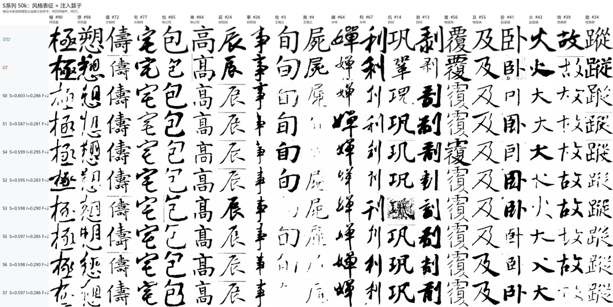
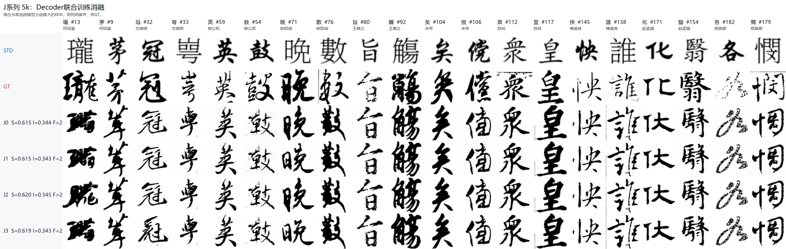

# 2026-10-28 书法生成实验阶段性结论与下一阶段计划

实验范围：S组风格表征与注入；J组现有VAE Decoder联合训练。
主结论数据截止：2026-10-28 21:30，北京时间。
后续状态单列附录，不混入本阶段模型排名。
本报告依据仓库指标、逐样本表、生成海报和本地Git对象核对编写。

## 1. 阶段判断

S0仍是本轮S组内容质量最强的基线：SSIM 0.6027，LPIPS 0.3395。
S4是最值得保留的新结构，但尚未证明整体质量显著超过S0。
S5具有较高Writer margin，提示局部Attention值得继续研究。
单独增加空间调制、Token数量或DynamicConv，没有获得稳定综合优势。
J2/J3解冻现有Decoder后改善SSIM和LPIPS，但未同步改善骨架或书风识别。
当前更有价值的问题是Writer应控制哪个生成阶段，而非注入器是否更复杂。

## 2. 实验契约与可比性

| 项目 | S组 | J组 |
|---|---|---|
| 主要变量 | 风格表征×注入算子 | Decoder训练与图像监督路径 |
| 生成器起点 | 随机初始化 | Deep-Sym4@85k EMA |
| 训练边界 | 50k | 额外5k |
| 固定评测集 | val100，100张 | 历史固定187张 |
| 采样随机性 | 单个固定noise seed | 单个固定noise seed |
| 模型状态 | U-Net EMA | U-Net EMA及配套Decoder EMA |
| 有效batch | 512 | FM batch 512 |
| 数值与infra | BF16、compile、无梯度检查点 | 同左，另有图像分支 |

S/J数据、起点和测试集不同，不能将两组SSIM直接排列为架构优劣。
同组对照使用相同固定样本；比较主张应与实际改变的变量对应。
bootstrap区间反映固定模型的样本不确定性，不覆盖独立训练seed的波动。
187张固定集也不能被整体称为未见字符集，需另分Seen/Unseen口径。

## 3. S组架构映射

| Arm | 风格表征 | 注入算子 |
|---|---|---|
| S0 | 单Writer Vector | Global AdaGN |
| S1 | 单Writer Vector | Spatial AdaGN |
| S2 | Vector映射的条件Token | Cross-Attention |
| S3 | Multi-Token | Cross-Attention |
| S4 | Writer×Local CNN | Spatial AdaGN |
| S5 | 局部Attention表征 | Cross-Attention |
| S6 | 单Writer Vector | DynamicConv |
| S7 | Multi-Token | DynamicConv |
| S8 | Writer×Local CNN | DynamicConv；截止时未完成终评 |

## 4. S组完整阶段指标

| Arm | SSIM↑ | LPIPS↓ | Ink-IoU↑ | Frag↓ | BSD↓ | 宽度比 | 骨架F1↑ |
|---|---:|---:|---:|---:|---:|---:|---:|
| S0 | 0.6027 | 0.3395 | 0.2859 | 2.627 | 0.875 | 1.144 | 0.192 |
| S1 | 0.5866 | 0.3494 | 0.2806 | 2.265 | 0.945 | 1.234 | 0.179 |
| S2 | 0.5949 | 0.3455 | 0.2835 | 2.489 | 0.913 | 1.193 | 0.191 |
| S3 | 0.5976 | 0.3426 | 0.2904 | 2.601 | 0.921 | 1.195 | 0.194 |
| S4 | 0.5988 | 0.3405 | 0.2951 | 2.299 | 0.888 | 1.196 | 0.196 |
| S5 | 0.5975 | 0.3425 | 0.2851 | 2.385 | 0.894 | 1.175 | 0.190 |
| S6 | 0.5980 | 0.3428 | 0.2901 | 2.399 | 0.843 | 1.177 | 0.188 |
| S7 | 0.5972 | 0.3431 | 0.2857 | 2.477 | 0.888 | 1.196 | 0.190 |

宽度比为逐图生成/GT中位笔宽比的均值，不是总墨量比。
骨架F1为三种阈值下2px容差结果的均值，不能与精确骨架IoU混用。
BSD是项目自定义辅助统计，较低并不自动意味着书风更正确。

| Arm | Writer Micro/Macro Top-1↑ | Margin mean↑ | Margin median↑ |
|---|---:|---:|---:|
| GT | 86.0% | 0.2921 | 0.3603 |
| S0 | 63.0% | 0.0544 | 0.1465 |
| S1 | 53.0% | 0.0199 | 0.0901 |
| S2 | 54.0% | 0.0217 | 0.0715 |
| S3 | 55.0% | 0.0169 | 0.0841 |
| S4 | 62.0% | 0.0850 | 0.1983 |
| S5 | 63.0% | 0.1017 | 0.1798 |
| S6 | 60.0% | 0.0356 | 0.1422 |
| S7 | 58.0% | 0.0467 | 0.1076 |

## 5. S组变量拆分与实际读图

S0→S1只更换注入：SSIM下降0.0162，配对95%区间[-0.0262,-0.0076]。
LPIPS也退化，改善方向的差值为-0.0099，区间[-0.0165,-0.0039]。
S1较低的Frag伴随1.234倍GT笔宽、更差墨量校准和较低Writer margin。
海报出现增粗、墨块与粘连，不能将Frag下降解释为运笔连续性改善。

S1→S4保留Spatial AdaGN，改用Writer×Local CNN后恢复大部分内容质量。
S4获得最高Ink-IoU与容差骨架F1，SSIM<0.5比例为14%，S0为17%。
但S4−S0的SSIM差为-0.0040，配对区间[-0.0112,+0.0035]跨零。
证据支持局部表征与空间注入存在有益交互，尚不支持S4全面获胜。

S2→S3更换Multi-Token后，SSIM/LPIPS略改善，Frag反而从2.489升至2.601。
S3海报存在局部噪声尾部失败，不能用均值的小幅提升忽略严重个例。
S5改善部分碎裂与Writer margin，但Ink-IoU未超过S4或S0。
S0/S4/S5的Top-1仅差0–1张，不能凭100张样本严格排序。

S6具有最低BSD和笔宽W1，却没有内容、骨架或Writer的同步优势。
S7没有超过同表征S3或同注入S6，未见Multi-Token×DynamicConv叠加收益。
截至主结论截止时间，S8仍待完成，不能提前用未收敛快照参与排名。

海报覆盖各书家，按跨模型分歧选择样本；它强调差异，不代表平均样本分布。
固定列使用相同STD、GT与噪声，选择索引另存JSON以便复核。

## 6. J组设计与完整指标

| Arm | Decoder | 图像监督 | GT重建 |
|---|---|---|---|
| J0 | 冻结 | 无 | 无 |
| J1 | 冻结 | 有，回传U-Net | 无 |
| J2 | 可训练 | 有，回传U-Net | 有 |
| J3 | 可训练 | 有，回传U-Net | 无 |

| Arm | SSIM↑ | LPIPS↓ | Ink-IoU↑ | Frag↓ | BSD↓ | 宽度比 | 骨架F1↑ |
|---|---:|---:|---:|---:|---:|---:|---:|
| J0 | 0.6149 | 0.3220 | 0.3437 | 2.397 | 0.774 | 1.046 | 0.242 |
| J1 | 0.6149 | 0.3222 | 0.3428 | 2.389 | 0.773 | 1.050 | 0.241 |
| J2 | 0.6198 | 0.3150 | 0.3447 | 2.236 | 0.696 | 1.088 | 0.240 |
| J3 | 0.6193 | 0.3147 | 0.3433 | 2.186 | 0.693 | 1.086 | 0.238 |

| Arm | Writer Micro↑ | Writer Macro↑ | Margin mean↑ | Margin median↑ |
|---|---:|---:|---:|---:|
| GT | 77.54% | 75.85% | 0.1645 | 0.2064 |
| J0 | 64.17% | 62.89% | 0.1049 | 0.1939 |
| J1 | 60.96% | 59.58% | 0.0948 | 0.1514 |
| J2 | 63.64% | 62.54% | 0.1004 | 0.1889 |
| J3 | 62.03% | 61.09% | 0.0940 | 0.1671 |

## 7. J组结论与因果边界

J1≈J0：冻结Decoder时，现有图像监督未显示稳定生成收益。
J2−J0的SSIM为+0.0049，配对95%区间[+0.0039,+0.0060]。
J3−J0的SSIM为+0.0045，区间[+0.0034,+0.0056]。
J2/J3的LPIPS分别改善约0.0069/0.0072，样本配对区间支持正收益。
J2和J3彼此差异没有稳定证据，GT重建锚在5k未显示额外生成价值。

四组尾段FM均约0.0402，不能用训练FM均值解释像素指标差异。
J2/J3记录的Decoder尾段梯度约0.754/0.019，生成指标却近似。
更大的重建梯度不等于更好的生成梯度，二者的观测目标必须区分。
骨架F1不升、笔宽略增、独立Writer不升，不能认定断笔或书风已解决。
尚缺固定latent的交叉Decoder解码，不能精确分配U-Net和Decoder各自贡献。

J0/J1视觉上高度接近；J2/J3也高度接近。
主要变化集中在边缘、墨量与局部外观，未看到一致的拓扑重组织。

## 8. 失败路线与保留项

| 路线 | 阶段判断 | 决策 |
|---|---|---|
| 单纯Spatial AdaGN | 增粗与粘连，内容退化 | 停止单独扩大空间自由度 |
| 增加普通Style Token | 收益弱且不一致 | 不继续堆Token数量 |
| DynamicConv | 低阶统计改善未转化为综合优势 | 保存结果，转向新职责划分 |
| 冻结Decoder的图像监督 | J1≈J0 | 不再延长J0/J1验证同一目标 |
| GT重建锚 | J2未优于J3 | 不无条件增加重建预算 |
| Writer×Local交互 | S4综合折中较好 | 保留为新分支依据 |
| 局部Attention | S5 margin较强 | 保留为学习式表征候选 |
| 解冻现有Decoder | 像素/感知指标稳定改善 | 保留，补条件化与梯度拆因 |

这些结论只约束本轮实现和预算，不能证明相应方法在所有书法任务上无效。

## 9. 下一阶段：改变Writer的生成职责

S9定义为`v = v_content(z_t,t,STD,script) + v_writer(z_t,t,STD,script,writer)`。
Content主干不接Writer；独立多尺度分支输出4×32×32速度残差。
Null Writer残差严格为零，用于检查控制是否实际发生。
S9整体冷启动50k，与已有S0/S4的50k结果按同协议比较。
从同一50k checkpoint分叉FM Control与Pair，两者同样增加10k更新。

Pair在物理`t=1`共享噪声，模型时间对应1000，真值为`z_b-z_a`。
因为FM目标为`epsilon-z_0`，不能将差分真值误写成反号。
GT差分含单张作品随机差异，只能通过重采样学习条件均值差的统计信号。
实际辅助梯度标定为FM约25%，并检查内容质量与独立风格方向是否保持。
S10增加连续几何输入；S11比较学习式局部Attention，不再堆普通注入器。

## 10. 下一阶段：让Writer进入高分辨率成像

J4–J7均从Deep85 EMA和原始VAE独立分叉，保留Encoder和latent契约。
J4：只训练普通Decoder的图像支路，截断图像到U-Net的梯度。
J5：在原Decoder高分辨率层加入Writer+Script条件，仍截断latent。
J6：加入Writer×STD的空间条件，仍截断latent。
J7：保持J6结构，允许图像梯度回传U-Net。
四组继续各自FM训练，首轮不加入GT重建、GAN或额外Decoder深度。

## 11. 24 / 48 / 64h累计预算

| 交付边界 | 4090 | 48GB |
|---|---|---|
| 24h | S9@50k及FM/Pair同起点各到60k | J4–J7各5k |
| 48h | S10冷启动50k；S9分支按门槛成对延长 | 有效Decoder对照延长，或转入S11 |
| 64h | 成熟模型与等曝光强基线；机制及独立seed | S11成熟对照、独立seed或经验证的联合线 |

64h是累计墙钟上限，不是三段额外预算，也不要求机械填满GPU时间。
等曝光之外还应登记LR轨迹、采样与EMA，不能仅因都到75k就称完全等价。
Pair若损坏内容且无正确书风收益，则停止延长；Decoder未通过风格门槛则转向S11。
执行细节见[完整队列](schedule64.md)，该文件是规划/实现记录，不是结果证明。

## 12. 验收与结论边界

最终候选统一187张×3个noise seeds，报告原过程评测以保持历史连续性。
同时看SSIM、LPIPS、Ink-IoU、缺笔错字、笔宽与多阈值连续形态统计。
Writer必须报告独立Top-1、margin和同批GT ceiling，不能只看训练监督器自身。
同字跨书家的GT–GEN差分需要方向、投影和残差，不能只要求Writer-swap幅度增大。
共享训练字面板只作机制诊断；未见字泛化必须使用单列协议。
新分支记录分时间`RMS(v_writer)/RMS(v_content)`、null与Writer交换。
新Decoder固定latent交换Writer，并与原Decoder交叉解码，检查是否仅增粗增黑。

当前不能宣布复杂架构全面优于Writer Vector，也不能宣布Decoder解冻必然改善书风。
下一代的核心验收是正确内容、正确的书家差异方向和可解释的机制响应同时成立。

## 13. Git与结果溯源

以下提交已由本地`git show`核实，完整SHA可在本仓库对象库解析。
本地存在不等于已推送GitHub；本报告未将远端分支发布状态作进一步推断。

| 完整SHA | 经本地核实的用途 |
|---|---|
| `34e06e4bf438f546c779197083e28176eda2362a` | 恢复compile并准备scratch 50k串行 |
| `eb3c652ec94e667847c3caa001c0850621b66183` | S0启动显存与实测步间隔 |
| `da2ce775a6213515025723f4c28a0c321393a407` | Deep85 Decoder对照与48GB串行 |
| `69083ab9e125eb4dc6625272ab7c2823f7d1ba43` | 校准、Decoder预检和48队列记录 |
| `e787f7bcdbce7d0edcdb92ebbef0c09bb67b8819` | S/J全面评测、海报与1028聚合 |
| `631df08fed4049430f6fd4a68545d6421e384692` | 第二代速度分支与条件Decoder首轮实现 |

这些记录不能替代逐run代码快照，不据此虚构每个模型的精确训练commit。
原始JSON/CSV位于[raw](raw/)，样本bootstrap汇总位于[metrics](metrics/)。
小文件SHA256、大图path+size登记在[manifest.json](manifest.json)。
模型身份仍由checkpoint `.done`、run identity及评测`complete.json`共同确定。
服务器检查命令：`git rev-parse HEAD`、`git status --porcelain`、读取run identity与ready。
若训练时有未提交修改，必须保存源码清单SHA，不能只登记当前HEAD。

## 14. 截止时间之后的附录

21:30时S8终评未完成；后续23:03日志核验已完成50k/100张评测。
其SSIM 0.60006、LPIPS 0.34290、Ink-IoU 0.28366、Frag 2.676，SoftInk 1.03654。
该记录不回填21:30主表；本报告未将其宣称为已补齐全部独立风格指标的终评。
后续双机24h队列已后台启动；S9与J4的早期训练日志不是成熟质量结论。
本次归档与文档提交只操作本地文件，未停止、重启或修改活动训练。

## 15. 归档内容与阅读顺序

归档包包含本报告、自动指标汇总、逐臂原始JSON/CSV、两张海报和样本选择索引。
各臂raw目录保留result、geometry、writer及逐样本batch，不包含训练权重。
封存清单排除自身及exports目录，避免归档文件与自身哈希的循环依赖。

- 内容与笔法比较：[S指标](metrics/S.md)、[J指标](metrics/J.md)。
- 统计区间与配对差值：[S完整表](metrics/S_full.md)、[J完整表](metrics/J_full.md)。
- 独立书风与GT可靠性：[Writer审计](metrics/writer.md)。

交付优先以可核验的本地证据为准，后续结果通过新时间截面追加，不覆盖本阶段边界。
