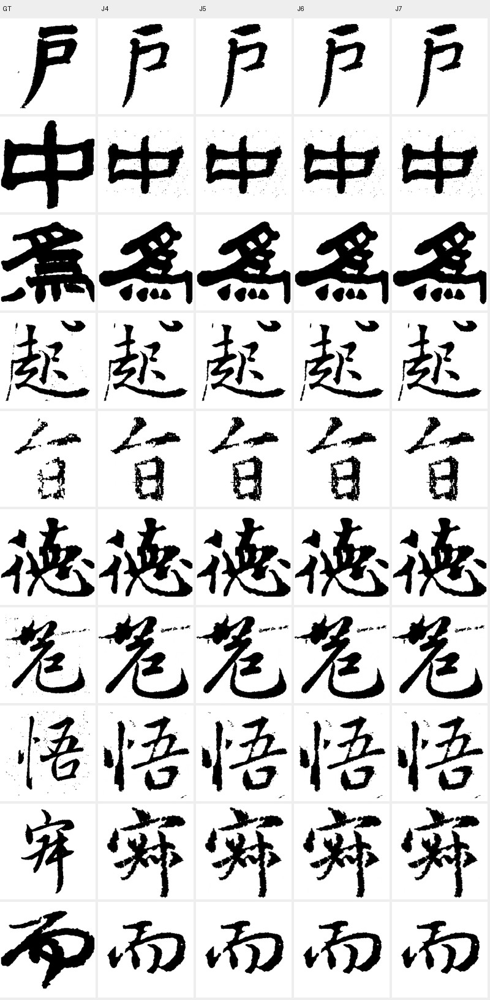

# 2026-10-29：暂停扩展后的数据与结论汇总

核查时间：2026-10-29 15:42–15:46，北京时间。现场查询两台机器日志、进程、GPU和评测JSON，并实际检查J4–J7生成图。本文取代旧页面中的“当前队列”描述；历史结果不回填成新协议结果。

## 1. 暂停范围与当前现场

用户要求先汇总、调整计划：暂停H0/H1实现及启动；两端调度器和later交接观察器已SIGSTOP，当前GPU子任务保留。当前子任务完成后不会由已暂停的父调度器启动下一个实验。没有终止训练、修改checkpoint或删除数据。

| 机器 | 当前事实 | 剩余 |
|---|---|---|
| 4090 | S9完成50k；val100及187字seed0指标已落盘，共享字面板评测进行中 | 不再自动接S9FM/Pair；Writer研究指标尚未汇齐 |
| 48GB | J4–J7各完成5k；S11约44,300/50,000，1.305 step/s，GPU100% | S11纯训练约1.2h，另加当前任务内评测；不自动接后续任务 |

暂停PID：4090 controller=3050460、handoff=2201919；48 controller=3463080、handoff=311969。远端根下`manual_pause_20261029.json`记录操作。恢复前应重新审定实验清单与剩余预算，不能直接沿用旧ETA。

S9此前因外部常驻GPU上下文PID变化，在评测前被所有者检查阻塞；本轮汇总前已恢复评测。不能把这段空闲时间计为模型推理成本。48 S11 allocated峰值约13.46GiB、nvidia-smi约15GiB；GPU计算100%，当前没有追求40GiB而再改batch。

## 2. 第一代S矩阵：复杂结构没有全面超过简单基线

以下均50k、同val100过程协议，EMA。既有完整原始表及bootstrap见`../1028/metrics/S.md`。S8为此次补齐的终点结果。

| 模型 | 改动 | SSIM↑ | LPIPS↓ | Ink-IoU↑ | Frag↓ |
|---|---|---:|---:|---:|---:|
| S0 | Vector×Global AdaGN | **0.60275** | **0.33950** | 0.28587 | 2.627 |
| S1 | Vector×Spatial AdaGN | 0.58659 | 0.34940 | 0.28062 | 2.265 |
| S2 | Vector×Cross-Attention | 0.59494 | 0.34554 | 0.28350 | 2.489 |
| S3 | Multi-Token×Cross-Attention | 0.59756 | 0.34258 | 0.29036 | 2.601 |
| S4 | Local CNN×Spatial AdaGN | 0.59875 | 0.34055 | **0.29513** | 2.299 |
| S5 | Local Attention×Cross-Attention | 0.59750 | 0.34246 | 0.28509 | 2.385 |
| S6 | Vector×DynamicConv | 0.59796 | 0.34284 | 0.29009 | 2.399 |
| S7 | Multi-Token×DynamicConv | 0.59717 | 0.34311 | 0.28572 | 2.477 |
| S8 | Local CNN×DynamicConv | 0.60006 | 0.34290 | 0.28366 | 2.676 |
| S9 | 独立Writer速度分支，总127.56M | 0.59814 | 0.34543 | 0.27672 | 2.381 |

变量拆分：

- S0→S1只改注入，明显退化；S1笔宽为GT的1.234倍，低Frag伴随增粗和粘连，不能视为拓扑改善。
- S1→S4在Spatial AdaGN下增加局部交互，恢复内容并提高覆盖。说明组合有价值，不说明空间调制天然有效。
- S2→S3、S6→S7：Multi-Token没有稳定的综合增益。
- S8补齐后，Local CNN×DynamicConv仍未超过S4；DynamicConv不是已验证的改进方向。
- S9相对S0：SSIM −0.00461、LPIPS +0.00593、Ink-IoU −0.00915；没有内容质量收益。Frag下降不能单独抵销上述退化。
- S9在同更新数下增加约13.56M参数且训练更慢。当前只能说“该实现的50k结果未胜”，不能归因成“分离Writer职责理论错误”；它同时改变条件路由、容量和优化路径。

S0、S4继续作为内容基线与局部交互候选。尚无证据支持立即扩大架构矩阵。

## 3. 第二代J4–J7：条件Decoder和端到端梯度没有显示额外收益

四组均从同Deep85 EMA分叉、各5k；同187字seed0、配套Decoder EMA。训练FM每步有效512，图像分支每步16张/micro8。不要与第一代J0–J3的不同采样噪声结果直接做精确差值。

| 模型 | 唯一区分重点 | SSIM↑ | LPIPS↓ | Ink-IoU↑ | Frag↓ | Writer Macro↑ | Margin↑ |
|---|---|---:|---:|---:|---:|---:|---:|
| J4 | 无新条件，图像支路截断latent | 0.617928 | 0.315176 | 0.345847 | 2.008 | 57.34% | 0.07969 |
| J5 | 增Writer/Script全局仿射 | 0.617748 | 0.315418 | 0.345607 | 2.023 | 57.85% | 0.08250 |
| J6 | Writer×STD空间调制 | 0.617830 | 0.315205 | 0.345658 | 2.049 | 56.75% | 0.07812 |
| J7 | 同J6，图像梯度回传U-Net | 0.617944 | 0.315320 | 0.345990 | 2.021 | 58.28% | 0.08191 |

SSIM全组跨度只有0.000196，LPIPS跨度0.000242。J7相对J6的Writer Macro多1.53个百分点，但Micro实际只多3/187张，未做多seed及配对不确定性检验，不能认定可靠提升。GT Writer Macro为75.85%，模型有明显改善空间。

J4→J5：增加Writer条件没有带来内容收益，margin仅+0.00280；J5→J6：空间调制未获额外收益；J6→J7：允许图像梯度回U-Net也没有明显内容收益。自动晋级结果`selected_pair=[]`，没有Decoder臂进入12k延长。

训练端四组5k FM约0.03877–0.03881；图像L1约0.00772–0.00774，Decoder梯度约0.036–0.038。日志说明Decoder有更新，但“梯度非零”不代表新增条件被有效利用。

### 实际读图

抽样索引固定为0/20/40/60/80/100/120/140/160/180，未按收益挑图。四列在可见尺度上几乎一致：上方隶书复杂字仍有内部笔画合并，后段字相对GT的部件比例和布局偏差在四组中共同保留；较好样本也没有肉眼可见的额外笔法变化。不能由这10张图推出所有187张完全相同，但它与整体指标重合一致。

## 4. 最重要的评测边界：训练字方向 ≠ 留出字风格泛化

共享训练字面板：26张、6个同字同书体单元、46个书家对。J4/J5/J6/J7方向cosine依次0.88645/0.88600/0.88630/0.88447，Writer Top-1全部100%。这是训练字拟合诊断，不是泛化成绩。

同一模型在187字留出上的Writer Macro仅56.75%–58.28%、SSIM约0.618；共享训练字SSIM约0.874。这说明两个集合表现差异大，但面板选择和样本构成不同，不能把0.256直接当成无偏过拟合量。

187字留出CSV中没有满足该差分定义的同字异书家单元，`direction.n_cells=0`、cosine=null。因此当前最重要的“未见字上书家变化方向是否正确”仍未被这个协议回答。训练面板cosine高不能补上这个缺口，也不能作为联合H训练的充分依据。

下一版评价应优先构造：训练中未见的共享字符×多书家×同书体真迹面板；固定STD与噪声，按字符/来源分组报告区间。单纯增加更多不共享字符的PNG，无法修复这个识别问题。

## 5. 新S路线尚不能下结论的部分

S9@50k统一187字seed0：SSIM0.602334、LPIPS0.336189、Ink-IoU0.310080、Frag3.323，near-blank 1/187。与它自己的val100结果差异明显，进一步说明不能跨集合混排名。

S9FM/Pair尚未开始；S10未开始；S11还在训练，没有正式50k终评。不能把Pair、几何先验或学习式局部Attention写成已验证有效/无效。H0/H1未实现、未启动。

## 6. 调整计划前应保留的结论

1. 简单S0依然是强基线；局部CNN×Spatial AdaGN有特定收益，复杂化不自动改善风格。
2. 第一代J2/J3证明解冻Decoder可小幅改善外观；第二代J4–J7没有证明给Decoder加风格条件能进一步改善书风。
3. 独立Writer速度分支S9的首个50k结果没有超过原S0；S11未终评，暂不宣判整条分离路线。
4. 目前最欠缺的是留出字符上的真实书家差分评价，以及新增条件支路的实际贡献测量。
5. 在这些证据不足时，把S路线与条件Decoder直接组合为H0/H1会增加归因困难。先暂停是合理选择；本文不自动提出/启动新的长训清单。

## 7. 证据与可追溯性

- J原始紧凑指标：[evidence/J4_J7.json](evidence/J4_J7.json)。包含同协议GT ceiling、样本数与训练面板方向区间。
- S9原始指标：[val100](evidence/S9_val100.json)、[187字seed0](evidence/S9_heldout187_seed0.json)。
- S8远端：4090 `assets/style_matrix_20261027/matrix64/4090/execution/runs/S8/evaluations/`。
- S9远端：4090 `assets/style_matrix_20261028/generation2full/4090/runs/S9/checkpoints/0050000.pt`。
- J4–J7远端：48 `assets/style_matrix_20261028/generation2full/48/runs/<arm>/checkpoints/0005000.pt`（可能是既有run的本机软链接）。
- S11远端：48 `assets/style_matrix_20261028/generation2full/48/runs/S11/`。

本次只传回小型JSON与约百KB的既有生成图拼图，不传模型或训练资产。未新增训练、未进行GPU测试、未清盘。未完成的Writer/机制统计以待完成标注，未用训练loss替代正式生成评测。
