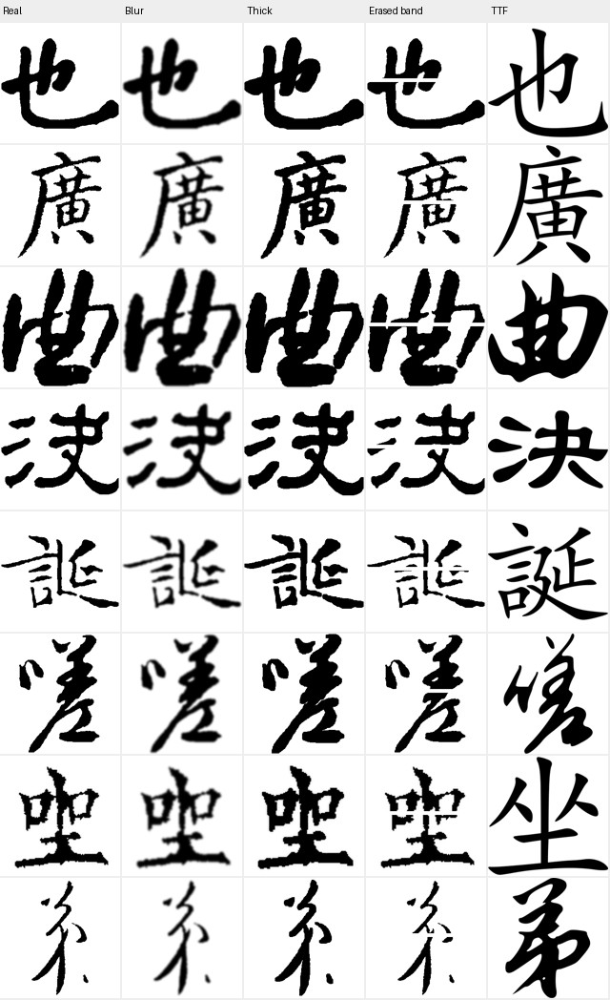

# 新评估网络与两阶段重评：eval_unpaired_v1

快照时间：2026-10-29T17:03:31+08:00（北京时间）。

数据与结论按本目录紧凑导出冻结；网络均冻结，未训练新生成器。全部指标独立报告，不合成总分。

## 核心结论

1. **通用IQA校准失败，不能据此宣布书法美学胜者。** MUSIQ-AVA偏好横带擦除，TOPIQ对空白图异常偏好；TTF普遍得到更高技术质量评分。
2. **SSIM优势不等于所有风格指标优势。** 同100字、K64异字检索中S5/S4高于S0，但另一套D1特征并不支持相同排序。
3. **J组没有出现稳定的新增条件收益。** J2/J3的MMD有描述性改善，Writer检索未同步提高；J4–J7仍接近。
4. **P1→P2有跨字检索收益。** 历史权重的原生采样、数据和初始化不同，只作参照，不作S/J架构因果比较。
5. OCR权重缺失、条件多样性缺多seed。当前不生成每模型6000张，不以无效评价器决定新训练。

## 1. 校准先于排名

24张固定训练真迹，比较原图/高斯模糊/5px增粗/擦除中央8px横带/纯白。表中为原图得分更高的比例。擦除操作见下图，不能将摄影领域的分数直接称为书法美学。

| 评价器 | 原图>模糊 | 原图>增粗 | 原图>擦除 | 原图>纯白 | 原图>同字TTF |
|---|---:|---:|---:|---:|---:|
| musiq-ava | 83.3% | 54.2% | 25.0% | 100.0% | 20.8% |
| musiq | 100.0% | 20.8% | 91.7% | 100.0% | 0.0% |
| topiq_nr | 83.3% | 16.7% | 54.2% | 20.8% | 0.0% |

MUSIQ-KONIQ可以响应模糊，不等于能评价书风；TTF更高并非单独的失效证明，擦除/纯白反例与人工校验缺失共同限制主排名。以上比例只基于24张，不是总体准确率。

## 2. S系列：同100字原过程面板（S10未训练）

| 模型 | 有效N | E-G Macro%↑ | Margin↑ | Bank-2AFC%↑ | E-G MMD²↓ | E-L Macro%↑ | E-L MMD²↓ |
|---|---:|---:|---:|---:|---:|---:|---:|
| S0@50k | 98/100 | 56.25 | 0.0251 | 82.54 | 0.1155 | 54.00 | 0.0464 |
| S1@50k | 98/100 | 51.75 | 0.0272 | 83.67 | 0.1176 | 49.75 | 0.0411 |
| S2@50k | 98/100 | 55.25 | 0.0166 | 81.75 | 0.1025 | — | — |
| S3@50k | 98/100 | 55.25 | 0.0066 | 82.88 | 0.1086 | — | — |
| S4@50k | 98/100 | 62.00 | 0.0652 | 85.03 | 0.0936 | 51.00 | 0.0490 |
| S5@50k | 98/100 | 64.00 | 0.0756 | 89.23 | 0.1012 | — | — |
| S6@50k | 98/100 | 61.50 | 0.0146 | 82.77 | 0.1097 | 49.25 | 0.0528 |
| S7@50k | 98/100 | 55.50 | 0.0474 | 83.79 | 0.1048 | — | — |
| S8@50k | 98/100 | 56.25 | 0.0086 | 84.13 | 0.1393 | 47.00 | 0.0663 |
| S9@50k | 98/100 | 48.75 | -0.0179 | 79.59 | 0.1187 | 43.00 | 0.0564 |
| S11@50k | 98/100 | 51.25 | -0.0101 | 81.18 | 0.1326 | — | — |

E-G为严格加载的ResNet Writer特征；E-L为历史跨字Pixel D1的多尺度统计特征。K=64，每个书家用异字参考图，top5相似度均值竞争，同书体比较。有效N不足100/187时显式排除参考不足槽位，所有模型使用同一规则。

E-G真实GT检索上限约80.75%（100字）、68.25%（187字）；E-L分别约63.0%、44.50%。E-L在187字上的可靠性尤其有限。原有原型分类Top-1、这里的kNN检索与历史困难三元组2AFC是不同指标，不得混称。

MMD按writer先对书体取平均、再对writer宏平均；报告不沿用早期原型的slot宏平均。参考来自生成器训练真迹，排除本面板目标字符，因此明确属于**Train-reference Style MMD**。字符分布、作品来源仍有混杂，点估计更低不等于显著改善。

### 新速度分支：统一187字seed0

| 模型 | 有效N | E-G Macro%↑ | Margin↑ | Bank-2AFC%↑ | E-G MMD²↓ | E-L Macro%↑ | E-L MMD²↓ |
|---|---:|---:|---:|---:|---:|---:|---:|
| S9@50k | 181/187 | 51.41 | -0.0009 | 81.09 | 0.1569 | 32.60 | 0.1397 |
| S11@50k | 181/187 | 48.09 | -0.0105 | 81.01 | 0.1684 | — | — |

S11在100字上SSIM0.59396、LPIPS0.35151；187字SSIM0.60237与S9接近，书家检索没有改善。独立Writer分支目前不能证明优于S0；其容量、条件路径与优化均改变，不归因为单一理论机制错误。

## 3. J0–J3：旧187字同协议

| 模型 | 有效N | E-G Macro%↑ | Margin↑ | Bank-2AFC%↑ | E-G MMD²↓ | E-L Macro%↑ | E-L MMD²↓ |
|---|---:|---:|---:|---:|---:|---:|---:|
| J0@5k | 181/187 | 62.16 | 0.0880 | 86.56 | 0.1095 | — | — |
| J1@5k | 181/187 | 60.24 | 0.0797 | 85.64 | 0.1106 | — | — |
| J2@5k | 181/187 | 60.28 | 0.0813 | 86.62 | 0.1046 | — | — |
| J3@5k | 181/187 | 60.05 | 0.0761 | 86.00 | 0.1075 | — | — |

## 4. J4–J7：新统一187字seed0

| 模型 | 有效N | E-G Macro%↑ | Margin↑ | Bank-2AFC%↑ | E-G MMD²↓ | E-L Macro%↑ | E-L MMD²↓ |
|---|---:|---:|---:|---:|---:|---:|---:|
| J4@5k | 181/187 | 57.70 | 0.0655 | 85.93 | 0.1096 | — | — |
| J5@5k | 181/187 | 59.59 | 0.0680 | 86.37 | 0.1083 | — | — |
| J6@5k | 181/187 | 57.08 | 0.0659 | 85.93 | 0.1094 | — | — |
| J7@5k | 181/187 | 58.93 | 0.0686 | 86.43 | 0.1088 | — | — |

J4–J7另有original_protocol原生噪声重评，保留在压缩JSON；不把这两种seed取各自最好值。旧J0–J3与新J4–J7分表，避免把噪声变化归因于Decoder结构。

## 5. 历史强基线：只比较各自原生面板

| 模型 | 有效N | E-G Macro%↑ | Margin↑ | Bank-2AFC%↑ | E-G MMD²↓ | E-L Macro%↑ | E-L MMD²↓ |
|---|---:|---:|---:|---:|---:|---:|---:|
| P1@10k | 98/100 | 47.50 | -0.0394 | 80.50 | 0.2049 | 38.00 | 0.1189 |
| P2@20k | 98/100 | 58.50 | 0.0275 | 87.64 | 0.1484 | 51.00 | 0.0998 |
| DeepSym4@75k | 181/187 | 57.59 | 0.0517 | 85.50 | 0.1390 | — | — |
| DeepSym4@85k | 181/187 | 61.09 | 0.0651 | 86.86 | 0.1323 | — | — |
| U100Base@55k | 181/187 | 62.30 | 0.0594 | 87.65 | 0.1396 | — | — |

历史样本逐张RGB GT像素匹配到已审计CSV，匹配失败不纳入。旧protocol.json保留EMA、采样器、seed、STD sigma；不能把旧原生STD与新模型的绝对差解释为架构效应。

## 6. 配对不确定性

固定这10位书家，在每位书家内部按字符重采样，重复noise按同字符聚类。下表是E-G Macro Top-1差值的95%区间，单位百分点；单seed筛选区间不含训练seed不确定性。

| 对照（前者−后者） | Δ Macro Top-1 [95%CI] |
|---|---:|
| S4−S0 | +5.75 [-2.75, +14.75] |
| S5−S0 | +7.75 [+0.50, +15.50] |
| S9−S0 | -7.50 [-17.50, +1.75] |
| S11−S0 | -5.00 [-13.00, +4.00] |
| S11−S9 | -3.32 [-9.90, +3.33] |
| S8−S4 | -5.75 [-15.25, +2.76] |
| J2−J0 | -1.88 [-3.76, -0.38] |
| J3−J0 | -2.11 [-4.42, +0.24] |
| J5−J4 | +1.89 [-0.52, +4.70] |
| J6−J5 | -2.51 [-5.55, -0.03] |
| J7−J6 | +1.86 [+0.00, +4.30] |
| P2−P1 | +11.00 [+1.00, +21.00] |

这些区间为探索性、未校正多重比较；特别是接近0的边界不能宣告机制成立。跨机器比较条件字段相同，但仍应补独立noise/训练seed复核。

### K-shot稳定性（有效样本数同时报告）

| 模型 | K32 Macro% / N | K64 Macro% / N | K128 Macro% / N |
|---|---:|---:|---:|
| S0 | 55.50 / 98 | 56.25 / 98 | 57.75 / 96 |
| S4 | 61.00 / 98 | 62.00 / 98 | 61.50 / 96 |
| S5 | 62.00 / 98 | 64.00 / 98 | 65.00 / 96 |
| S9 | 48.00 / 98 | 48.75 / 98 | 49.00 / 96 |
| J4 | 58.93 / 181 | 57.70 / 181 | 60.83 / 175 |
| J7 | 58.23 / 181 | 58.93 / 181 | 61.74 / 175 |

K变化可能改变可评槽位和N；正式稳定性结论应再限制到三K共同有效样本，不拿不同分母直接宣称性能变化。

## 7. 无参考质量与非配对分布诊断

下面保留实测分数以便复核，**不形成美学排行榜**。FID/KID使用官方Clean-FID缩放和Inception；FID用等价低秩SVD计算完整经验协方差距离，已与标准协方差公式核对，无PCA。小样本偏差仍在。

| 模型 / 面板 | AVA | TOPIQ | KONIQ | pooled FID | KID | SSIM↑ | LPIPS↓ |
|---|---:|---:|---:|---:|---:|---:|---:|
| DeepSym4@75k / verified_saved_GT_187 | 4.3056 | 0.3864 | 51.10 | 101.31 | 0.01254 | 0.6132 | 0.3228 |
| DeepSym4@85k / verified_saved_GT_187 | 4.2999 | 0.3933 | 51.55 | 100.30 | 0.01168 | 0.6129 | 0.3209 |
| J0@5k / heldout187 | 4.2907 | 0.3865 | 51.06 | 94.07 | 0.00663 | 0.6149 | 0.3220 |
| J1@5k / heldout187 | 4.2827 | 0.3861 | 51.00 | 94.87 | 0.00725 | 0.6149 | 0.3222 |
| J2@5k / heldout187 | 4.2811 | 0.4102 | 52.38 | 97.53 | 0.01043 | 0.6198 | 0.3150 |
| J3@5k / heldout187 | 4.2474 | 0.4025 | 52.04 | 97.27 | 0.01091 | 0.6193 | 0.3147 |
| J4@5k / heldout187_seed0 | 4.2721 | 0.4030 | 51.86 | 96.06 | 0.01017 | 0.6179 | 0.3152 |
| J4@5k / original_protocol | 4.2557 | 0.4037 | 52.05 | 98.51 | 0.01161 | 0.6192 | 0.3149 |
| J5@5k / heldout187_seed0 | 4.2655 | 0.4024 | 51.92 | 95.52 | 0.00952 | 0.6177 | 0.3154 |
| J5@5k / original_protocol | 4.2507 | 0.4033 | 52.08 | 98.07 | 0.01140 | 0.6193 | 0.3148 |
| J6@5k / heldout187_seed0 | 4.2688 | 0.4015 | 51.83 | 95.70 | 0.00951 | 0.6178 | 0.3152 |
| J6@5k / original_protocol | 4.2624 | 0.4054 | 52.11 | 97.91 | 0.01098 | 0.6200 | 0.3142 |
| J7@5k / heldout187_seed0 | 4.2701 | 0.4011 | 51.91 | 95.85 | 0.00984 | 0.6179 | 0.3153 |
| J7@5k / original_protocol | 4.2597 | 0.4056 | 52.19 | 97.49 | 0.01119 | 0.6199 | 0.3143 |
| P1@10k / verified_saved_GT_100 | 4.2538 | 0.3730 | 49.33 | 133.09 | 0.01229 | 0.5664 | 0.3710 |
| P2@20k / verified_saved_GT_100 | 4.2014 | 0.3703 | 48.78 | 135.23 | 0.01806 | 0.5908 | 0.3497 |
| S0@50k / heldout | 4.3129 | 0.3913 | 50.53 | 127.09 | 0.00857 | 0.6027 | 0.3395 |
| S1@50k / heldout | 4.3352 | 0.3943 | 50.60 | 123.46 | 0.00443 | 0.5866 | 0.3494 |
| S11@50k / heldout187_seed0 | 4.3087 | 0.3829 | 50.12 | 97.47 | 0.01065 | 0.6024 | 0.3364 |
| S11@50k / original_protocol | 4.3214 | 0.4031 | 50.07 | 128.16 | 0.00659 | 0.5940 | 0.3515 |
| S2@50k / heldout_s | 4.3041 | 0.4013 | 50.09 | 124.25 | 0.00511 | 0.5949 | 0.3455 |
| S3@50k / heldout_s | 4.2946 | 0.3924 | 50.60 | 123.24 | 0.00492 | 0.5976 | 0.3426 |
| S4@50k / heldout | 4.3108 | 0.3896 | 50.53 | 126.36 | 0.00799 | 0.5988 | 0.3405 |
| S5@50k / heldout_s | 4.3324 | 0.3943 | 51.24 | 125.52 | 0.00831 | 0.5975 | 0.3425 |
| S6@50k / heldout | 4.3255 | 0.3912 | 50.11 | 127.11 | 0.00711 | 0.5980 | 0.3428 |
| S7@50k / heldout_s | 4.3236 | 0.3917 | 50.45 | 126.05 | 0.00619 | 0.5972 | 0.3431 |
| S8@50k / heldout | 4.3143 | 0.3931 | 50.16 | 125.54 | 0.00589 | 0.6001 | 0.3429 |
| S9@50k / heldout187_seed0 | 4.2932 | 0.3887 | 50.55 | 97.30 | 0.00980 | 0.6023 | 0.3362 |
| S9@50k / original_protocol | 4.3166 | 0.3998 | 50.85 | 125.39 | 0.00516 | 0.5981 | 0.3454 |
| U100Base@55k / verified_saved_GT_187 | 4.2817 | 0.3732 | 50.41 | 103.24 | 0.01592 | 0.6017 | 0.3317 |

Real-vs-Real分割按writer×script分层；另记录相同样本数下Gen-vs-Real对照，详见JSON的matched_n/matched_gen_fid。不能拿100-vs-100生成FID与50-vs-50 Real分割直接判高低。不计算每书家十几张的FID；KID负估计保留，不截断为0。

## 8. 当前不能回答的问题

- 审美/自然度：通用IQA未通过任务校准，150–300组人工盲评尚未完成。当前没有书法审美金标准。
- 内容：两机未找到可严格加载并验证字表的OCR权重，OCR为缺失，不是0%。已修复旧评价器“缺权重仍输出随机网络分数”的危险行为。
- 风格泛化：KNN排除同字符，跨dataset-source控制可算；dataset标签不等于作品来源。现有参考库来自训练集，不假装是独立作品留出。
- 多样性：尚未形成统一同条件三seed面板；部分模型的原生噪声与新固定噪声两组结果不能直接代替该协议。feature Coverage已作诊断，但依赖每槽生成数和参考数，低值不直接证明坍缩。
- E-L严格权重仅在4090本地找到；48没有可核验的同源权重，按数据规则没有跨机搬模型。E-L只作现有子集的第二意见，不能据此对所有模型排名。
- S10未训练，不虚构结果。S11已完成50k与新指标；一次性任务只接续评测，不恢复旧训练队列。
- 严格未见字应排除整个预训练链见过的字符，不能仅排除最后一次Top10微调CSV；历史P1来自100k预训练，需要单独审计。

## 9. 执行与证据

4090完成IQA三网、E-G/E-L与Clean-FID/KID；48先在CPU以低优先级重评，S11原训练完成后使用GPU完成S11与历史强基线的末段评测，未恢复S9-Pair/S10/H0/H1。新工具不修改生成器、VAE或旧checkpoint。

| 结果根 | 完成 | 结果数 |
|---|---|---:|
| `assets/eval_unpaired_20261029/4090` | True | 7 |
| `assets/eval_unpaired_20261029/4090_rescored` | True | 7 |
| `assets/eval_unpaired_20261029/history4090_eval` | True | 2 |
| `assets/eval_unpaired_20261029/4090_clean` | True | 7 |
| `assets/eval_unpaired_20261029/history4090_clean` | True | 2 |
| `assets/eval_unpaired_20261029/48_rescored` | True | 16 |
| `assets/eval_unpaired_20261029/48` | True | 16 |
| `assets/eval_unpaired_20261029/history48_full` | True | 3 |
| `assets/eval_unpaired_20261029/history48_full_clean` | True | 3 |
| `assets/eval_unpaired_20261029/48_clean` | True | 16 |
| `assets/eval_unpaired_20261029/S11_v1` | True | 2 |
| `assets/eval_unpaired_20261029/S11_v1_clean` | True | 2 |

压缩JSON包含逐query判定、K32/64/128、GT ceiling、分writer/script MMD、标签交换负控、Coverage及原始质量分数。`—`表示该快照未完成或资产缺失，不是零。

实现：[工具说明](../../../tools/eval_unpaired/README.md)。模型版本与语义参照：[IQA-PyTorch官方ModelCard](https://github.com/chaofengc/IQA-PyTorch/blob/main/docs/ModelCard.md)；分布特征实现：[Clean-FID官方仓库](https://github.com/GaParmar/clean-fid)。

下一步先用人工盲评和真正的留出跨字书家面板验证评价器，不依据摄影美学分数继续扩展生成架构。
