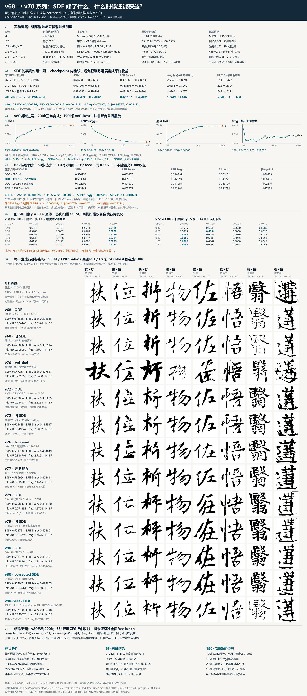

# v68 与 v70 系列消融：SDE 的作用、成立条件与新模型的推理收益空间

证据截止：2026-10-12。本文整理已有结果、数学推导和实现审计；没有追加训练或模型推理。配套 poster 使用原始 256×256 输出，不做锐化、反色或笔画后处理。



[查看原尺寸 poster（3140×5830）](v68_v70_sde/poster.png) · [证据清单](v68_v70_sde/evidence.json) · [v80 50k 四组逐样本数据](v68_v70_sde/v80_50k_paired.csv)

## 判断

**有可能通过调整 SDE，在新模型上获得不重训、同 NFE 的推理收益。** 目前证据支持继续保留这个方向，但不支持直接把固定 `gamma=0.5` 当作所有 VAE 的通用增强。

v68 的提升真实存在：历史图像批的 SSIM 从 0.616886 到 0.626036，frag 报告值从 5.06 到 2.38。然而它使用旧漂移和 C2OT，不能证明 corrected SDE 应当复现相同增幅；同批 LPIPS-alex 和 ink IoU 还分别变差 0.007848 与 0.008383。

v80 的正确链路在 50k、CFG=1、Heun-50 下，三个路径 seed 都使 frag 下降，SSIM 都略升。按样本先平均三条路径再 bootstrap，frag 的 95% 区间不跨零，SSIM/LPIPS/ink IoU 等均跨零。因此当前最准确的说法是：**观察到小幅的碎片率收益，尚未证明整体质量的 free lunch。** frag 较低也可能来自误并笔或丢笔，必须与墨量、结构正确性、LPIPS 和图像一起判断。

上一轮“精确场同分布，所以正确 SDE 不应带来普遍提升”的论证只适用于理想极限。真实模型有预测误差；不同扩散系数会改变这些误差如何积累。SiT 原论文明确展示了同模型调整采样扩散系数后的收益，也强调最优系数依赖模型和插值路径。这为不重训调 sampler 提供了依据，但它的 ImageNet/FID 结果不能直接推出本项目 paired-SSIM 的收益。[SiT，§2.4、§3.2](https://arxiv.org/html/2401.08740v2)

## 1. 实验关系与可归因边界

| 实验 | 主要变化 | 已有结果/状态 | 可读结论与限制 |
|---|---|---|---|
| v68 | SD-VAE，aug，C2OT，三表+路由，REPA | 200k；batch288；horizon200k | 主线基准；旧 SDE 有显著 SSIM/frag 收益 |
| v70 | 相对 v68，把字符表换成经 VAE 编码的 std-skel；骨架空间注入 | 停于约78.7k；最好0.553535@65k | 同65k v68为0.583309，差−0.029774；同时涉及条件表示与注入方式，不能只归因于“骨架本身” |
| v71 | 旧 Calli-VAE 的非标准编码/解码约定 | 作废 | 不进入有效数值比较 |
| v72 | DINO监督 Calli-VAE，标准 sample 约定，noaug，C2OT | 130k；batch288；horizon200k | 相对 v68 同时改变语料和 VAE；早期领先、后期平台；旧 SDE 没有复现 v68 收益 |
| v73 | 解冻 VAE encoder、REPA-E | 配置就绪、未启动 | 没有结果；计划batch64，与v72不同，不能预设是纯encoder消融 |
| v74 | 相对 v72，sample目标改为mode | 匹配协议23/23评测点落后；SSIM约−0.008、LPIPS约+0.032 | 不支持“移除posterior噪声就能恢复质量”的方案；不能因此排除posterior几何的全部影响 |
| v75 | 基于DoG修正VAE的下游臂 | 度量修正后HF/GT约0.783→0.788，已停 | 不能用旧错误高频指标宣布成功 |
| v76 | 直接topband高频损失的VAE；旧sf约定 | 海报图40k；stored std约0.20 | HF/GT报告0.629；与v72差训练进度和VAE |
| v77 | 相对v76去掉REPA | 海报图35k；HF/GT报告0.623 | 35k图不能与v76的40k图归因比较；需要读匹配步数曲线 |
| v78 | 相对v76修正latent scale/shift，stored std约1 | 存在训练曲线；本机没有对应完整海报图集 | 配套文档保留该臂，海报不造缺失图像 |
| v79 | 纯物理VAE：L1+LPIPS+GAN+KL+HF，无DINO；C2OT | 海报使用55k批；stored std约0.996 | 与v78匹配5k–45k曲线平均LPIPS-vgg改善约0.0543、SSIM约+0.0048；VAE提升没有变成同幅度DiT提升 |
| v80 | 相对v79关闭C2OT；纯物理VAE；当前corrected sampler | 正确链路50k；batch288；horizon200k | 训练侧自动评测gamma=0；本次独立SDE评测gamma=.5，三路径seed |

v70 另一个同步数对照：30k v68 SSIM 0.549509、v70 0.545722（差−0.003787）；65k差扩大到−0.029774。海报中的 v70 图像来自旧30k图集，不能把65k曲线数字贴成该图集的指标。

以上配置来自 `src/train/configs/v68_*.json`、`v70_*.json`、`v71`–`v80` 对应配置；v68/v70曲线来自 `assets/ledger/points_all.csv`。未启动、无效和缺图的臂都明确标注。

## 2. 评测口径与证据强度

这份材料分三条数据流，避免把不同批的输出误当成同一个对照：

| 数据流 | 来源 | 口径/使用方式 |
|---|---|---|
| 历史图像批 | `eval/v68`、`v68_sde`、`v72`、`v72_sde`；`assets/eval200_splits_exact_metrics.csv` | N187、CFG1、Heun50、LPIPS-alex；读各模型自己的ODE/SDE变化 |
| 历史扫描/训练 | v68旧扫描报告、v72 sweep CSV、ledger | 各CFG/步数明确登记；LPIPS-vgg与alex不能混；扫描只在自己的行内比较 |
| 正确v80 50k链路 | `_local_v80_50k_ode` 与三个 `_sde_g05*` | N187、CFG1、Heun50、LPIPS-alex；同checkpoint/VAE/条件映射/固定起始噪声，独立路径seed |

历史简报把v68图像批的frag记为5.06，而ledger中的训练侧v68@200k为2.536518，旧二维扫描CFG1为2.493。v72历史图像批frag为2.566，扫描CFG1为2.6813。**这些差异尚未完整归因，不能合并读数，也不能仅凭跨批frag绝对值量化“可修空间”。** 海报标星的数据是历史简报保留读数，未冒充本次重算。

v80 ODE本地SSIM 0.583217、frag 1.744919；4090自动评测约0.5835、1.7490，复现差分别约0.00028和0.0041。这通过了正确链路的复现门禁。旧 `eval/v80` 的低分批不进入本次数字和图像；v79也明确使用 `eval/v79_55k`，避免与旧 `eval/v79` 混用。

poster八列选取固定的v68零基SSIM排名 `15,45,70,90,110,135,155,175`，对应idx `75,82,158,133,99,140,154,178`。选择规则只依赖v68历史基线，没有按SDE增量挑图。它覆盖容易到困难样本，但不是全187张的视觉普查，难度档也有v68排序偏差。

## 3. SDE 实际改善了什么

历史图像批与简报：

| 配对 | SSIM ODE→SDE | LPIPS-alex ODE→SDE | ink IoU ODE→SDE | frag ODE→SDE* | HF/GT ODE→SDE* |
|---|---|---|---|---|---|
| v68 200k，旧式γ.5 | .616886→.626036 | .391066→.398914 | .304445→.296062 | 5.06→2.38 | .811→.760 |
| v72 130k，旧式γ.5 | .607004→.605835 | .385605→.385537 | .348574→.349047 | 2.566→2.867 | .622→.630 |
| v79 55k，旧式γ.5* | .5799→.5788 | .4318→.4283 | .2719→.2838 | 1.876→1.466 | .647→.622 |

星号是 `docs/sde_analysis_brief.md` 的历史读数。由此可见，旧SDE对v68显著减少碎笔，伴随墨迹/感知/高频让渡；对v72则可能更碎；对v79是连通性和部分感知收益与高频下降并存。“SDE总是平滑”“SDE一定降低高频”都不是普遍定律，连历史v72的HF都略升。

v68旧二维扫描中，γ.5的SSIM在六个CFG上均最高，但LPIPS并非如此：CFG1时γ.35为.3235、γ.5为.3237；CFG1.2时γ.2/.35为.3225、γ.5为.3234。“所有CFG、所有指标全面获益”的旧文案与它自己的表冲突。

正确v80 50k、γ.5的三seed配对统计：

| 指标 | ODE | 三seed SDE均值 | SDE−ODE | 95%样本bootstrap区间 |
|---|---:|---:|---:|---|
| SSIM | .583217 | .583793 | +.000576 | [−.000315, +.001512] |
| LPIPS-alex | .425130 | .424300 | −.000830 | [−.001957, +.000341] |
| MSE | .858908 | .856722 | −.002187 | [−.005136, +.000686] |
| ink SSIM | .419955 | .419991 | +.000036 | [−.001193, +.001218] |
| ink IoU | .283448 | .284355 | +.000908 | [−.000377, +.002231] |
| skel IoU | .018644 | .018502 | −.000142 | [−.000700, +.000388] |
| frag | 1.744919 | 1.672945 | −.071973 | [−.147870, −.002186] |

这里先按每个样本平均三个路径seed，再重采样187个样本，20,000次、固定随机种子20261012。三seed共享固定起始噪声；这不是覆盖所有起始seed/checkpoint的置信区间，也未校正多指标检验/条件组相关性。frag区间仅略越过零，宜视为当前批的探索性证据，不能宣布普适显著。

单seed图像分析显示：ODE frag最差四分位平均frag改善0.3719、SSIM+.001626；最好四分位frag轻微恶化、SSIM−.000374。改善与原本断裂程度有关。但这是诊断分层，涉及GT，不能把该分层直接当作部署时的SDE选择器。

## 4. 数学上成立的 SDE 家族

固定条件c，训练路径为

\[
x_t=(1-t)x_0+t\epsilon,\qquad \epsilon\sim\mathcal N(0,I),\quad \epsilon\perp x_0\mid c.
\]

定义精确速度和score：

\[
v=\mathbb E[\epsilon-x_0\mid x_t=x,c],\qquad
s=\nabla_x\log p_t(x\mid c)=-\frac{x+(1-t)v}{t}.
\]

这个score关系不要求数据端 `Var(x0)=1`。拟合latent scale仍有优化和数值意义，但std=.2本身并不让正确公式失效。

用生成时间 `u=1-t` 写，可以彻底避免倒退时间符号混淆：

\[
dX_u=[-v(X_u,1-u)+D(1-u)s(X_u,1-u)]du+
\sqrt{2D(1-u)}dW_u.
\]

对于仅依赖时间的非负D，且满足常规正则性和边界可积条件，其Fokker–Planck中的扩散项与score漂移项抵消，保持同一条精确条件边缘分布。在代码 `t:1→0`、`dt<0` 的记号下：

\[
b_{\rm code}=v-Ds=v+\frac{D(t)}{t}[x+(1-t)v],\qquad
g^2(t)=2D(t).
\]

当前 `D(t)=γ²t(1-t)`，得到 `b=v+γ²(1-t)[x+(1-t)v]`。这也是当前 `src/loss/flow_matching.py` 中真正执行的加号式。精确场下，ODE和这整个SDE家族同分布；同一初始噪声对应的逐样本结果可以不同。

旧式 `b_old=(1+γ²t)v` 缺少状态项，且先做ODE的Heun平均再加修正，构不成上述保持边缘的SDE。局部常速、忽略随机项的粗略近似下，γ=.5会额外积分12.5%的速度权重。这说明它有显著偏置，**不证明它真实轨迹必然“越过目标12.5%”，也不证明v68的收益全部由该偏置造成**。

C2OT按数据重排噪声；即便噪声边缘仍高斯，`epsilon | x0,c` 已不再独立。上述高斯积分恒等式因此不再有保证。仅在推理时设置 `use_c2ot=false`，不能改变已训练checkpoint的耦合。旧C2OT模型若要获得这条公式的理论保证，需要独立配对训练（或另学正确score），v80正是满足该前提的新训练臂。

CFG=1对应原始条件场。CFG≠1将条件与空条件场混合，推导出的score可用于guidance，但这里不再自动保证与原条件ODE共享同一条p_t；这是一个新的采样目标/权衡。严格诊断先固定CFG1，联合CFG调参单独报告。

## 5. 为什么实际模型仍然可能吃到 free lunch

令 `v_theta=v+e`。把同一个预测场同时用于velocity和代数score时，代码漂移误差为

\[
\delta b=\left[1+\frac{D(t)(1-t)}{t}\right]e.
\]

对于当前桥式系数，这变成 `[1+γ²(1-t)²]e`。γ=.5时，速度误差在数据端附近的直接系数最高达到1.25，即便随机项已趋近0，漂移修正仍可能放大预测误差。

SDE同时引入混合和score回拉，可能抑制某些早期误差，也可能放大末期误差；总效应还依赖场的Jacobian、噪声强度和步长。这个公式解释了为什么不能仅靠“加更多噪声”期待自动修好字，也解释了时间日程的重要性。已有理论研究在特定误差模型下得到“早期误差更适合SDE、生成末期误差更适合ODE”的结果，适合用来提出候选日程，不能直接当作书法上的收益定理。[Cao等，2023](https://arxiv.org/abs/2306.02063)

“Free”应定义为不重训、单次采样相同模型前向次数；仍然需要验证和随机数计算，运行时间也不保证逐毫秒相同。增加corrector前向、best-of-K挑样或额外OCR/拓扑模型属于额外计算，不能在同NFE意义上称为free lunch。

### 推荐候选：中段弱 SDE，末段 ODE

先从具有理论保证的时间日程开始，而不是改训练路径或latent scale：

\[
D(t)=γ_0^2 t(1-t)w(t)^2.
\]

建议的首个候选是平滑窗 `w(t)`：生成初段 `t>.85` 为0；`.75→.85`由1平滑降至0；`.25≤t≤.75`为1；`.15→.25`由0平滑升至1；`t<.15`为0。这是**未验证的设计值**，不是已找到的最优区间。沿生成顺序，含义是先建立布局，在中段允许局部探索，最后15%的时间由ODE固定细笔/飞白。起始γ0建议弱于旧默认，例如.2/.35，依据是当前v80的收益小、末段场误差可能被放大；不能据此断言.5太强。

实现必须同时改两项：

```python
D_i = gamma0**2 * t_i * (1 - t_i) * window(t_i)**2
dW = sqrt(2 * D_i * h) * noise
b1 = v1 + (D_i / t_i) * (x + (1 - t_i) * v1)
# corrector 使用 t_next 的 D_next 和完整修正漂移；共享同一个 dW
# t=0 分支直接令 D/t=0，避免数值0/0
```

不能只减小/关闭随机项，却继续保留原γ²漂移；那会重新破坏匹配关系。当前共享dW的随机Heun对时间变扩散系数仍有有限步误差，不能笼统称作二阶弱收敛；日程切换平滑、末端分支和oracle检查都是实现门禁。本次只写设计，未修改sampler或运行候选。

### 其他 SDE 变体的优先级

| 变体 | 数学条件/成本 | 本项目状态与判断 |
|---|---|---|
| ODE，D=0 | 同训练路径，基线Heun NFE100 | 已测；作为所有候选的对照 |
| 旧γ桥式+乘性速度放大 | 有偏漂移；无边缘保持保证 | v68/v72/v79已测；工程收益可保留，但不能冒充正确SiT采样 |
| corrected固定γ桥式 | 独立配对；精确场同边缘 | v80γ.5三seed已测：小幅frag收益 |
| 时间窗SDE→ODE | 时间D与score漂移同步调整；相同NFE | 首选未测候选，有机会减少末期误差/高频损伤 |
| SiT系数如D∝t或sin²(πt) | 必须按D重新推导完整漂移；endpoint处理 | 原论文有依据；当前桥式并不覆盖整个可用SDE家族；迁移效果未知 |
| KL/代价正则化D(t) | 需时间损失剖面、稳健endpoint处理 | 次优先；线性路径未正则化系数在t→1发散，不能直接照抄 |
| 按样本/状态自适应加噪 | 状态D需额外FP项；门控不能使用测试GT | 暂不优先；简单按碎片评分改变噪声并套旧漂移，没有理论保证 |
| 额外Langevin corrector或best-of-K | 增加前向/挑样成本 | 可研究质量，但不是同NFE free lunch |
| 低频/各向异性噪声 | 用匹配协方差替换score漂移矩阵 | 非“只滤掉noise高频”就成立；可能伤结构，不是第一候选 |

如果D依赖状态x，生成时间漂移须包含 `div(D)`；标量情形为 `∇D`，不能继续使用只适用于时间D的公式。部署门控涉及整条轨迹或先跑ODE再判断时还会改变分布/成本，必须独立评价。

对SiT原论文的引用只支撑“可以在训练后调扩散系数”和“最优系数依赖模型/路径”，不把其数值提升幅度外推到本项目。[SiT官方论文](https://arxiv.org/html/2401.08740v2)

## 6. 什么时候才可以宣布 free lunch

下列是未来验证标准，本次没有执行：在独立验证集选γ/时间窗，再冻结参数，在未参与选择的条件组合和多个起始seed/路径seed上比较；固定checkpoint、EMA、VAE、CFG、NFE、图像预处理。

至少满足主指标有稳定收益，且LPIPS、墨迹结构、字形正确性和飞白质量不出现预先约定范围之外的退化。paired SSIM和分布/多样性指标回答不同问题；不能拿更高多样性替代重建收益，也不能凭一个SSIM涨幅宣称全面质量提升。frag要同时查误并笔/丢笔；HF下降可能是去掉碎渣，也可能是真细节消失，单独HF数值不能裁决。

当前判断：对新模型的零重训推理优化仍有机会，尤其是控制扩散时段；期望应是有限、可验证的改进。v68的大涨值得研究，但不能把它当作新VAE必须兑现的收益额度。新VAE后验宽度也不足以单独解释失败：v74的mode目标没有恢复质量，条件场/结构学习仍是主要待解决问题。

## 7. 产物与复现

本commit只收录文档、poster、既有数据快照和CPU绘图/统计脚本。原始checkpoint、全量PNG目录、前一轮评测链路修复与无关增广改动不包含在本提交中。

```powershell
# 从已经提交的 evidence.json 重绘；需要本机既有图像，哈希不一致会拒绝
python tools/analysis/render_v68_v70_sde_poster.py

# 从本机既有CSV/图像更新证据快照，并绘图；不会加载模型、VAE或进行推理
python tools/analysis/render_v68_v70_sde_poster.py --capture
```

依赖NumPy和Pillow、Microsoft YaHei或Noto Sans CJK。海报内的8列图片保持256×256原尺寸；preview仅供浏览。`evidence.json`记录96张图像的SHA-256、选择规则、来源CSV的hash、扫描矩阵与三seed统计。`v80_50k_paired.csv`快照保存4×187行，足以独立重建v80数字，无需权重。

主要项目来源：`docs/sde_analysis_brief.md`、`docs/experiments/2026-10-08-sit-sde-sampler-investigation-and-sweep.md`、`assets/ledger/points_all.csv`、`assets/ledger/v72_sweep_130k_2d.csv`、各版本配置和`state.md`。历史材料中的早期机制推断并非最新结论；应与本文记录的数学修正和口径限制一起引用。

## 8. 后续：v80 65k 的实际推理调参

用户随后授权执行推理扫描，结果见 [v80 65k 多指标推理调参](2026-10-12-v80-65k-inference-tuning.md)。
80 张选参、107 张预留验证、三个初始/Brownian seed，同 100 NFE：提高 CFG 到 1.5 可稳定改善两种 LPIPS 和墨迹 IoU，
但 SSIM 小降；同 CFG 加 corrected SDE γ0.5 的额外收益未得到支持，中段窗口也未在调参集胜出。
同时查明 checkpoint 缺失 VAE shift 字段，后续验证按 shard provenance 修复解码；该修复影响很小。
本海报与 50k 快照保留原实验的历史口径，不把后续的解码修复/CFG 收益追记成旧实验的 SDE 增益。
