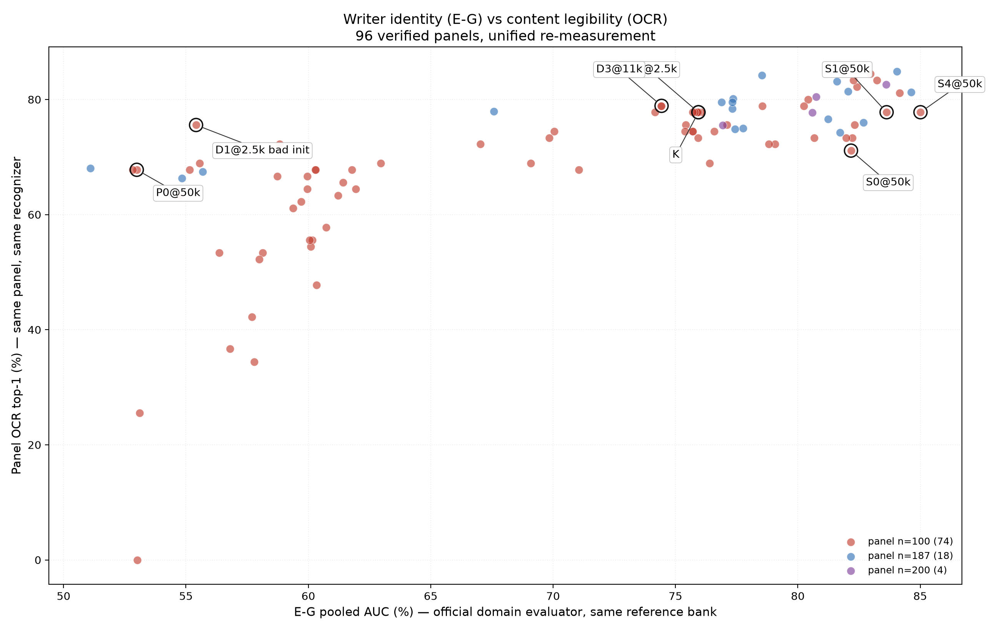

# 马良 / Callig-DiT：可控中国书法生成研究全周期总结

**2026 年 9 月—11 月阶段总结｜用于研究汇报与项目归档**  
**资料截面：** GitHub `KiritoFD/DiT` 主分支，2026-11-02；主要证据为 `exp.md`、`Milestones.md`、`All.md`、`docs/04_experiments/`、`docs/105–108/`、`docs/1028–1031/` 和最新结构化指标。  
**报告原则：** 以研究问题串联不同阶段，不把不兼容的 SSIM/LPIPS 混成一个排行榜；正文中未取得的图片留出原位，并写明所需素材和作图规范。

**仓库外素材与补图要求：** [缺图/缺数据清单](./2026-09_to_11_missing_assets.md)。GitHub版使用仓库已有图片；仍未入库的21字整版海报保留图位，完整图已在随报告交付的PDF版中。

> **项目主结论。** 从9月初「标准骨架能否驱动未见汉字」的可行性验证出发，项目经历了 **Flow Matching与数据清洗、条件架构设计、SkelNet两阶段探索、闭集高保真上界、VAE与潜空间契约、CNN U-Net深化、Writer表征矩阵、预训练迁移、Decoder后训练与双轴评价** 等阶段。我们已经形成了可用的标准字形＋书家＋书体条件生成系统，以及一套可以分别审视**字符内容、书家身份、笔墨质量和泛化**的实验体系。最重要的成果不是某个孤立的最优 SSIM，而是把这些目标的冲突与改善来源转化为可测量、可复查的问题。

## 执行摘要：五条可以放在汇报首页的结论

1. **从闭集“查字表”转向连续标准字形条件。** 早期仅用字符ID会限制未见字输入；9月的标准骨架路线和10月的STD-soft路线提供了不依赖目标字符类别的生成接口。它们解决了输入表示问题，**但不自动保证所有未见字都生成正确**。
2. **高画质基线已被反复建立。** 10月的 `v68@200k` 在旧统一187协议 SSIM约 **0.6169**；`v80@190k` 在历史PNG统一重算 SSIM **0.6192**。这些结果保留为强基线，说明项目既有“文字结构生成”，也确实研究过笔墨与VAE细节。
3. **形成了可归因的架构结论。** 同50k的Writer表征×注入矩阵中，S0内容保真强，S4在墨迹与可读性上平衡，S5在跨字书家身份上有统计支持的提升。复杂网络**不是无条件更优**。
4. **Decoder画质改进已获得干净证据。** 固定K生成器仅换D1 Decoder，val100配对SSIM **0.5946→0.5982**，LPIPS **0.3462→0.3416**，但容差骨架F1略降。这是图像渲染改善，而非证明解决了缺笔。
5. **当前没有“全方面冠军”。** 统一重测的val100中，S4的E-G书家AUC约 **85.01%**、OCR **77.78%**；K约 **75.94% / 77.78%**。S0的配对SSIM更高，但OCR较弱。未来必须按内容×身份×质量×严格未见字做Pareto选型，不能只看单列指标。

## 01｜研究目标与统一的技术问题

目标是输入目标汉字的**标准字形图**、指定**书家ID**与**书体**，生成一张具有目标书家结体、用笔、墨色与自然变化的单字图像。我们追求的是**可信的条件分布**，不是逐像素复刻某一张真迹。

四条轴必须分开：**内容 C**（OCR、偏旁和笔画正确）、**风格 W**（跨字书家身份、writer-swap）、**画质 Q**（SSIM、LPIPS、Ink-IoU、墨色、笔宽、Frag）、**泛化 G**（未见组合、未见Unicode、未见作品来源）。结构与外观有相关性，但不可互相代理：一个字可以更接近某张GT，却更容易被OCR读错；可以更像某个书家，却错写部首。

**现在的主要输入输出链路：** `64×64 STD-soft glyph + Writer-ID + Script → 条件CNN U-Net / Flow Matching → 4×32×32 latent → ODE采样 → VAE Decoder → 256×256书法字`。后期模型中的书家条件在多尺度位置注入；K约114.6M生成器参数，Decoder约49.5M。早期则使用DiT、DDPM和不同条件输入形式，不能把它们说成同一个网络不断叠模块。

### 技术路线全景（汇报主图，留白）

<figure class="fig-placeholder">
FIG 01 · 待补技术路线图

<figcaption><strong>应绘制：</strong> 从「char-ID/DiT/DDPM」分叉为「STD骨架开集」与「字表高保真闭集」，再汇合到「STD-soft＋U-Net/FM＋Writer条件」，下接「Decoder」和四轴评价。标出2026-09、10月上旬、中旬、下旬、11月四个时间锚点。 <strong>素材：</strong><code>docs/04_experiments/00_exhaustive_experiment_chronicle.md</code>、<code>All.md</code>、<code>docs/1031/README.md</code>。<strong>要求：</strong> 画出真实分叉，不能伪装成单一直线上的持续进步。</figcaption></figure>

## 02｜九月：从“能写字”到“如何控制文字的结构”

### 2.1 9月初：v10b 标准骨架与开放字符输入

**出发点。** 8月的v1–v9已经证明DiT可以用字符ID与书家ID拟合训练字，但字符表每个未见Unicode都缺乏对应的已学习嵌入；这是输入接口层面的闭集限制。9月初转用印刷标准字骨架作为连续空间条件，移除目标字ID，重点考察未见字符输入。

**改动。** `v10b` 采用约36M参数的DiT-2Cond、全层空间Cross-Attention、DDPM及41书家条件；长跑约390k步。旧记录给出 Seen SSIM约 **0.763**，严格集合约 **0.5058**（同代原生协议，不与11月val100比较）。

**获得的能力与问题。** 标准字形能作为新字符的条件输入；但 Seen—Strict 差距很大，且边缘较生硬。此时最核心的瓶颈并非“完全不能生成未见字”，而是**训练内拟合能力无法转化为稳定的跨字泛化和自然笔触**。历史记录把一些错位骨架案例当作“完美结构—风格正交”的证据；后来的评测审计显示，这类证据只能证明条件通路在起作用，不能单凭Bug宣称严格零样本成功。

<figure class="fig-placeholder">
FIG 02 · 待补9月初代表图

<figcaption><strong>应引用：</strong> v10b GT／Seen／Strict三列同字、同书家图，特别选复杂偏旁和细笔。<strong>候选路径：</strong> <code>docs/04_experiments/imgs/historical_strict_common_poster.png</code>；另见<code>assets/milestones_posters/01_v10b_390k.png</code>。<strong>图注：</strong> “开放输入已可行，但Seen与Strict差距仍大”；需要标注两类样本身份及真实模型步数。</figcaption></figure>

### 2.2 9月8—14日：v11/v12，Flow Matching与条件注入减法

**为什么改。** DDPM需要较长反向采样，且画笔边缘偏机械；全层Cross-Attention同时昂贵又难调。项目迁到**Flow Matching（FM）＋Euler/Heun ODE**，并尝试RoPE、QK-Norm、RMSNorm等现代算子。

**v11系列。** 探索12通道联合目标和拉普拉斯结构损失。`v11_struct-loss`长训约500k，旧Strict SSIM约 **0.5670**；额外通道和损失没有解决核心问题，历史测得训练速度下降约45%。这一结果只否定**具体联合训练配方**，不能宣称所有多通道条件都必然失败。

**v12系列。** 把空间骨架压成全局池化向量，降低模型条件开销，但丢失字的局部拓扑定位，出现部首位置偏差、笔画错连。由此确定一个可迁移原则：**汉字的几何输入不能只依赖单一全局向量；要保留可定位的空间结构。**

**技术教训。** 算子堆叠不是因果解释。早期文档曾把现代算子整体归罪于训练退化，但后续配置审计发现强模型同样使用RMSNorm/QK-Norm/RoPE等；它们的单项收益还需公平消融。相对稳定的是**FM的快速采样方案、轻量空间条件，以及减少不必要的辅助目标**。

### 2.3 9月14—21日：v13/v14/v15，数据清洗、细粒度风格与小样本

**v13“干净底模”。** 清洗约50k图，统一裁切、极性和标签；舍弃重Cross-Attention，以分层AdaLN进行轻量条件注入。旧记录v13@125k Strict SSIM约 **0.5713**、LPIPS约 **0.380**。相对v10b的改进是整个**清洗＋FM＋架构简化**组合的收益，无法单独全部归因于某一项。

**v14“书家×书体”细分。** 将书家风格分为87种联合类别，旧原生Strict SSIM约 **0.5764**；但许多罕见类别样本太少，长尾拟合不稳定。真正的结论不是“书体不重要”，而是**直接拆成大量离散联合类别会扩大样本稀疏性**，应探索结构化共享参数。

**v15低资源迁移。** 尝试以100—200张真迹对沈周等少样本书家微调；曾有2000步达到约 **0.5568 SSIM** 的记录。它是“预训练模型可以快速适配小样本书风”的可行性信号，而不是与大规模Top10同难度的SOTA。

<figure class="fig-placeholder">
FIG 03 · 待补9月中旬“清洗、条件和风格”对照

<figcaption><strong>应引用：</strong> v10b与v13同字海报、v14细分类和v15少样本风格示例；如果原图无法找齐，保留该图位不画想象样本。<strong>候选：</strong> <code>docs/04_experiments/imgs/milestone_eval200_evolution_poster.png</code>、<code>assets/milestones_posters/02_v13_155k.png</code>；<code>docs/04_experiments/08_milestone_evolution_summary.md</code>。<strong>建议：</strong> 并排标注GT、Writer、原始协议，不以不同旧面板重算一个统一均值。</figcaption></figure>

### 2.4 9月22—27日：条件失衡诊断与SkelNet / SplitLN

**研究问题。** 标准印刷骨架保证字形，却容易把不同书家约束成同一种标准结构。项目转向**“先学习书家特有的骨架变形，再渲染墨迹”**：`v21` 的SkelNet预测仿射与局部位移，送入DiT渲染；`v23`将联合归一化改为分路归一化。

**诊断比结论更重要。** 旧测量中，骨架分支方差可达风格分支的 **38倍**，联合LayerNorm会让较弱的Writer信号被压制。SplitLN后风格响应幅度约提高 **4.24倍**。这验证了**条件分支尺度不平衡会破坏调制**，不等价于证明整套SkelNet两阶段模型已经优于单阶段生成器。

**为什么后来放弃。** 预测骨架在1px细线、断笔、位置偏移上的误差会被第二阶段渲染放大；latent空间的误差下降并不确保解码后拓扑正确。后续增广、结构损失和层级联合训练未能稳定消除该误差传递。因此保留SplitNorm的诊断成果，而不是继续把SkelNet当默认主干。

<figure class="fig-placeholder">
FIG 04 · 待补SkelNet机制与成败图

<figcaption><strong>建议绘制：</strong> 左侧两阶段框图「STD→SkelNet→预测骨架→Render」，右侧同字展示STD骨架、预测骨架、GT骨架和最终成像；在图上标记“38×方差失衡 / 4.24×响应修复”。<strong>候选：</strong><code>assets/milestones_posters/03_v21*</code>、<code>assets/milestones_posters/04_v23*</code>、<code>docs/experiments/2026-09-30-stage1-skel.md</code>。<strong>限制：</strong> 两个响应数字来自历史分支，不得作为最终生成质量的增量。</figcaption></figure>

### 2.5 9月28日—10月3日：两阶段路线完整收口

`v24–v45`比较**GT骨架上限、预测骨架条件、端到端/级联、混合std+GT课程**。GT骨架用于上限探测，但推理时无法获得目标未见字的真迹骨架，不能作为实际部署条件。尤其不能把评测中`predskel`与STD骨架混合的高分当纯预测骨架结果：仓库审计查出`eval_blend_alpha=0.5`会隐式提供50%标准骨架。另一次联合训练中还出现字符条件被固定为全零的实现问题。

**项目决策：** 10月3日将18个相关实验目录归档，重回单阶段「标准字形→真迹图像」路线。核心科学收获：**如果中间表征不具有可控的物理拓扑质量，两阶段看似可解释，却会制造新的分布偏差与误差传播。**

<figure class="fig-placeholder">
FIG 05 · 待补“为什么两阶段终止”反例图

<figcaption><strong>应引用：</strong> GT骨架 / 预测骨架 / 50%混合 / 纯STD四种条件下，同一Render的真实输出，并在图下列明`eval_blend_alpha`。<strong>来源：</strong><code>docs/experiments/2026-09-30-stage1-skel.md</code>、<code>docs/experiments/2026-10-03-v46-singlestage-experiment-summary.md</code>，以及<code>docs/experiments/2026-10-06-recurrent-skeleton-refinement-failure-analysis.md</code>。<strong>绘图：</strong> 逐字Ink-IoU / Skel-IoU变化与SSIM并列。</figcaption></figure>

## 03｜十月上旬：高画质基线、骨架回归与VAE的真问题

### 3.1 单阶段STD路线v46：训练条件必须与推理条件一致

10月3日的`v46`重新直接从标准字形生成真迹图，避免SkelNet预测骨架。初期采用训练时**50% STD / 50% GT骨架混合**；随后试100%标准字形条件。历史`eval200`记录：50/50方案@37.5k SSIM **0.5351**、LPIPS **0.3947**、Ink-IoU **0.2249**；纯STD@35k分别为 **0.5516 / 0.3825 / 0.2480**。即使少训练约2.5k步，纯STD在这三项上表现更好。

**可用的结论：** 在这组训练与评测条件下，训练时提供“真实骨架拐杖”没有提高标准字形推理质量，反而造成域偏差。**不能因此宣布所有课程混合都无效**，因为两臂并非完全等更新数、种子和调度的单变量消融。对后续设计更有价值的是：必须首先明确定义**部署时能够获得的条件**。

### 3.2 MoYi复现与4ch/12ch：辅助任务不一定是免费监督

项目同时复现MoYi的12通道联合去噪和更简单的4通道方案。旧Strict记录如下（这张表只在MoYi自身原生协议内比较）：

| 模型 | 训练步 | SSIM ↑ | LPIPS ↓ | 解释 |
|---|---:|---:|---:|---|
| MoYi 12ch | 50k | 0.5935 | 0.3724 | 联合去噪图像、边缘与骨架 |
| MoYi 4ch | 50k | **0.5949** | **0.3678** | 等步数4ch略胜 |
| MoYi 4ch | 80k | **0.6085** | **0.3489** | 更长训练进一步改善；不属等预算比较 |

**得到什么。** 12ch并未在等50k预算下提供更好的生成结果。多目标联合训练可能发生梯度竞争，也增加计算；但这不是“12ch理论上失败”的证明。正确表述是**在现有实现与数据分布下，优先把生成目标简化为真实图像latent，结构作为条件输入**。

### 3.3 v54/v60/v61/v66/v68：为什么又回到字表？

这是项目一次有意的**高保真上限探索**，不是放弃开集目标。为了确认模型到底能把真实书法拟合到什么程度，10月上旬尝试不使用标准骨架，改用`char_id + writer_id + script_id`与不同的表嵌入、层级路由、条件最优传输（C2OT）及数据增强。

- **v54：** 简单的字表条件建立了稳定闭集内容基线。冻结187跨代表记录SSIM约 **0.5960**（该表使用的共同口径）。
- **v60 / v61：** 同一DiT-B容量下，随机字符表长训Seen—Strict gap从30k时约 **0.0104** 增至50k时 **0.0846**；引入预先学习的字符表后旧原生严格评分提升。此处证明的是**条件初始化/目标域组合能够影响训练集记忆和泛化**，不能断言“所有大网络必定过拟合”。
- **v66：** 测试三表及层级条件注入，旧187跨代分约 **0.5955**。所谓blocks(2,4,5,6)“黄金路由”是强历史配方，**不是已隔离出的单项最优层集合**。
- **v68：** 字表路线结合C2OT、对称增强和长训练，在旧统一187协议达到约 **0.6169**；账本原生200k记录 **0.614868**。这是本项目重要的闭集画质基准，但**不能对没有char-ID的未见字直接查表生成**。

**关键认识。** 当输入条件携带了很强的字形“查表”信息，模型能把容量集中在笔墨纹理与结体拟合上，因而取得较高的单GT指标；代价是开放字符能力不足。项目从此明确了两条需要同时保存的路线：**闭集高保真上界**和**STD驱动的开放字符路线**，不能用前者的高分否定后者存在的价值。

<figure class="fig-placeholder">
FIG 06 · 待补10月上旬闭集/开放条件对决

<figcaption><strong>应引用：</strong> v54、v66、v68和v70真实对照；列为同一个字、行为不同模型，附GT和输入条件。<strong>已登记图片：</strong><code>docs/04_experiments/imgs/milestone_eval200_evolution_poster.png</code>；<code>assets/milestones_posters/05_v66_150k.png</code>、<code>06_v68_200k.png</code>；<code>docs/experiments/v68_v70_sde/poster.png</code>。<strong>图注必须写：</strong> 闭集字表/开放STD条件不同，不能凭一张漂亮图片证明开放泛化。</figcaption></figure>

### 3.4 v70/v72/v80：早期好不等于后期好，VAE收益也需拆解

将闭集高画质配方迁回STD骨架，`v70`早期收敛不错，但长期与v68拉开。旧账本选择同一`eval200fix`实例、同一评测实现时，能看到以下轨迹：

| 步数 | v68 字表 | v70 STD骨架 | v72 Calli-VAE路线 |
|---:|---:|---:|---:|
| 5k | 0.5225 | **0.5341** | 0.5247 |
| 30k | 0.5495 | 0.5457 | **0.5844** |
| 50k | 0.5701 | 0.5496 | **0.5999** |
| 65k | 0.5833 | 0.5535 | **0.6034** |
| 200k | **0.6149** | — | — |

**两条相反的重要信息：** 第一，v70在5k**比v68高0.0116**，所以“STD起步就学不会”是错的；但到65k它落后v68约 **0.0298**，说明随训练增长，表示条件或目标分布的瓶颈暴露。第二，v72在50k相对v68同阶段高约 **0.0298**，提示VAE/latent/训练配方有巨大改进空间；但v72同时变更了VAE、增强和潜空间合同，不能把这个增量全记给VAE单模块。

**v79/v80物理路线。** 对书法真实图重新训练/调整VAE，修复潜空间scale/shift、解码约定和高频保留；旧成组重建测量PSNR **30.56→34.04 dB**、顶带高频保持约 **0.783→0.901**。v80随后长训至200k，原生记录在190k附近达到SSIM **0.6168**、LPIPS-VGG约 **0.3247**；另一份187张历史PNG统一重算得到SSIM **0.6192**，两者属于不同实现/协议记录，不能直接合并。

**后续纠偏。** 曾尝试的SDE采样在部分模型/设置下提高SSIM，但更完整的采样与VAE联合排查发现，它可能同时改变笔宽、漏笔与对GT的偏移，不能包装为通用“免费0.02提升”。`GT→VAE→GT`在后期样本上已能得到很高的重建保真，这表明**当前主要瓶颈可能已经从静态VAE重建转移到生成latent与条件监督**；然而生成器latent的分布偏移仍然值得做Decoder适配。

<figure class="fig-placeholder">
FIG 07 · 待补10月上旬最重要的训练曲线

<figcaption><strong>必须绘制：</strong> 同一纵轴SSIM、横轴真实训练步数，v68/v70/v72三条线，标记5k与50–65k交叉；右侧可嵌入VAE GT→Decode局部100%裁剪。<strong>数据源：</strong><code>assets/ledger/points_all.csv</code>（按run+instance+set+step筛选）；审计见<code>docs/1031/06_RAW_DATA_RECONCILIATION.md</code>。<strong>图片候选：</strong><code>docs/experiments/poster_v68_vs_v72_20261010.png</code>、<code>tools/vae/bench_results/vae_comparison.png</code>。<strong>不能做：</strong> 从不同SSIM实现拼接一条“单调进步”曲线。</figcaption></figure>

## 04｜十月中旬：从DiT转向CNN U-Net，重新理解“深度、局部性和书家控制”

### 4.1 标准软字形与Writer监督：v83–v86

项目把二值细骨架变成**标准软字形`g`**，由小编码器提取空间token与全局条件。它比过早VAE压缩1px骨架更好保持字符拓扑，也避免硬二值边缘造成的不连续。此前v83-A四臂实验中，**无增强arm4**的原生评测为SSIM **0.6098**、LPIPS-VGG **0.3252**、Ink-IoU **0.3467**；这是独立实验协议，不能与当日S组val100数字直接横比。

随后引入Writer分类、成对约束与critic（v85/v86）来提高书家控制。部分训练Writer分类分数改善，但独立留字符/留来源检验发现明显泛化落差，说明模型可能学习到判别器偏好，而不是真迹书风本身。项目因此转向**用冻结的跨字书家评价器与Writer-swap诊断条件是否起作用**，而不是无限加强训练时CE。

Qwen-Image LoRA以及“两张同书家异字参考”的方案也做过对照；已有两张参考的注入常降低指标，提醒我们在固定10个已知书家、且每个书家有大量不同字符训练图的条件下，**Writer-ID端到端聚合**可能比小K临时参考更可靠；这不排除未来对新书家的大K参考建模。

### 4.2 U-Net为何成为主要竞争者？

对单字图，最终输出由长笔画、端点、转折、留白及局部墨迹共同决定。CNN U-Net的多尺度卷积和skip connection天然保留局部几何；DiT提供全局建模能力，但对低分辨率细笔局部细节可能需要更深/更宽的主干或更强条件。

实验上的依据比直觉重要：

- 72M `U100-Base` 在同一旧`eval200fix`原生协议，55k时 **SSIM 0.6017、LPIPS-VGG 0.3317、Ink-IoU 0.3192**；其局部笔画有明显进步，但Writer容易平均化。
- 后续尝试DiC残差门控、分尺度条件及GELU的组合。它们并非稳定提升，门控对高频笔画可能有负面作用，因此不能把“新增门控”写成最终贡献。
- `U100-Deep-Sym4`把宽度维持`[192,384,576]`、各尺度ResBlock深度增加，参数约114M；**30k达到SSIM 0.6012**（几乎追平旧Base@55k 0.6017），**75k达到0.6132**，85k约0.6129。相对72M Base，给出了更深网络在该数据/协议下提高收敛样本效率与峰值质量的经验支持。

**注意：** “30k追上55k”是**同批量更新数的比较**，不是训练用时减少45%或FLOPs减少45%的证明；114M单步更贵。其结果也不意味着“把任何DiT加深就会更好”，因为CNN局部归纳偏置、训练策略与参数分配同时发生变化。

<figure class="fig-placeholder">
FIG 08 · 待补U-Net与DiT的公平对照

<figcaption><strong>建议绘制：</strong> 72M U100与114M Deep-Sym4的SSIM/LPIPS训练曲线；单独画两者的样本曝光量、wall-clock、理论FLOPs，避免“更少step=更快”误导。补同字生成图，裁切为真实毛笔细笔与长撇。<strong>来源：</strong><code>docs/experiments/2026-10-18-unet-progress-and-dic-scaling.md</code>、<code>docs/experiments/2026-10-19-unet-deepening-114m-and-convergence.md</code>、<code>docs/experiments/ledger/unet_35000_poster.png</code>。</figcaption></figure>

### 4.3 算力与基础设施：让消融能够完成，而不是堆更多代码

10月的工程工作围绕：`torch.compile`、BF16、channels-last、数据分片缓存、梯度累积、EMA、可复用评测接口、模型/条件配置解耦、跨机实验串行调度。更重要的不是列举功能，而是**测过哪些瓶颈**。

代表性统计：在某次v88稳态配置中，吞吐约 **3.50 step/s、1008 samples/s**，代理MFU约 **59.1%**；训练内频繁全量评测累计约占墙钟 **10.77%**。同期Profiling记录H2D约 **0.80 ms/step（0.3%）**、EMA约 **0.35 ms/step（0.1%）**，因此优先优化全量评测调度，而不是继续做收益极小的数据搬运或EMA微优化。

更早两阶段训练中关闭默认激活重算，特定配置从约 **0.30 step/s到4.40 step/s**；这是不同内存占用策略的巨大工程变化，不可作为一般模型普遍的14倍加速宣称。工程产出是**以Profiler和正确的CUDA计时找瓶颈、明确保存真实配置、让大型消融矩阵可复跑**。

<figure class="fig-placeholder">
FIG 09 · 待补训练效率与评测开销图

<figcaption><strong>建议绘制：</strong> 左图各阶段CPU/GPU耗时占比（模型前向、反向、EMA、H2D、评测），右图24GB 4090不同microbatch的吞吐与peak reserved显存，另标48GB节点。<strong>数据：</strong><code>docs/infra-1015-measurements.md</code>、<code>docs/infra_1015.md</code>、<code>ANALYSIS/style_repr_injection_matrix_20261026/measurements/</code>。<strong>图注要求：</strong> 只对同一profiling窗口比较MFU与吞吐。</figcaption></figure>

## 05｜十月下旬：把“像书法”拆成可检验的结构与书家身份

### 5.1 为什么不再只看SSIM？

同一书家写同一个字，落笔角度、速度、墨量与部首开合本来就存在自然变化，因此**单GT逐像素相似度不是书法质量的唯一标准**。项目对24,728张真迹的同条件配对分析曾记录：同书家×书体×字的随机真迹对，均值SSIM约 **0.6235**；按条件均匀抽组的均值约 **0.6503**。它们是人类真迹的**条件内自然离散度统计**，不是生成模型绝对不可超过的数学上限；以条件均值为目标的模型甚至可能取得比随机真迹对更高的逐像素分数。

因此，研究对象转成四类互补问题：

| 问题 | 主要量表 | 容易误解的地方 |
|---|---|---|
| 字写对了吗？ | OCR Top-1/Top-5、人工缺笔/错字 | OCR对异体、草化和细笔错误有自己的偏差 |
| 像这个书家吗？ | E-G跨字AUC/EER/mAP、Writer-swap | AUC是正负配对排名能力，不是“十分类准确率” |
| 墨迹自然吗？ | LPIPS、Ink-IoU、笔宽、Frag、连通块 | Frag下降可能是粘连变粗，不能单独庆祝 |
| 未见输入也能生成吗？ | Seen组合/Unseen字符/Source-holdout | “187字评测”不等于“187个全阶段未见字符” |

### 5.2 表征实验：DINO特征告诉我们什么？

在10位书家、共享字符严格留字的实验中，DINOv2-B CLS的线性Writer识别约 **43.6%**（随机10%）；加局部patch约 **45.5%**。K-shot均值原型K=1/8/32分别约 **12.6% /18.1% /24.0%**，说明**风格信息存在，但跨不同字符分散，很难用几张参考图的均值压缩**。一个特征空间ANOVA分解中，字符主效应约 **93.9%**、Writer全局均值约 **0.5%**、Writer×字残差约 **5.6%**。这只是该表征空间里的分解，不是图像像素能量占比。

另一条独立研发的E-G跨字Writer检索器，在**1008张真实真迹查询、异字匹配**上AUC **95.98%**、EER **7.44%**；简单墨量/宽度/布局等20维低阶特征探针AUC约 **49.35%**。这证明已有评价器抓住了较强的跨字身份线索，但它仍可能受到来源作品/扫描等共线因素影响，不能直接当“书法审美真理”。

**研究转折：** 目标从“尽量让生成图逼近某张GT”改成“保持OCR正确，同时让换Writer导致的生成差异沿真实跨字书家差异方向变化”。Writer-ID依然是当前固定Top10场景最合理的监督接口，不必强制显式编码Writer×字形类别交互。

### 5.3 S0–S11：Writer表征×注入矩阵，最关键的消融

这是一组研究结论价值很高的**同50k、相近数据与评测口径的对照**。它不预设某个复杂结构一定更先进，而是真实测试Global/Spatial AdaGN、Cross-Attention、DynamicConv等算子，配合单向量、LocalCNN、LocalAttention、多token等Writer表征。

| 模型 / 条件路径 | SSIM ↑ | LPIPS ↓ | Ink-IoU ↑ | Frag ↓ | E-G AUC ↑ |
|---|---:|---:|---:|---:|---:|
| **S0：Vector→Global AdaGN** | **0.6027** | **0.3395** | 0.2859 | 2.627 | 82.13 |
| S1：Vector→Spatial AdaGN | 0.5866 | 0.3494 | 0.2806 | **2.265** | 83.50 |
| **S4：LocalCNN→Spatial AdaGN** | 0.5988 | 0.3406 | **0.2951** | 2.299 | **84.91** |
| **S5：LocalAttention→Cross-Attn** | 0.5975 | 0.3425 | 0.2851 | 2.385 | **87.98** |
| S9：独立Writer速度分支 | 0.5981 | 0.3454 | 0.2767 | 2.381 | 80.35 |

注：图像指标采用S组val100匹配口径；E-G列为旧公布的100字协议。这里优先讲**S家族内部**的关系，不把这张表与v68/v80的187协议拼接。

**最值得汇报的三个结果：**

- **S0内容强。** 最简单的全局Writer向量拿到最高SSIM、最低LPIPS，不需额外复杂跨注意力。但val100 OCR仅 **71.11%**，不等于字写得最对。
- **S1警示“表面少碎≠拓扑更好”。** 相对S0，仅换成Spatial AdaGN，SSIM减少 **0.0162**，样本配对95%CI **[−0.0262,−0.0076]**；Frag虽降低，笔宽/GT比约 **1.234**，出现加粗、并笔的可能。增加空间自由度可能改变笔画物理统计。
- **S4 / S5证明局部Writer信息有价值。** S4改善Ink-IoU并维持OCR **77.78%**；S5跨字E-G AUC高于S0约 **5.85个百分点**，按98共字配对Writer宏AUC增量 **+5.73pp，95%CI [1.65,9.84]**。但S5相对S4的增量CI跨0，且像素保真不如S0，不能宣称“局部Attention全胜”。

这是目前最可复用的架构结论：**表征和注入必须匹配；局部Writer条件能提高身份，但内容与身份的Pareto边界还没被消除。**

<figure class="fig-placeholder">
FIG 10 · 待补 S 矩阵主海报与帕累托图

<figcaption><strong>左图引用：</strong><code>docs/1028/posters/S_comparison.png</code>，至少S0/S1/S4/S5/GT五列；<strong>右图绘制：</strong> 横轴SSIM、纵轴E-G AUC，气泡大小Ink-IoU，标明不同S模型的相同50k预算与n=100。<strong>数据：</strong><code>docs/1028/raw/S*/</code>、<code>docs/1030/eval_style_v2/FINAL_REPORT.md</code>、<code>docs/1029/RESULTS_AND_PLAN_REVIEW.md</code>。<strong>说明：</strong> S5风格收益的置信区间应用脚注显示。</figcaption></figure>

### 5.4 J0–J7：图像域训练确实有用，但附加条件未必

在相同的成熟`DeepSym4@85k`起点，再进行5k更新（**不是5k冷启动**），比较FM训练、解冻Decoder、GT重建、图像损失回传U-Net，以及给Decoder再加Writer/STD条件。最重要的matched对照：

| 实验 | 变化 | SSIM ↑ | LPIPS ↓ | Ink-IoU ↑ |
|---|---|---:|---:|---:|
| J0 | FM，冻结Decoder | 0.6149 | 0.3220 | 0.3437 |
| J1 | 冻结Decoder＋图像损失 | 0.6149 | 0.3222 | 0.3428 |
| **J2** | 解冻Decoder＋图像损失＋GT重建 | **0.6198** | 0.3150 | **0.3447** |
| **J3** | 解冻Decoder＋图像损失 | 0.6193 | **0.3147** | 0.3433 |

`J2−J0` SSIM **+0.0049**，100字配对95%CI约 **[+0.0039,+0.0060]**；但独立Writer检验未见同步提升。更复杂的J5–J7在J4基础上加Writer/STD解码条件，也没有稳定明显超过J4。这说明**像素域Decoder适配本身是有效模块**，不需要把每一种条件都塞到最后的解码器里。

<figure class="fig-placeholder">
FIG 11 · 待补J组“固定latent换Decoder”图

<figcaption><strong>应引用：</strong><code>docs/1028/posters/J_comparison.png</code>（J0/J2/J3/GT）。<strong>应绘制：</strong> 同latent的原始Decoder→J2/J3换装散点或逐字ΔLPIPS箱线图；另示OCR和Writer身份基本不动。<strong>数据：</strong><code>ANALYSIS/style_repr_injection_matrix_20261026/full_eval_20261028/J2_J3_metrics.json</code>、<code>docs/1030/eval_style_v2/cross_decoder_summary.json</code>。</figcaption></figure>

## 06｜十月末—十一月：预训练迁移、K与严谨的Decoder结案

### 6.1 P0→P1→P2→P3→A：实际步数比旧名字更重要

研究从通用书法分布开始预训练，再专门适配Top10已知书家。这一条链在旧文件名里经常标作P125，但实际累计更新数不是125k：

| 阶段 | 实际累计步 | 训练对象 | val100 SSIM ↑ | LPIPS ↓ | Ink-IoU ↑ |
|---|---:|---|---:|---:|---:|
| P0 | 50k | 通用字符/书家预训练 | 0.5573 | 0.3841 | 0.2258 |
| P1 | 55k | 混合通用与Top10 | 0.5636 | 0.3735 | 0.2440 |
| P2 | 70k | Top10 Writer适配 | 0.5857 | 0.3527 | 0.2723 |
| P3A | 75k | Top10 FM | 0.5857 | 0.3528 | 0.2725 |
| A@25k | 约80k | 修正LR/状态继承后专项训练 | 0.5914 | 0.3478 | 0.2829 |
| **K=A@43,429** | **约98,429** | 成熟A主线 | **0.5946** | **0.3462** | **0.2886** |

**整条训练链的净增量：** P0→K SSIM **+0.0373**，LPIPS **−0.0379**，Ink-IoU **+0.0628**，val100 OCR **67.78%→77.78%（+10.0pp）**。因此“专项书家训练有效”是有数据的；但不能把全部提升归因于“通用预训练”。更早另一套预训练起点中，混合＋配对采样30k达到SSIM **0.5908**，同期直接微调30k为 **0.5829**，说明数据组织可能有价值，仍需要同条件拆解。

**注意实际训练合同。** 先前Style学习率配置字段错误，实际曾回落到`1e-4`；A组修复了参数分组LR、EMA/optimizer状态处理及cosine restart，所以A早期收益是多项改变的合成，不能写作“多5k步就得到净增益”。而且**P0 50k+Top10 25k**与**纯Top10从头75k**的等总算力比较还没完成，因此通用预训练是否最划算仍未被证明。

<figure class="fig-placeholder">
FIG 12 · 待补P75→K训练轨迹

<figcaption><strong>应绘制：</strong> 横轴真实累计更新50k/55k/70k/75k/80k/98.4k，四条纵轴分别SSIM、LPIPS、Ink-IoU、有效Writer曝光；不以旧别名P120/P125作为横轴。<strong>建议画一条训练流程条：</strong> P0通用→P1混合→P2Top10→P3 FM→A 继续。<strong>数据：</strong><code>docs/1031/03_TRAINING_TRANSFER_AND_DECODER.md</code>、<code>assets/metrics_index/lineage_summary.csv</code>、<code>assets/metrics_index/fig_lineage_trajectory.png</code>。</figcaption></figure>

### 6.2 D1/D2/D3的“失败”：先修正因果事实

11月1日最初的D1（Decoder-only）、D2（联训）、D3（困难字FM）报告称K仍最好、D1导致Writer崩塌。随后排查发现：创建实验spec时**遗漏`transfer_style=True`**，只继承了K主干，没有继承33个Style分支张量，尤其三个注入gain。`D1/D2/D3`都从**K主干＋随机Style分支**出发，因此它们的退化**不能用来证伪Decoder-only或联合训练机制**。

这个事故的定量证据非常直接：368个应继承的生成器张量中，有 **33个不同**，最大绝对差约 **36.06**；正确加上`transfer_style=True`后变为 **0/368不同**。之前D1的latent Writer direction约0.1607，而K同协议约0.5571——原因首先是**模型权重初始化不同**，不是Decoder篡改latent。修复`--decoder-from`后，还解决了“交叉解码OCR实际读的仍是旧图”的静默评测错误。

**这段必须在汇报中出现。** 项目研究不只是调参，还建立了一条硬纪律：每条fork必须审计parent checkpoint的所有参数、EMA、条件slot、Writer/Script重映射、VAE scale，以及评测器加载路径，才能解释实验的因果差异。

### 6.3 K＋D1 Decoder：已经证明的干净正收益

将D1训练出的Decoder直接换到**未经改动的K生成器**，不改变生成latent，得到以下同val100、同噪声、100字配对结果：

| 指标 | K原始 | **K＋D1dec** | 变化及证据 |
|---|---:|---:|---|
| SSIM ↑ | 0.5946 | **0.5982** | **+0.0036**，95%CI约[+0.0023,+0.0052] |
| LPIPS ↓ | 0.3462 | **0.3416** | **−0.0046**，配对显著 |
| Ink-IoU ↑ | 0.2886 | **0.2893** | +0.0007，配对显著 |
| Frag ↓ | 2.658 | **2.377** | −0.281，但仍需核验是否粘连 |
| 容差骨架F1 ↑ | **0.0258** | 0.0253 | −0.0005，轻微但显著退化 |
| val100 OCR | 77.78% | **77.78%** | n=90，未检测到变化 |
| latent direction | 0.5571 | **0.5571** | K生成器相同，理论上必须相同 |

**最严谨的成果表述：** 在固定生成器和生成latent下，Decoder微调可在不改变面板OCR的前提下改善图像接近度和若干笔墨统计，但不保证改善笔画拓扑；如果局部笔画被并合，Frag下降还可能含有伪收益。旧结果中部分端点/连通块异常来自随机Style分支，不能再据此宣称D1本身“必然糊连”。

### 6.4 GAR：有新正结果，但还没超过最优Decoder

仓库随后按Generation-Aware Reconstruction思路：冻结K的368个生成器张量（逐张量验证差异严格为0），用GT latent加噪、**单步**去噪获得生成感知latent，只训练Decoder。当前仓库GAR变体采用MSE、感知特征及VGG Gram监督，**不是前一轮D1的L1+LPIPS+Edge**。它在Top10去重作品上做约672步（记录为2 epoch）。

val100：正确冻结K的baseline SSIM **0.594575** / LPIPS **0.346214**，GAR@672为 **0.596863 /0.343268**，墨量和OCR基本稳定。**这证明GAR适配有正信号，但它未超过此前K＋D1dec的0.5982/0.3416。** 另一个将GAR梯度回传U-Net的GARU已配置预检，但仓库这份记录仍标“尚未正式训练”；不能把未来计划写成已完成实验。

<figure class="fig-placeholder">
FIG 13 · 待补正确K起点Decoder换装及错误对照

<figcaption><strong>左侧建议：</strong> 四张同latent图“K原Decoder / K+D1dec / K+GAR / GT”，放大细笔端点和相邻墨线；<strong>右侧建议：</strong> Decoder步数500/1000/1500/2000/2500的ΔSSIM/ΔLPIPS曲线和容差骨架F1曲线。<strong>源：</strong><code>docs/d_results.md</code>、<code>docs/1031/GAR_DECODER.md</code>、<code>assets/metrics_index/fig_decoder_sweep.png</code>、<code>assets/d_20261101/review/</code>。<strong>特别标注：</strong> 早期D臂含随机Style分支，不能放进“干净训练方法排行榜”。</figcaption></figure>

## 07｜全历史比较：我们的提升有多大，哪些模型仍比我们强？

这部分刻意分为**同面板、跨时代187与跨协议历史记录**三张互不混淆的表。尤其不要拿“旧Strict的v68≈0.6169”直接减去“新val100的K≈0.5946”宣布K退化多少；模型体系、GT、采样协议和SSIM实现都可能不同。

### 7.1 十月末val100：当前可比的关键模型

**图像质量n=100，面板OCR有效n=90；E-G为统一重测同100面板。**

| 模型 | SSIM ↑ | LPIPS ↓ | Ink-IoU ↑ | OCR ↑ | E-G AUC ↑ | 研究定位 |
|---|---:|---:|---:|---:|---:|---|
| P0@50k | 0.5573 | 0.3841 | 0.2258 | 67.78% | 52.99% | 通用预训练，目标书家弱 |
| P3A@75k | 0.5857 | 0.3528 | 0.2725 | 74.44% | 75.70% | 目标Writer训练初步见效 |
| K=A@43429 | 0.5946 | 0.3462 | 0.2886 | **77.78%** | 75.94% | 成熟的条件生成器 |
| **K＋D1dec** | 0.5982 | 0.3416 | 0.2893 | **77.78%** | 75.71% | K生成器不变，画质更好 |
| **S0@50k** | **0.6027** | **0.3395** | 0.2859 | 71.11% | 82.17% | 内容保真强，OCR较低 |
| **S4@50k** | 0.5988 | 0.3406 | **0.2951** | **77.78%** | **85.01%** | 当前最平衡的候选之一 |

**四个可以站得住脚的比较：**

1. **P0→K是整条目标训练链的明显改善**：SSIM+0.0373，Ink-IoU+0.0628，OCR+10.00pp；但阶段不同、模型参数与训练总量不同，不是单变量“预训练有效”证明。
2. **K＋D1dec相对K是固定生成器的干净后训练增益**；与此前“D1全面退化”的初版口头结论不同。
3. **S0在单GT相似度上优于K，但内容正确率不如K**；这直接反驳“SSIM最高＝字形最好”的单指标叙事。
4. **S4与K的OCR持平，书家AUC高约9.07pp**；K＋D1dec对S4在像素指标上十分接近，但风格身份明显弱。因此K不应被宣称为项目总冠军。

### 7.2 跨时代187：历史强点和本阶段的位置

仓库维护了`eval200_fixed`对应187张的跨时代记录。以下采用存档的共同口径评测/已验证输入集合；历史与近期生成噪声种子仍有不同，差异小于噪声底时不能宣称胜负。

| 模型 | 步数 | 187图SSIM ↑ | 说明 |
|---|---:|---:|---|
| **v68闭集C2OT** | 200k | **0.6149** | 旧旗舰，字表有闭集限制 |
| DiT-B + v66路由 | 40k | 0.6104 | 高容量旧模型，预算/FLOPs不同 |
| **S9** | **50k** | **0.6023** | 新的Writer速度分支，187字强点 |
| v54纯字表 | 150k | 0.5960 | 旧闭集基线 |
| v66三表＋路由 | 150k | 0.5955 | 旧三表基线 |
| S0@85k | 85k | 0.5963 | 新S0续训，非val100同面板 |
| MoYi 12ch | 50k | 0.5931 | 旧对照；困难尾部表现有优势 |

在这把尺子上，**S9@50k超过v54/v66@150k约0.006—0.007 SSIM**，但不能把“训练更新数少三分之二”误称为“计算成本省三分之二”。另一方面，v68仍领先S9约 **0.0126**，证明历史高保真闭集路线至今有研究价值。

**v80独立补充：** 历史187张PNG统一重算中，`v80@190k` SSIM **0.6192**、LPIPS(Alex) **0.3805**，在对应43个历史面板中双指标最高。其原训练报告的LPIPS-VGG约0.3247，**不能拿这两个LPIPS的绝对值去和K的Alex结果直接比较**。K当前没有完成同样的历史187生成协议下全部指标覆盖，无法宣布它与v80的严格名次。

### 7.3 书家身份与可读性：134个面板给出的全局信息

新的E-G×OCR合并图包含134个**可明确识别目标身份/GT的面板**，使用统一评价器重新打分。这项工作的价值，是把不同年代的生成图重新放在**内容可读性与书家身份**两个坐标上。但图中存在100字、187字等不同难度题面，**相同评价器≠相同GT分布**；需在图注中注明分层，不把所有点当完全匹配的单一排行榜。

关键例子：在同一val100面板上，**S4≈(E-G 85.01, OCR 77.78)**，**K≈(75.94,77.78)**，S0约(82.17,71.11)；历史`v80@190k`在187题面约(86.72,73.84)；另一条CFG扫描中CFG1.6可达较高E-G AUC约89.93，但OCR仅约65.12。**这些点说明，写得像特定书家与写对字符确实存在可测量的张力。**

<figure class="fig-real fig-wide"><figcaption><strong>FIG 14 · 已有原图：</strong> 用户提供的134面板E-G pooled AUC × OCR散点。适合汇报“为什么项目从单指标走向内容×风格双轴”。灰点只表示其他模型/面板，并非全部满足同训练预算、同GT难度。</figcaption></figure>

### 7.4 21字实际生成海报：读图时看什么？

这张图不是为了选最“黑”或最“像书法”的模型，而是检查不同书家、不同书体、不同复杂度字符中的**可读性、字形、断笔、粘连、间架与墨色**。

**观察要点：** S0在多字上笔画较清楚，K在一些字上更具风格变化；早期P3A/部分预训练模型存在明显缺笔、破碎或错形；S系与K都仍有个别书家的异常结体和笔画粗细问题。图里的GT逐行对齐，但原面板来源、种子和采样器不完全同一，**这些观察用于解释现象，不当作统计上有显著因果优势的证据**。

<figure class="fig-placeholder">
FIG 15a · 21字真实生成海报上半部（原图尚未入库）

【待放入用户已提供的21字原始海报上半部；不要以其他海报替代】
<figcaption><strong>FIG 15a：</strong> 需将本次已提供的21字整版海报及对应样本清单复制至仓库，才能在GitHub版嵌入。此处为明确保留的真实图位。</figcaption></figure>

<figure class="fig-placeholder">
FIG 15b · 21字真实生成海报下半部（原图尚未入库）

【待放入用户已提供的21字原始海报下半部；不要以其他海报替代】
<figcaption><strong>FIG 15b：</strong> 与上半部属于同一张真实对照图，应保留原始列顺序和GT身份。</figcaption></figure>

## 08｜技术与工程上真正学到了什么？

### 8.1 经过验证、可以长期复用的科学认识

**① 连续空间字形条件是开放字符接口的必要设计之一。** 字符ID表在未见Unicode上没有自然的训练值，骨架/STD-soft则有实际可计算的空间输入；但是输入接口的开放性与模型生成正确率是两回事，必须单独测严格未见字。

**② 几何条件的空间位置不能被全部平均掉。** v12全局池化和SkelNet细线latent实验提醒我们：高频笔画和部首关系需要保留空间定位。高层全局条件适合控制整字气质，但不够承载所有拓扑。

**③ 没有必要重复生成确定性的辅助条件。** 4ch与12ch MoYi、v11结构Loss和J1等对照说明，新增输出任务、损失项并不自动提供免费信息；它们可能消耗模型容量和计算并改变优化方向。

**④ 不同阶段的强模型可以有不同优势。** v70早期领先后期掉队、v72前期收敛很快、v80长训强、S0内容强但S5身份强。模型选择必须看训练曲线、真正的部署输入和评测的Pareto边界。

**⑤ Decoder可以优化可见细节，但不能承担书法结构的全部学习任务。** J2、K＋D1dec和GAR表明解码映射可以改善感知与墨迹；但并没有证明它能把latent里缺失的偏旁重新创造出来。结构缺笔仍要回到生成器与条件数据。

**⑥ Writer身份是跨字、分布式、受条件耦合的信号。** DINO上的简单小K均值原型效果有限，S5局部Writer条件提升身份却未同时超过S0的像素指标。针对固定已知书家，训练Writer-ID比只取2张参考图更适合当前数据规模与任务。

**⑦ “指标进步”必须附带代价测量。** Frag下降可以由加粗并笔造成，SSIM上升可能是低频平滑，也可能奖励对唯一GT的临摹而不是允许合法书法差异。因此选模不能省略笔宽、墨量、骨架、OCR、E-G和肉眼对照。

### 8.2 工程上更重要的六条纪律

1. **权重继承逐张量比对。** `transfer_style`遗漏会让整条D臂失去因果意义；冻结`requires_grad`不是初始化正确的证明。
2. **条件字典及VAE latent合同必须固定。** Writer slot映射、Script remap、`g`渲染sigma、VAE scale/shift、posterior处理必须同源。
3. **样本身份以idx→GT→字符/Writer三重JOIN为权威。** 曾发生`g0,g1,g10,...`字典序和CSV错位、PIL尺寸宽高颠倒、`t3_writer_swap --decoder-from`未生效等事故。
4. **记录真实的训练步数与FLOPs。** P120/P125别名不等于实际120k/125k；J组5k建立在Deep85之上，不能说它5k从头就训练成功。
5. **评测器也需要回归测试。** OCR真实200图测试曾约80% Top1，但不代表全部6975张Real-Test已评完；E-G的不同AUC/mAP实现需要复现已公布值后才能统一。
6. **基础设施优化先用Profiler。** H2D、EMA非瓶颈时不再反复重构；评测频度和训练配置稳定性往往比小算子优化更有收益。

<figure class="fig-placeholder">
FIG 16 · 待补“实验错误如何改变结论”的工程案例图

<figcaption><strong>建议绘制：</strong> 同一D1实验的错误构造/正确构造，两条分支在初始化权重差异、latent direction、SSIM和Decoder交叉换装上的变化；重点标明33/368非继承张量和“纠错后K+D1dec显著正收益”。<strong>数据：</strong><code>docs/d_results.md</code>、<code>tools/d_20261101/check_init.py</code>、<code>assets/d_20261101/eval/</code>。这是讲科研方法的关键一页。</figcaption></figure>

## 09｜当前瓶颈与下一阶段研究决策

**当前最大瓶颈不是“再找一个更高SSIM的技巧”，而是同时守住字形正确与Writer身份，并在严格未见字上可靠地泛化。** 现有模型至少形成三个不互相支配的代表点：**S0（GT保真强）、S4（双轴平衡）、K＋Decoder（条件链成熟、可进一步分开优化生成器/成像）**；v68/v80是不可忽略的历史高保真参照。

下一阶段建议按实验成本从低到高：

| 顺序 | 工作 | 预期回答的问题 | 晋级门槛 |
|---|---|---|---|
| **P0** | 冻结统一评测合同；按seen组合、unseen Unicode、来源拆分 | 当前性能差异是否来自同一题面？ | 缺GT/重复索引即失败，不发布该分组排名 |
| **P1** | S4、S0、K、K＋D1dec做同字符/同噪声完整Writer-swap | S4在图像身份优势上是否对应更正确的Writer变化方向？ | OCR内容稳定，E-G及换家方向均验证 |
| **P2** | K与S4在187历史基准直接统一采样，并补未见字分层 | 能否公允对比9月—11月代表模型？ | 187集合/配置/seed/metric实现一致，报告CI |
| **P3** | 以S4为强起点，继续比较图像域Decoder和Writer条件 | 画质小收益能否叠加而不伤书家身份？ | 两轴同时非退化，而非只看LPIPS |
| **P4** | 若仍有结构缺笔，改生成器目标/数据而非重复磨Decoder | 笔画几何究竟受latent还是Decoder限制？ | 用同latent交叉解码＋结构异常图确认 |

不应立即重启大规模SkelNet、多条件Decoder或新一轮12ch长训；这些方向已经有具体负结果或尚不具备足够的独立正信号。对于更远期的“任意新书家2–K张参考”任务，需要独立设计训练目标与大K聚合器，不能把当前固定Writer-ID实验当作它的证明。

## 10｜可直接转成PPT的报告结构（建议12—14页）

| 页 | 标题 / 一句话结论 | 应放的视觉 |
|---|---|---|
| 1 | 目标：从标准字形生成指定书家的单字 | FIG01 技术路线图 |
| 2 | 9月：首次建立开放字符输入，但Seen/Strict落差大 | FIG02 v10b示例 |
| 3 | 9月：FM＋数据清洗＋轻量条件比堆通道更稳 | FIG03 v10b/v13对照 |
| 4 | 9月末：SkelNet揭示条件失衡与级联误差 | FIG04＋FIG05 |
| 5 | 10月初：v68闭集最高画质，v70开放迁回受限 | FIG06 |
| 6 | 10月：v68/v70/v72训练曲线揭示不同阶段瓶颈 | FIG07 |
| 7 | U-Net多尺度深度让内容建模更强 | FIG08 |
| 8 | Writer条件：S0内容、S4平衡、S5身份 | FIG10 |
| 9 | 画质不仅取决于生成器，Decoder也能独立优化 | FIG11/FIG13 |
| 10 | 全代际E-G×OCR：没有单一模型两轴都领先 | FIG14（已有） |
| 11 | 21字真实生成对照：看风格、错笔、粘连 | FIG15a/15b（已有，可只摘选） |
| 12 | 当前可比结果与历史v68/v80基准 | 第7章两张表或FIG07 |
| 13 | 科学上的负结果和工程修复：D臂初始化问题 | FIG16 |
| 14 | 下一步：严格未见字、风格差分与结构缺陷 | 第9章P0–P4路径图 |

---

## 附录A｜缺图与待绘数据的制作清单

**这里的“图位”是刻意留白。** 没有核对真实模型输出身份之前，不能用生成式示意图代替历史实验图片，也不能拼接不同评测协议画一条假的性能提升曲线。

| 图号 | 需要制作或补充的内容 | 最优来源 | 首选形式 |
|---|---|---|---|
| FIG01 | 整个研究分叉/收敛流程 | `All.md`＋编年史＋模型配置 | 技术路线框图 |
| FIG02 | 9月v10b Seen/Strict/GT | `assets/milestones_posters/01_v10b_390k.png` | 三列真实生成对照 |
| FIG03 | v10b/v13/v14及小样本 | `docs/04_experiments/imgs/milestone_eval200_evolution_poster.png` | 同字对照 |
| FIG04 | v21/v23骨架、SplitLN诊断 | 9月SkelNet run、历史里程碑 | 机制图＋真实结果 |
| FIG05 | 两阶段污染与正确合同 | `docs/experiments/2026-09-30-stage1-skel.md` | 同条件反事实 |
| FIG06 | v54/v66/v68/v70闭集与开放 | `docs/experiments/v68_v70_sde/poster.png` | 真实生成对照 |
| FIG07 | v68/v70/v72同协议训练曲线 | `assets/ledger/points_all.csv` | 三线曲线＋置信区间 |
| FIG08 | 72M/114M U-Net收敛与时间成本 | 10/18及10/19报告 | 双y轴分图，勿混FLOPs |
| FIG09 | GPU剖面及训练速度 | `docs/infra-1015-measurements.md` | 阶段耗时堆叠图 |
| FIG10 | S矩阵真实图＋内容×风格帕累托 | `docs/1028/posters/S_comparison.png`＋raw/S | 海报＋散点 |
| FIG11 | J组共同起点Decoder收益 | `docs/1028/posters/J_comparison.png`＋raw/J | 图片＋配对差异图 |
| FIG12 | P0→K真实累计步数与曝光 | `assets/metrics_index/lineage_summary.csv` | 多指标训练轨迹 |
| FIG13 | K／D1／GAR同latent细笔对照 | `assets/d_20261101/review/`、`docs/d_results.md` | 放大局部＋checkpoint曲线 |
| FIG14 | 已有E-G×OCR散点 | 用户提供图片、`fig_pooled_eg_ocr_final.png` | 本文已嵌入 |
| FIG15a/b | 已有21字跨血统真迹对照 | 用户提供图片 | 本文已嵌入、拆为两半 |
| FIG16 | D臂Style权重未继承的因果错误 | `docs/d_results.md` | 正误对照＋因果流程图 |

### 附录B｜证据出处与版本审计

- **完整历史与9月原始结论：** [全周期编年史](https://github.com/KiritoFD/DiT/blob/main/docs/04_experiments/00_exhaustive_experiment_chronicle.md)、[里程碑海报说明](https://github.com/KiritoFD/DiT/blob/main/docs/04_experiments/08_milestone_evolution_summary.md)、[All实验总账](https://github.com/KiritoFD/DiT/blob/main/All.md)。其中早期“证实绝对上限”“无限开集已解决”等强措辞已按后来的负结果与勘误修正。
- **9月末两阶段结案：** [2026-09-30骨架报告](https://github.com/KiritoFD/DiT/blob/main/docs/experiments/2026-09-30-stage1-skel.md)、[10-03单阶段决策](https://github.com/KiritoFD/DiT/blob/main/docs/experiments/2026-10-03-v46-singlestage-experiment-summary.md)、[10-06循环反例](https://github.com/KiritoFD/DiT/blob/main/docs/experiments/2026-10-06-recurrent-skeleton-refinement-failure-analysis.md)。
- **10月闭集/开放、VAE：** [107统一基线](https://github.com/KiritoFD/DiT/blob/main/docs/107/02_model_benchmarks.md)、[v80终点](https://github.com/KiritoFD/DiT/blob/main/docs/experiments/2026-10-12-v80-progress-200k.md)、[latent合同](https://github.com/KiritoFD/DiT/blob/main/docs/vae_latent_contract.md)、[原始CSV对账](https://github.com/KiritoFD/DiT/blob/main/docs/1031/06_RAW_DATA_RECONCILIATION.md)。
- **U-Net与基础设施：** [72M U-Net](https://github.com/KiritoFD/DiT/blob/main/docs/experiments/2026-10-18-unet-progress-and-dic-scaling.md)、[114M深度](https://github.com/KiritoFD/DiT/blob/main/docs/experiments/2026-10-19-unet-deepening-114m-and-convergence.md)、[Profiler实测](https://github.com/KiritoFD/DiT/blob/main/docs/infra-1015-measurements.md)。
- **Writer、S/J矩阵与独立评价：** [10-28原始S/J结果](https://github.com/KiritoFD/DiT/blob/main/docs/1028/CONCLUSION_AND_NEXT_PHASE_20261028.md)、[10-30 E-G评价器](https://github.com/KiritoFD/DiT/blob/main/docs/1030/eval_style_v2/FINAL_REPORT.md)、[10-31证据矩阵](https://github.com/KiritoFD/DiT/blob/main/docs/1031/01_EVIDENCE_MATRIX.md)。
- **P链和最新后训练：** [迁移训练合同](https://github.com/KiritoFD/DiT/blob/main/docs/1031/03_TRAINING_TRANSFER_AND_DECODER.md)、[D计划修订](https://github.com/KiritoFD/DiT/blob/main/docs/d_results.md)、[GAR最新记录](https://github.com/KiritoFD/DiT/blob/main/docs/1031/GAR_DECODER.md)。
- **全历史统一重测及重要勘误：** [E-G×OCR全代际](https://github.com/KiritoFD/DiT/blob/main/docs/1031/PAIRED_EG_OCR.md)、[SSIM/LPIPS历史面板](https://github.com/KiritoFD/DiT/blob/main/docs/1031/SSIM_LPIPS.md)、[评测错误及风险](https://github.com/KiritoFD/DiT/blob/main/docs/1031/04_EVALUATION_AND_ERRATA.md)、[全局里程碑](https://github.com/KiritoFD/DiT/blob/main/docs/1031/GLOBAL_MILESTONES.md)。

**数据纪律：** 报告中所有跨时代绝对值均附所属口径；同一时间的“不同步数/不同GT集合/不同LPIPS网络/不同采样器”不按数值大小直接计算增益。历史旧报告中超出当前证据的“物理上限”“永久证伪”和“毫无缺点”表述，在本报告一律降格为**该次实验的经验观察**。

**GitHub版图片与数据状态：** 参见 [仓库已有/缺失素材的逐项核对清单](./2026-09_to_11_missing_assets.md)。
