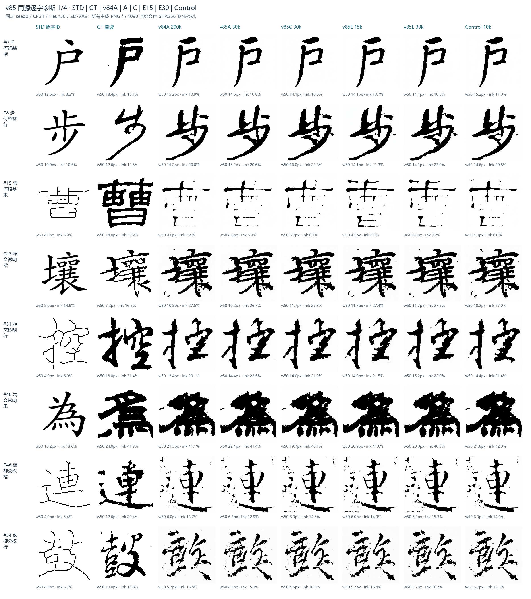
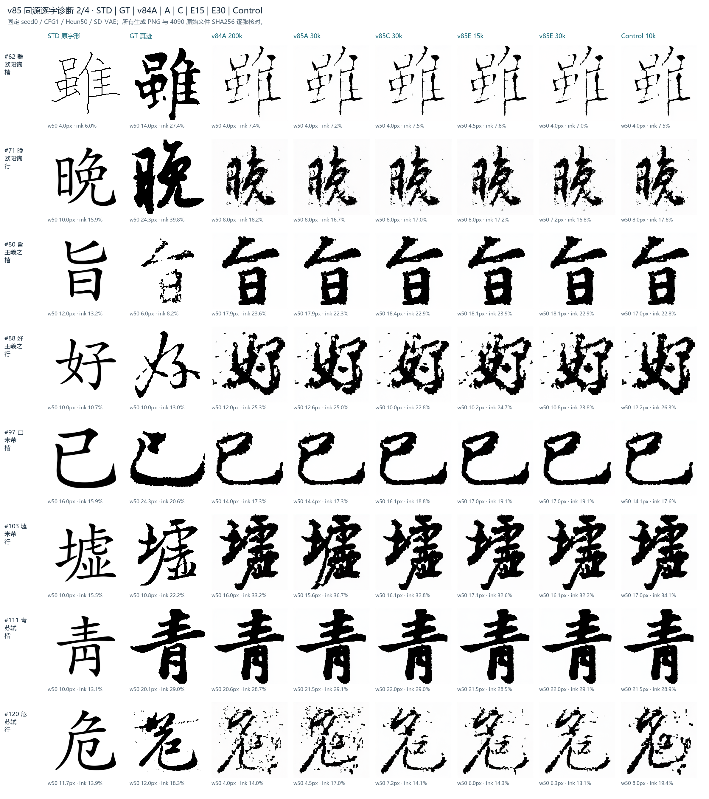
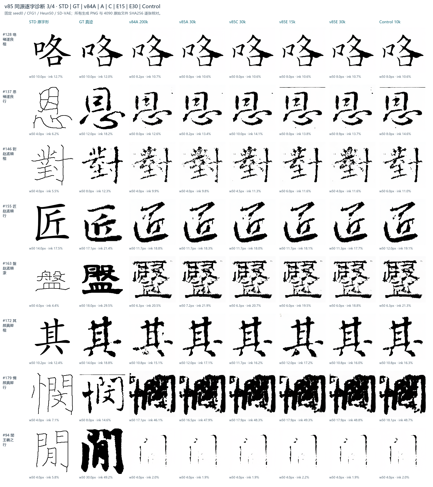
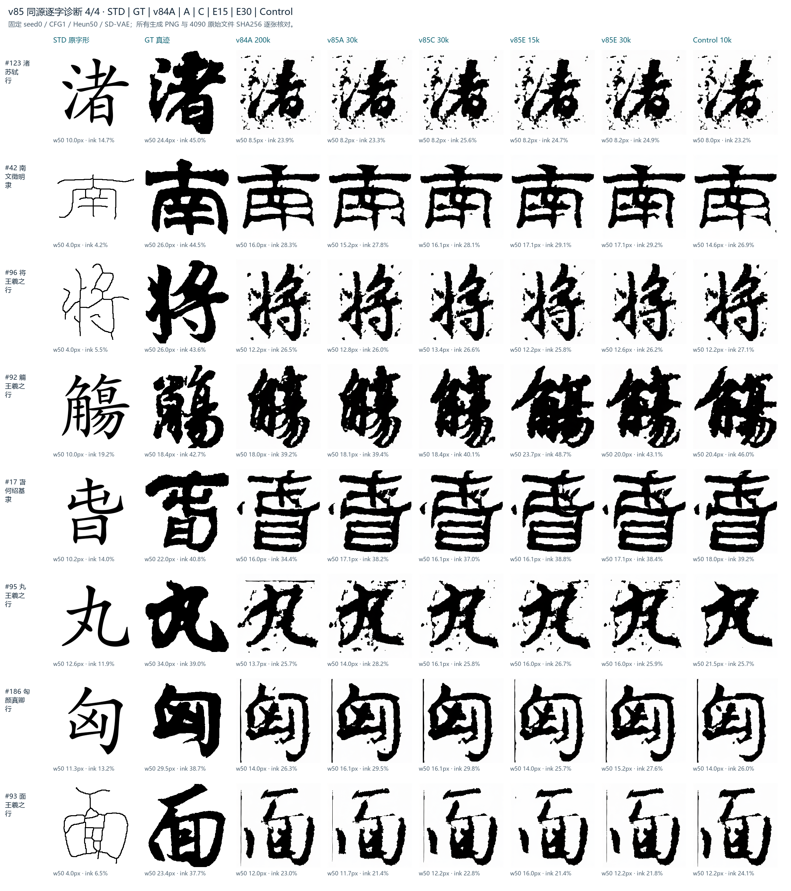

# v85 同源诊断与 v86 单项短实验

更新时间：2026-10-14。已完成 4090 归档核查、v85C 补评、同源六组重评与 32 字对照；Control5k已完成，按后续要求转入书家表解冻/冻结20k对照。

## 最关键的纠错：基线图片用成了 V80

旧风格横评中的 `assets/style_eval_src/step0200000/g*.png` 被标作 v84A@200k，实际上 **187/187 张逐文件 SHA256 与 V80@200k 完全一致**。真正的 v84A 图片来自 4090 的 `assets/runs/v84A_std_cond/20261013-072215-v84A-std-cond/eval_samples_ctrl/step0200000/eval200fix/`。

因此旧表把 V80 的 DINO/CLIP/BSD 数字，与 v84A 的内容指标和独立判别器数字拼成了一行。旧表的“DINO 下降约 0.05”和“BSD 恶化六倍”均撤回。这是文件身份混淆，不能解释成 Critic 导致的笔画退化。

独立 CE 判别器重新在真正的 v84A 原图上运行，仍得到 Top-1 0.5241、writer-margin 0.0493、std-margin 0.5141；这一条证据原来使用的是正确基线。其 margin 是像素判别器特征的原型余弦裕度，并非训练 latent Critic 的 CE logits，也并非分类准确率。

## P0：补评与 BSD 口径

同一批 N187、同一参考库 3000 张，gallery 2154，BSD 参考按槽抽样实际 943 张；DINOv2-L/14、CLIP-L/14、CLS 池化。

| 同源输出 | DINO-S ↑ | CLIP-S ↑ | HWD-CN ↓ | BSD-width ↓ | 独立 Top-1 ↑ | writer-margin ↑ |
|---|---:|---:|---:|---:|---:|---:|
| v84A@200k | 0.7270 | 0.7922 | 21.061 | 3.2740 | 0.5241 | 0.0493 |
| v85A@30k | 0.7223 | 0.7913 | 21.344 | 3.2730 | 0.5134¹ | 0.0486¹ |
| v85C@30k | 0.7241 | 0.7919 | 20.996 | 3.1161 | 0.4920 | 0.0477 |
| v85E@15k | 0.7303 | 0.7941 | 21.017 | 2.8926 | 0.5508 | 0.0729 |
| v85E@30k | 0.7263 | 0.7923 | 21.107 | 3.0464 | 0.5294 | 0.0723 |
| 现有 Control@10k | 0.7251 | 0.7946 | 21.104 | 3.1939 | 0.5455 | 0.0469 |

¹ A 的独立指标沿用已有报告；其余独立指标本次在 4090 重跑。全部 DINO/CLIP/BSD 本次重算，生成文件身份与 4090 核对。现有 Control 只有 10k checkpoint、日志停在 11.7k，batch288；v85E 是 batch192，因此不能拿它直接作严格匹配的 30k 对照。

BSD 还受参考集合影响。保持同一套真实 v84A 图片与同一实现，参考参数 `(max_ref, bsd_ref_max)` 为 `(3000,1000)`、`(3000,1200)`、`(4000,1200)` 时，BSD 分别 **3.2740 / 3.0701 / 2.9593**；E15 则是 **2.8926 / 2.6836 / 2.5728**，本次各口径都没有出现六倍退化。

历史 **1.929440877** 已在 `hist_compare`、`full_trend`、`moyi_vs_ours` 三份原始 JSON 中定位到 **v84A@120k**；交接报告将其误标为 200k。0.5113 的来源则是错标的 V80@200k 图片，二者不能拼成同 checkpoint 趋势。当前固定版本为 `brush-v1-thresh055-width2edt-q51-pooled`，实现 SHA256、参考文件集合哈希与生成文件哈希均存入审计 JSON。当前实现将整库骨架点宽度池化，并未实现同书家/同书体分组 BSD，故它只作为总体笔画分布辅助量。

VAE、STD 与采样合同一致：SD-VAE ft-ema、sf0.18215/shift0、seed0、CFG1、Heun50、ODE；STD-soft sigma0.65，输入条件 SHA256 为 `d0b751829462df92d58a0789d030e6f0dc78064264ae04d6ed5d71fbd3a8fd3b`。

## P1：实际笔画与独立判别

六组生成共 **1122 张 PNG** 全部与 4090 原图核对哈希。选取 32 字，先覆盖每个书家×书体槽，再加入 GT 墨量较大的复杂样例。四张海报每格保留 256px 原像素，并列 STD、GT、v84A、A、C、E15、E30、Control；每图附宽度中位数和墨量，manifest 另存 p10/p50/p90。

| 全 N187 平均 | v84A | A30 | C30 | E15 | E30 | Control10 |
|---|---:|---:|---:|---:|---:|---:|
| 单图笔宽 p50 的平均，px | 10.355 | 10.346 | 10.553 | 10.842 | 10.748 | 10.519 |
| 墨量 | 17.594% | 17.590% | 17.748% | 18.121% | 17.895% | 17.906% |

E 有轻微增粗/增墨，幅度远小于旧表暗示的灾难退化。海报可见基线本身已有缺笔、噪声与局部粘连，几个续训 run 的主要字形通常很接近；仅凭这些例子尚不能证明起收笔与书家笔势得到稳定改善。人工盲评需要真人提供判断，目前没有人工票数。

## P2：已启动的单项 Loss 短实验

三条 run 都从真正的 v84A@200k EMA warm-start，重建优化器，seed0、batch192、AdamW LR1e-5/WD0.02、相同 C2OT/REPA/STD/VAE、warmup1000+5k cosine、2500 步保存 checkpoint。三条均开启 compile（与 v85E 一致），顺序使用 4090；与旧 Control 的 batch 不同，使用新匹配 Control。

| run | Writer 系数 | AwaySTD 系数 | 初始校准目标 |
|---|---:|---:|---|
| v86-diag-control-5k | 0 | 0 | FM+REPA 续训 |
| v86-diag-writer-5k | 0.0054488401 | 0 | 加权梯度均值约 FM 的 25% |
| v86-diag-brush-5k | 0 | 0.0698031960 | 加权梯度均值约 FM 的 10% |

校准依据是 E 的前 400 次真实参数梯度探针，不是把 25%/10% 直接填成 loss 系数。Writer 原加权比例 p10/p50/p90 为 71.73%/89.88%/114.79%；AwaySTD 为 0.000345%/0.02131%/27.41%，有明显饱和和间歇大梯度。按 **均值** 校准，避免中位数倒数导出错误的巨大 AwaySTD 系数 23.46。新臂仍需核对前 400 步实际比值；这些目标不是保证每一步精确命中的自适应归一化。

运行链：`logs/v86_diagnostics_chain_20261014.log`。Control 首次启动于 19:53，数据阶段因 epoch_steps/ckpt_every 不一致被守门拦下；已统一到 2500。第二次 eager 模式在首步前 OOM，恢复 compile=true 后于20:23完成5000步：SSIM0.5840、LPIPS-vgg0.3554、InkSSIM0.4248。按后续贴文的新优先级，旧队列已停止，Writer与Brush两臂后移、未启动；转入书家表解冻/冻结各20k的匹配实验，详见[书家条件诊断与反事实海报](v86A-writer-table-diagnostics-2026-10-14.md)。未启动WB组合、capped loss或STD削弱实验。

当前判断：E15 仍是值得继续验证的候选，margin 提升有独立证据；Top-1 只净增约五张，尚无配对显著性或人工风格偏好支持生产替换。默认模型继续保留 v84A。

数据：[同源风格重评](../assets/style_eval_local/v85_verified_20261014/v85_compare.json)、[独立判别重评](../assets/style_eval_local/v85_verified_20261014/independent_disc.json)、[4090 审计](../assets/v85_diagnostics_20261014_audit.json)、[海报来源与逐图统计](../ANALYSIS/v85_verified_20261014/manifest.json)。
