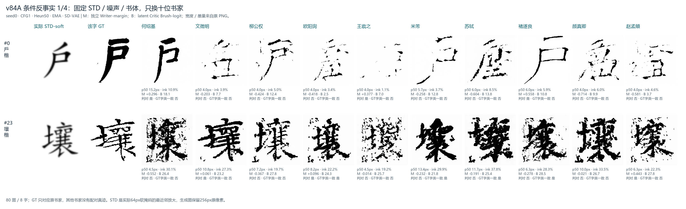
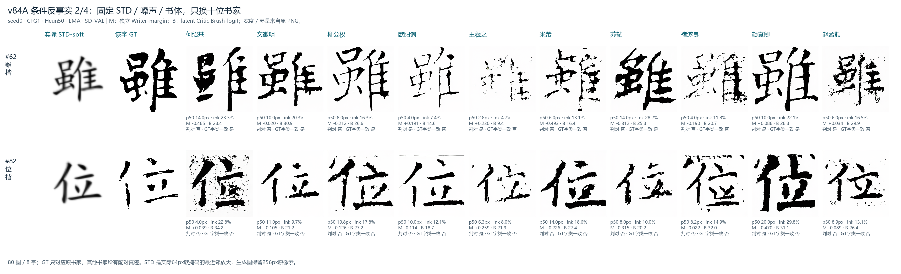
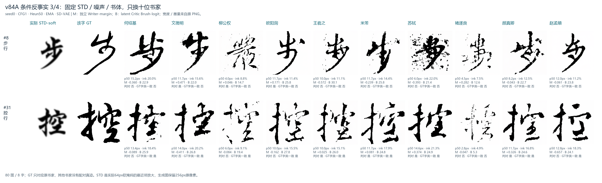
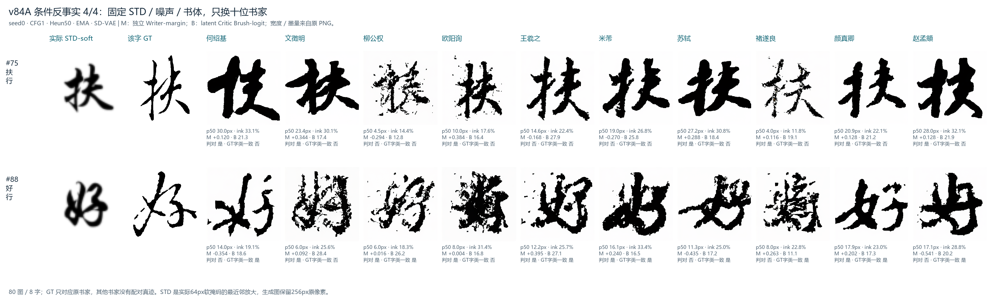

# v86A：先验证书家条件，再解冻书家表

更新时间：2026-10-14 20:48。固定条件反事实已完成；20k 解冻臂正在训练，匹配冻结臂排队，尚无 20k 效果结论。

## 阶段判断

书家条件不是完全没有进入模型：同一个 STD、初始噪声和书体，仅替换书家 ID，笔宽、墨量、局部形状都会明显改变。但变化不等于准确的书家控制，部分输出同时出现缺笔或接近空白。因此优先检验书家表示是否可改善是合理的；目前不能断言冻结表就是根因，也没有证据要求先削弱 STD。

贴文引用的旧基线需要纠正：旧风格横评将 V80@200k 图片标成 v84A@200k，历史 BSD 1.929 实际属于 v84A@120k。真正 v84A@200k 的同口径 DINO-S / CLIP-S / BSD 为 **0.7270 / 0.7922 / 3.2740**，不存在此前声称的六倍 BSD 退化。详见[同源核查报告](v85-diagnostics-2026-10-14.md)。

## 固定条件、只替换书家 ID

真正 v84A@200k EMA，8 个字 × 10 个书家，共 80 张。字为楷书「戶、壤、雖、位」及行书「步、控、扶、好」。每字固定 STD、script、seed0 初始噪声，CFG1、Heun50、ODE、STD-soft σ0.65，SD-VAE ft-ema、sf0.18215/shift0；逐组核对条件与噪声哈希。

独立像素 CE 判别器的原型 Top-1 为 **33/80（41.25%）**，平均 writer-margin **−0.0556**。此处是同书体书家原型比较，不是训练 Critic 的准确率，也不能直接和原 N187 的不同书家构成相减。

| 替换书家 | Top-1（每人8张） | writer-margin ↑ | 平均墨量 | 平均笔宽p50，px |
|---|---:|---:|---:|---:|
| 何绍基 | 25.0% | −0.1731 | 22.19% | 13.79 |
| 文徵明 | 62.5% | 0.0547 | 19.06% | 11.36 |
| 柳公权 | 25.0% | −0.1806 | 13.67% | 6.31 |
| 欧阳询 | 62.5% | 0.0189 | 15.13% | 8.24 |
| 王羲之 | 62.5% | 0.0666 | 13.42% | 8.04 |
| 米芾 | 25.0% | −0.1180 | 19.71% | 12.19 |
| 苏轼 | 25.0% | −0.1985 | 22.95% | 12.34 |
| 褚遂良 | 25.0% | 0.0852 | 13.51% | 5.48 |
| 颜真卿 | 62.5% | 0.0542 | 20.72% | 12.83 |
| 赵孟頫 | 37.5% | −0.1655 | 18.36% | 11.89 |

例如「雖」的墨量在十个书家条件下从 **4.67% 到 28.25%**。可见条件具有实质影响，但其中很薄的输出存在内容缺失，不能把所有变化都称为风格进步。

海报每格附笔宽、墨量、独立 writer-margin（M）、原始生成 latent 上的 Critic brush logit（B）。字头一致性只比较分类器对生成图与 GT 的预测是否相同，不是已验证的 OCR 正确率。GT 只属于原始书家，其他九个书家没有配对 GT；没有人工盲评票数。每人仅8张、每字仅一个噪声，此结果是诊断而非正式风格排名。

完整逐图数据：[metrics](../assets/writer_counterfactual_20261014/metrics.json)、[来源与协议](../assets/writer_counterfactual_20261014/manifest.json)。其中按书家/书体 BSD 使用每槽最多100张真实参考，和此前全局池化943张的 BSD 不是同一口径，不应横向拼表。

## 已实现的匹配 20k 实验

两臂均从真正 v84A@200k EMA 开始，重建优化器；batch192、seed0、trunk AdamW LR1e-5/WD0.02、warmup1000、20k cosine，每5k保存并评估。STD、FM、REPA、C2OT、VAE 不改，不加入 Writer/AwaySTD Critic loss。

| 项目 | 解冻臂 | 冻结对照 |
|---|---|---|
| 真实10×32书家表 | LR2e-6，独立WD0参数组 | 冻结 |
| 原向量锚定 | 归一化向量平方距离，权重0.01 | 无训练作用 |
| 主干 | 正常训练 | 相同 |
| 字表、书体表 | 冻结 | 冻结 |
| CFG null | 梯度清零、每步精确恢复；EMA同步保护 | 冻结 |

“只解冻书家表”指原本冻结的条件表中仅书家真实行可变，不是只训练320个参数而冻结主干。保留原 Parameter 和 checkpoint 键名；单独零 weight decay 并每步恢复 null，防止 AdamW 或恢复的优化器动量使 null 漂移。锚定参考单独保存，续训时不会重置为新向量。

验证：5个书家表单元测试和1个离线分类器测试均通过；真正 v84A checkpoint 的前后向检查确认真实行更新、书体表和 null 不变。4090 的 compile/DDP 实际训练也确认非零表梯度。另修正评估分类器在 `pretrained=False` 时仍访问远程 TorchHub 的行为，完整分类器权重严格加载，无缺失或额外键。

20:47:45，解冻臂 **2,950/20,000**：FM0.2078，REPA0.0058，表梯度0.00725，真实行漂移0.000583，**null最大漂移0**，速度约5.14步/秒。冻结20k臂随后顺序运行。漂移只是实现健康检查，不是风格改善指标。

配置：[解冻](../src/train/configs/v86A_writer_table_20k.json)、[冻结](../src/train/configs/v86A_writer_frozen_20k.json)。远端日志位于 `/root/Workspace/xy/DiT/logs/v86A_writer_table_20261014.log` 与 `v86A_writer_table_chain_20261014.log`；队列脚本见[run_v86A_writer_table.sh](../tools/analysis/run_v86A_writer_table.sh)。

## 旧短实验与下一步

此前 FM+REPA Control5k 已完成，N187：SSIM **0.5840**、LPIPS-vgg **0.3554**、InkSSIM **0.4248**，没有明显涨点。它不是新20k解冻臂的匹配对照。

按新的优先级，原 Writer-only25% 和 Brush-only10% 的5k队列已后移，未启动；不削弱STD、不从头训练更强AwaySTD。先看解冻/冻结同一步数的内容与风格结果，并复做固定条件反事实。如果可识别性仍差，再讨论中等Writer loss或书家条件到STD-token的FiLM映射，当前尚未实现这些扩展。
